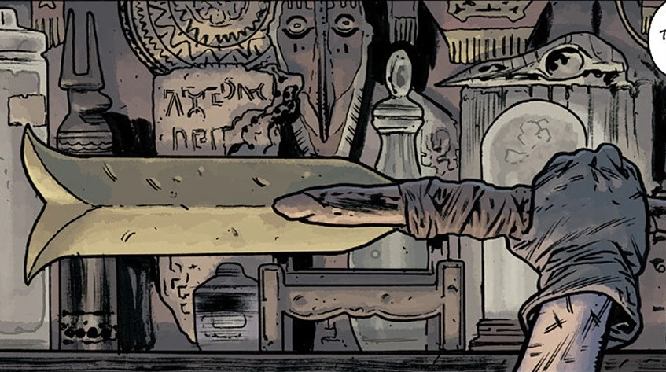

The **Hyperborean Sword** is a weapon with a long and storied history that continued well beyond its origins with the First Race of Man. It was most prominently in the possession of [B.P.R.D.](/entry/Bureau_for_Paranormal_Research_and_Defense) agent [Ted Howards](/entry/Ted_Howards), who upon holding the blade was changed by a mysterious connection to a prehistoric human named [Gall Dennar](/entry/Gall_Dennar) who also wielded the sword. Though Howards' personality was now subsumed by Gall Dennar's experiences and memories, he wields the sword with vicious efficacy against the various hostile forces crawling over the apocalyptic Earth.

## History

### Prehistory

The sword was originally wielded by a powerful Hyperborean warrior who fell in combat in one of their cities, breaking the blade in two. There the blade rested for ages until the broken blade was rediscovered by a wandering human who plumbed the ruined city. Seeing that the blade was still sharp, he carried it with him out of the city, dogged by the vicious [troglodytes](/entry/Servants_of_the_Left_Hand) that prowled the ruins. Wrapping the blade to a stick, he fashioned a new sword and was visited by the spirit of the blade's former owner, calling to him to stand and fight. The blade lit up with a bright light and scared the creatures away. Soon after, the man took a wife and started a new tribe, where he passed the sword down to his son, who passed it down to their son: Gall Dennar.

Gall Dennar's father fell in battle against the [Cold People](/entry/Vampire_(creature)), a primitive form of vampire. The tribe's elder wrenched the blade free from the skull of a fallen enemy and handed it to Gall Dennar, causing him to fall asleep for a moment as he established a connection with the blade's owner in the 21st Century: Ted Howards. Thus the two lived in coterminous fashion, seeing the other's life in each other's eyes as they went about their days. After defeating more Cold People and tribes of Ogdru worshipers, Gall Dennar embarked on a journey north to find the original city where the sword was recovered. There he met with a mysterious wolf spirit who led him to the ruins of the Hyperborean city of Urrasan. He was confronted by yet another Ogdru cultist and their master, Mera-Hem. Thus Gall Dennar died in battle, and the sword was lost to the ages.

### 20th Century

The sword was eventually rediscovered in 1871, when Lord Wellington lead an expedition and found the ruins of Urrasan. The blade was recovered and taken back to Great Britain, where it was used by the witchfinder [Sir Edward Grey](/entry/Edward_Grey) against an undead creature that had haunted Wellington since the expedition.

The [Heliopic Brotherhood of Ra](/entry/Heliopic_Brotherhood_of_Ra) soon seized Wellington's artifacts, the Hyperborean sword included, and left England for mainland Europe. The sword remained in their possession, housed in a manor near Evere, Belgium. In 1916, they captured and exposed the lady Graf Ling de Gotha as a Volskak (a rare vampire-werewolf hybrid) and attempted to enslave her to their will as their personal assassin. The sword, combined with a Vril crystal in the Brotherhood's possession, freed the transformed Graf from her bindings. The Hyperborean spirit appeared once more, urging her to keep the blade and the crystal away from the Brotherhood. She cut her way through her kidnappers and stole their zeppelin, only to be shot down by the Germans. Graf crashed into the North Sea and perished, but her objective was complete and the sword was lost to the depths.

The Brotherhood worked to reclaim the sword however, and on July 1940 they hired (and then threatened) deep-sea diver Victor Olssen to salvage the wreck of their zeppelin to recover the crystal. Olssen found only the sword before their ship was discovered by a German U-boat and sunk by a torpedo. With his oxygen about to run out and surrounded by a horde of strange lizard-men, Olssen took up the sword. He was caught in a vision where an armored Hyperborean mermaid (the lost Vril crystal in hand) called to him to use the sword against the reptilians (what she called the Nag-Unra) and defend her city of [Atlantis](/entry/Atlantis). Olssen accepted and battled the creatures. The next thing he knew, he woke up safe and sound on the shores of a tropical beach, sword and Vril crystal in his hands. For the next seven years Olssen retired there, setting up a bar and hanging the sword and crystal on the shelf behind him, until they were stolen from him in his sleep by a Brotherhood member.

Thus the sword was brought to Chicago where it rested as a mantelpiece in a building where they were conducting dark rituals. In 1952, their latest ceremony was interrupted by one Elijah Bone, a traveling blues musician. Guided there by the voice of the devil who granted him his musical talents, he discovered that his lover Margaret was the sacrifice for the Brotherhood's ritual. Elijah fought them, picking up the sword that dropped from the display and throwing at them. The sword shattered the Vril crystal and killed the Brotherhood members gathered, with Elijah and Margaret left unharmed. The spirit of the wolf and the Hyperborean warrior appeared to him and told him to return the sword to the display case. Elijah complied and left, leaving the sword there to gather dust for the next sixty years.

### 21st Century

In the midst of a global apocalypse, B.P.R.D. agent Ted Howards was on an investigation with a few local street kids who showed him the Brotherhood's long-abandoned chamber. Howards picked up the sword out of curiosity and plunged into an unwakeable sleep as he experienced the life of Gall Dennar. He remained there unconscious while the people around him were killed in a shootout with the elderly Brotherhood custodian of the chamber.

Howards reawakened weeks later in the midst of a rescue led by Johann Kraus. They were under attack by zombies infected by the gas from an Ogdru Hem that had settled in the city above. Howards flew into a berserker fury and cut through the zombies, unaffected by the gas, and rejoined the B.P.R.D. The sword remained in his possession ever since, using it to cut down all sorts of enemies ranging from [hammerheads](/entry/Hammerheads) to [Zinco](/entry/Zinco_Corporation) security. At the onset of Ragnarok, Howards battled against the Ogdru Hem to his death as the B.P.R.D. escorted as many people as they can to the sanctuary of the Hollow Earth.

Despite his death, the sword survived into the next world, in the hands of the Third Race of Man.

## Holders of the Hyperborean Sword

The spirit of the sword's original owner, appearing to Gall Dennar's grandfather

Gall Dennar

Graf Ling de Gotha

Victor Olssen

Elijah Bone

Ted Howards

A member of the Third Race of Man
