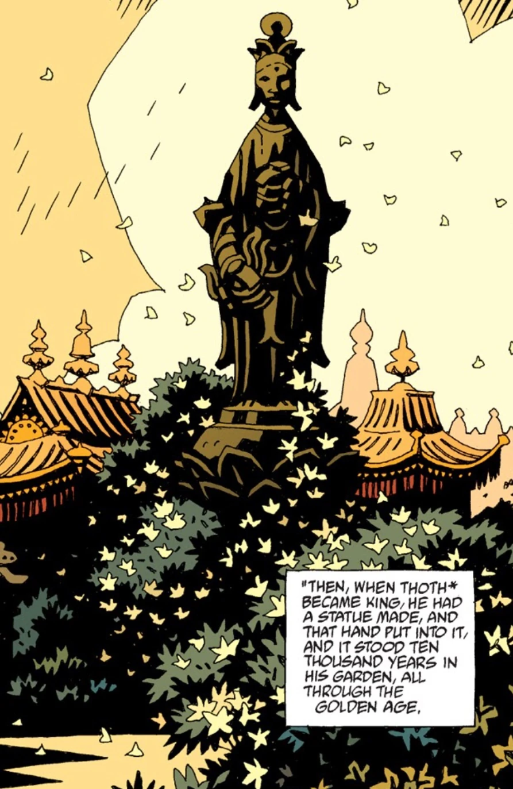

The **Golden People of Hyperborea** were the first race of man.

## History

After the great war between the [Watchers](/entry/Watchers) and the [Ogdru Hem](/entry/Ogdru_Hem) had ended, many of the lesser spirits were allowed to assume shape. They became the Golden People of Hyperborea and they ruled the world for the next 100,000 years. Using [Vril](/entry/Vril) as their power source, they expanded their empire and had cities all over the world such as Thadrethes, Leto, Hypos, Urrasan, and [Atlantis](/entry/Atlantis). The capital city of Hyperborea was [Gorinium](/entry/Gorinium) and the most sacred object of the Hyperboreans was kept in the city.  This object was the Right Hand of [Anum](/entry/Anum), the Watcher who created the [Ogdru Jahad](/entry/Ogdru_Jahad) and with that same hand imprisoned them.  The hand was dipped in amber in order to preserve it, and it was kept in a golden bowl. The hand remained there until the last ten thousand years of the empire.  This was time of [Thoth](/entry/Thoth), the greatest King of Hyperborea. At some point, Thoth had a statue built and placed the Hand within the statue.

Thoth had a secret garden where he kept three Watchers. From these spirits he was able to learn all the workings of the universe and all the words, signs, and devices of power. He had this knowledge written down in 42 books, but he only shared two of these books with his people. The rest he kept for himself.

## Downfall

The downfall of Hyperborea began when [Hecate](/entry/Hecate) came to Gorinium and seduced Thoth. While he slept she stole into his garden and killed the three watchers. She drank their blood and gained their knowledge. She then went into Thoth's temple and vomited up all of the blood, using it to write all of their knowledge onto the walls of the temple. She then gathered all of Thoth's people and shared this knowledge with them, telling them to do with it what they will. When Thoth learned this he cast Hecate out and cursed her but it was too late.

The people who came to learn in Thoth's temple eventually became the king and priests of the Hyperborean empire. They were corrupt and committed atrocities such as burning children alive inside idols to Neb-ogeroth, the Black Goddess. They poisoned the land and the air, and brought earthquakes, famine, and plague. The statue that stood in Gorinium that contained Anum's Right Hand saw the atrocities of these people. It wept to see what Thoth's people had done. The statue became filled with a terrible rage and killed the people of Gorinium, the blood of the people dying the statue red. Aftering killing everyone in Gorinium, it threw itself from the walls of the city and was destroyed. The only piece that remained was the Right Hand, which would later come to [Hellboy](/entry/Hellboy).

## The Dying Empire

Although Gorinium was destroyed many of the other cities remained. Thadrethes, Leto, Hypos, Urrasan, and Atlantis were still populated allowing the empire to linger on. The Hyperboreans split into two groups: The People of the Right Hand still kept to the teaching of Thoth and worshipped the Right Hand and the People of the Left Hand worshipped the Black Goddess. Most followers of the Right Hand had left the Earth to found the kingdom of Hyperberum in the stars. Their power was so great that through their prayers they were able to hold the Ogdru Jahad in their prisons despite the work of various black cults on Earth feeding them power.

By this time, the spirits of the Ogdru Hem were beginning to drift back into the world and despite their previous power the Hyperboreans could not stop them forever. Some Hyperborean priests took it upon themselves to ensure the second race of man, [humanity](/entry/Human), would have a chance against the Ogdru spirits. They taught a very select few how to summon and utilize the power of [Vril](/entry/Vril).  [Shonchin](/entry/Shonchin) is one of the few humans to learn from a Hyperborean priest. Once their work was done, they left this world to join their brethren in Hyperberum.

The People of the Left Hand chose to descend into the inner world. They created a race of slaves, the [Servants of the Left Hand](/entry/Servants_of_the_Left_Hand), to build and maintain great war machines. They hoped to one day return to the surface world and reclaim their old power. However their slaves rebelled from the People of the Left Hand and slaughtered all of them.

## Notes

There is a fan theory that the People of the Right Hand eventually evolved into the aliens seen in [*Hellboy: Seed of Destruction*](/entry/Seed_of_Destruction) and [*Hellboy: Conqueror Worm*](/entry/Conqueror_Worm_(story)).
