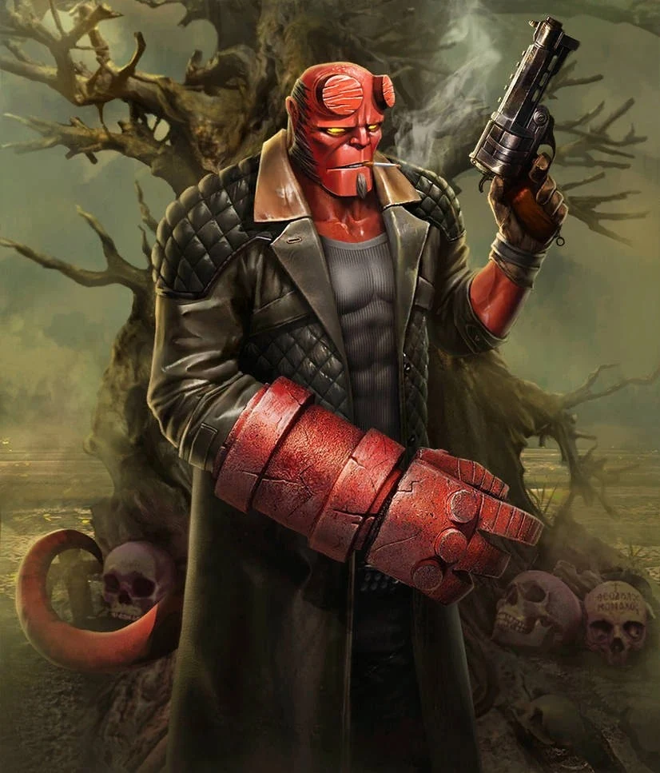
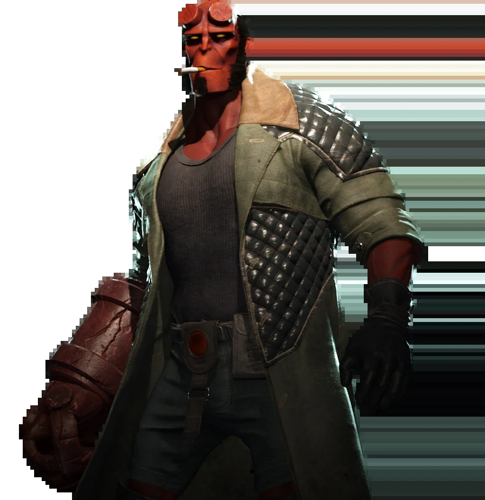
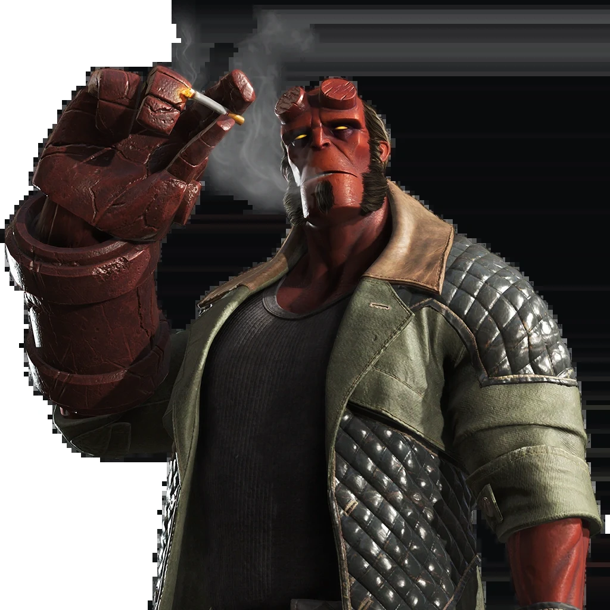

***Injustice 2*** is a 2017 fighting video game developed by NetherRealm Studios and published by Warner Bros. Interactive Entertainment. It is the sequel to 2013's *Injustice: Gods Among Us*.

[Hellboy](/entry/Hellboy_(Injustice)) is a playable guest character in *Injustice 2*. He is available as downloadable content (DLC) as part of Fighter Pack 2, added to the game on November 14, 2017; all DLC is included in the *Legendary Edition* of the game, released March 27, 2018.

## Hellboy's Moveset

*See [Hellboy (Injustice)#Powers and Abilities](/entry/Hellboy_(Injustice)#Powers_and_Abilities)*

While fighting, Hellboy uses his revolver as well as an assortment of specialist grenades and magical relics, but his the majority of his attacks are based on the massive, stone-like [Right Hand of Doom](/entry/Right_Hand_of_Doom).

## Trivia

- This is the first time since 2004 that Hellboy was voiced by an actor other than [Ron Perlman](/entry/Ron_Perlman), who first [portrayed Hellboy](/entry/Hellboy_(2004%E2%80%932008_film_character)) in [the 2004 film adaptation](/entry/Hellboy_(2004_film)).
- Hellboy's ending in *Injustice 2* is rendered in an art style different from the rest of the game. It is designed to resemble the distinct style of *Hellboy* creator [Mike Mignola](/entry/Mike_Mignola), illustrated by [Peter Bergting](/entry/Peter_Bergting) and overseen by Mignola himself.

## Gallery

Hellboy from *Injustice 2 Mobile*

|Hellboy from Injustice 2 Mobile

|Hellboy, as he appears on the fighter selection screen

|Hellboy
## External Links

- Injustice Wiki
