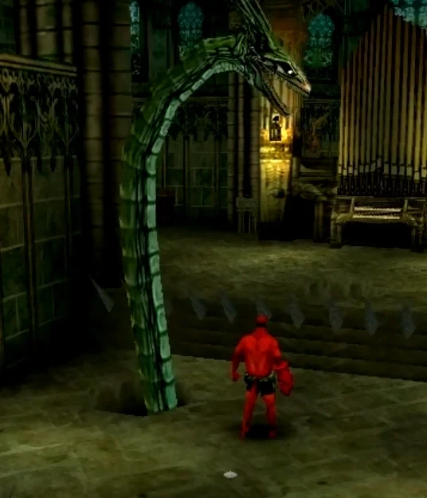

The **Inquisitor** is a fictional character from the *[Hellboy: Dogs of the Night](/entry/Hellboy__Dogs_of_the_Night)* game.

## History

### Dogs of the Night

A guest at the Monastery, the Inquisitor kept to himself most of the time. It is rummored that he was a powerful allie to those in need, but that he was also easily insulted by the uninitiated.

When he met [Hellboy](/entry/Hellboy_(character)), the Inquisitor told him that he was not welcome here and should die, then he transformed into a great serpent and attacked him, but was defeated.

## Allies and Enemies

### Allies

- **Monks** from the Monastery

### Enemies

- **[Hellboy](/entry/Hellboy_(character))**

## Gallery

|The Inquisitor's monster form.
