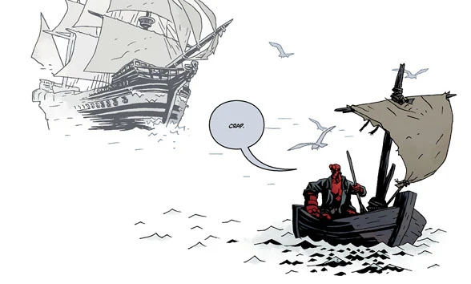

***Into the Silent Sea*** is the third *Hellboy* original graphic novel. It was formally announced August 2016 and published April 2017.

## Publication History

Mignola deliberately set aside this story for Gary Gianni when he drew a panel in [*Hellboy: The Storm* \#1](/entry/The_Storm) which featured Hellboy referring to a story that hadn't been told yet.

Gianni was given the freedom to do whatever he wanted. He and Mignola co-wrote the story by bouncing ideas back and forth until the plot was nailed down, then Gianni scripted it and Mignola revised the script to get Hellboy's dialogue right.[1]

[Gary Gianni](/entry/Gary_Gianni) was nominated for an [Eisner Award](https://www.comic-con.org/awards/eisner-awards-current-info) for Best Penciller/Inker or Penciller/Inker Team in 2018 for his work on the title.

## Synopsis

Hellboy sets sail from the wreckage of a deserted island only to cross paths with a ghost ship. Taken captive by the phantom crew that plans to sell him to the circus, Hellboy is dragged along by a captain who will stop at nothing in pursuit of a powerful sea creature. Following the events of [*Hellboy: The Island*](/entry/The_Island), Gary Gianni draws Hellboy in a brand-new graphic novel.

## Flesk Studio Edition

On September 13, 2017, [Flesk Publications](https://www.fleskpublications.com/) launched a Kickstarter for an oversized [studio edition of *Hellboy: Into the Silent Sea*](https://www.kickstarter.com/projects/481703930/hellboy-into-the-silent-sea-by-mike-mignola-and-ga/description). The idea for the book was that it would be as close as possible to being given a personal studio tour by Gary Gianni. The book features Gianni's thumbnails, pencil preliminaries, and final art with commentary throughout. The book also includes thirty pages of material focusing on Gianni's creator-owned series [*The MonsterMen*](/entry/Gary_Gianni). There was also a deluxe slipcase edition limited to one hundred copies.

## Content

### Characters

- [Hellboy](/entry/Hellboy)
- Crew of the Rebecca
  - "Captain"
  - William
  - Master Kip (Dog)
  - Other Crewmen
- Three [Mermaid](/entry/Merfolk) Sisters (Flashback)
- "Old Spaniard" (Former Priest) (Flashback)
- [Heliopic Brotherhood of Ra](/entry/Heliopic_Brotherhood_of_Ra)
  - "Lady"
  - Other Members (Flashback)
- [Hyperboreans](/entry/Hyperboreans)
  - Talking Mummy (Flashback)
  - Other Citizens (Flashback)
- [Witches](/entry/Witches)
  - [Hecate](/entry/Hecate)
- Sea Monsters

### Locations

- Atlantic Ocean
  - Island off the coast of Portugal
    - Castle (Flashback)
  - The Rebecca
- Africa (Flashback)
- Lost City of Tunungar (Somewhere in The Americas) (Flashback)
- Assortment of unnamed locations (Flashbacks)

## Gallery

by Gary Gianni

## References

<references />

[1] <http://www.multiversitycomics.com/interviews/mignolaversity2017_6/>
