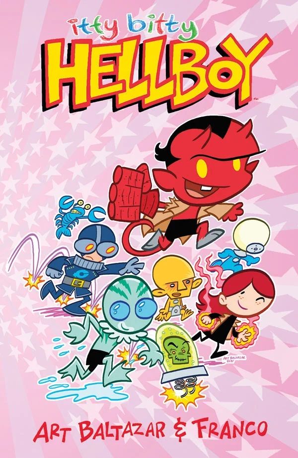
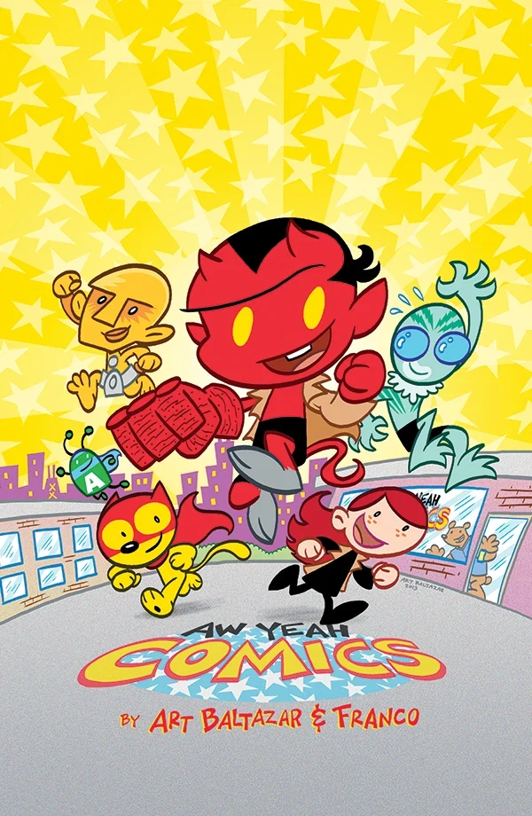
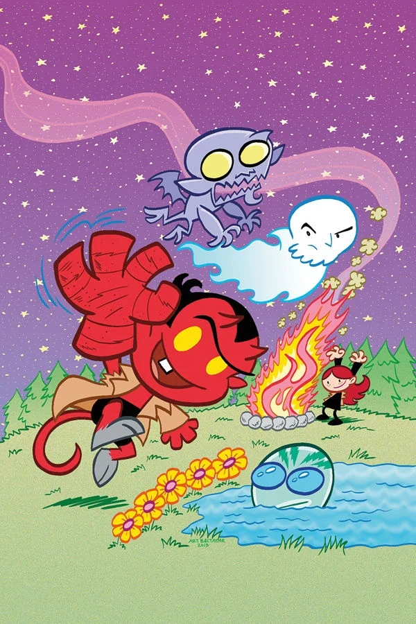
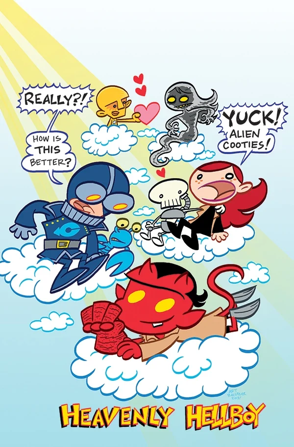
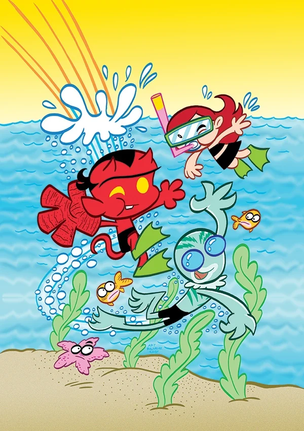
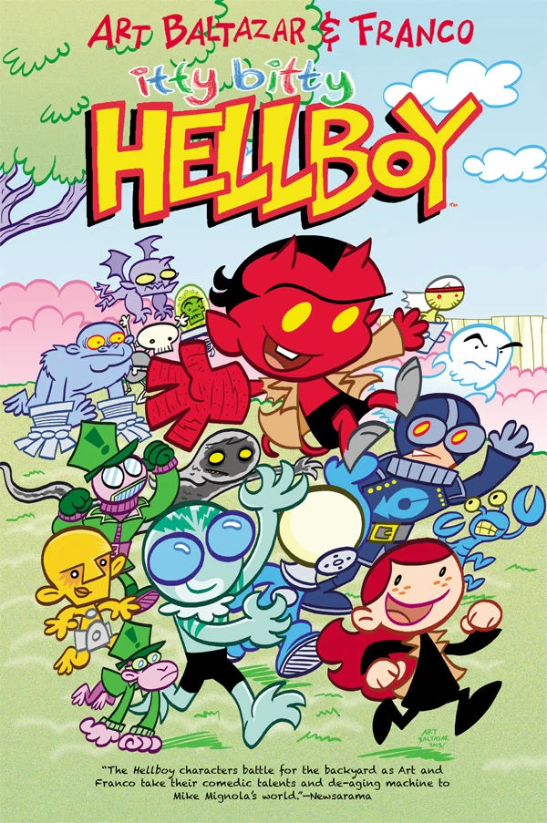
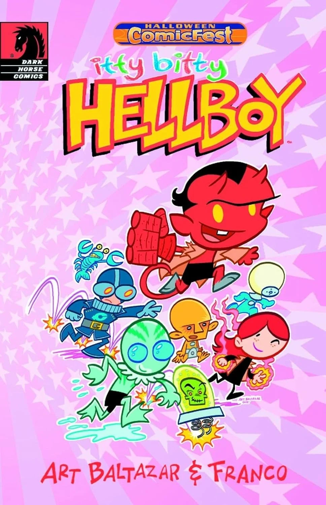
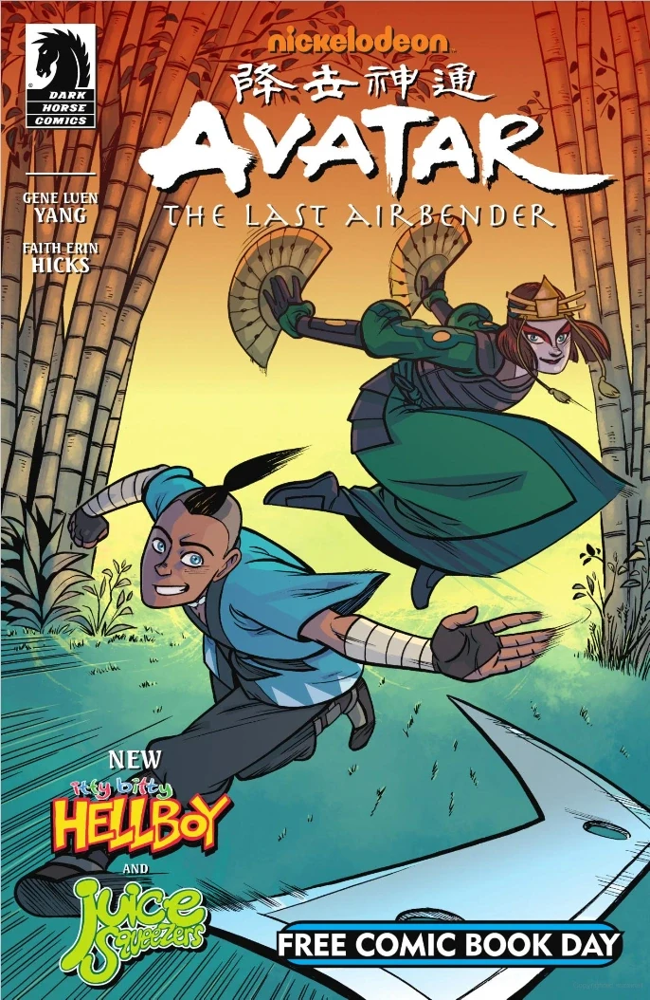

***Itty Bitty Hellboy*** is an out-of-continuity children's comic book spinoff created by [Art Baltazar](/entry/Art_Baltazar) and [Franco Aureliani](/entry/Franco_Aureliani).

## Publication History

In April of 2013, at C2E2, [Dark Horse](/entry/Dark_Horse) announced *Itty Bitty Hellboy* from creators Art Baltazar and Franco Aureliani who had previously worked on *Aw Yeah Comics* and *Tiny Titans* together. The first of the series five issues was released in August of that same year. Issues were released mostly regularly, with the final issue hitting shelves in December of 2013.

As part of the annual Halloween ComicFest celebration, twelve pages of the first issue were reprinted in the digest sized *Halloween ComicFest Itty Bitty Hellboy* single issue that was made available in October of 2013 to be distributed on and around Halloween 2013.

The five issues were collected into a trade paperback, [*Itty Bitty Hellboy*](/entry/Trade_Paperback_Collections), in April of 2014.

In May of 2014 a new *Itty Bitty Hellboy* story, *The Chained Coughin*', was included in Dark Horse's Free Comic Book Day offering, *[Free Comic Book Day 2014: All Ages](/entry/Free_Comic_Book_Day_2014%3A_All_Ages)*.

A sequel series, *[Itty Bitty Hellboy: The Search for the Were-Jaguar!](/entry/Itty_Bitty_Hellboy__The_Search_for_the_Were-Jaguar%21)*, released its first issue in November of 2015.

## Synopsis

### Issue One

A ghost named Rasputin has been spotted! And Hellboy and the B.P.R.D. are going to find out what he’s up to.

Who is Hellboy anyway? Why does he have such a big hand and what is it used for? Who's weirder, him or his friends? What is the B.P.R.D.? And what does **chicken soup** have to do with all of it? This and more answered in the debut issue, where BIG things happen to itty bitty Hellboy!

### Issue Two

Lobster Johnson is on the trail of a Squatch!

His search has led him to the deep woods, and Hellboy and the B.P.R.D. are going to help him the best way they know how! That's right—it’s a camping trip! One thing is for sure: when Liz is around you never need a flashlight, but you might need to bring your own marshmallows!

### Issue Three

It had to happen! Because you demanded it! Hellboy and the gang go to the fiery pits of HELL! How did they get there anyway? ALSO, our B.P.R.D. heroes’ search for Sasquatch continues! But what does Rasputin have to do with all this? OOOOH! Is he just trying to scare us? You WILL find out in this exciting issue!!!

### Issue Four

What comes down must go UP! All the way up to the heavens! That's right! Things may never be the same for Itty Bitty Hellboy and his pals after Roger tries to make friends with the Baba Yaga! What? Doesn't she like flowers? Maybe it's just Roger she finds irritating. Roger may be feeling separation anxiety after this story! Prepare yourself for the fluffiest, cloudiest, heavenliest issue yet!

### Issue Five

It had to happen. It was unavoidable. Sooner or later, we all end up there. That’s right! It’s time to visit our friend who lives underwater! Let’s go hang out with Abe Sapien! Are Hellboy and his pals underwater by choice? Or did something more sinister send them to the cold, lagoony depths? We know one thing: Abe does not mind the company! And where is Lobster Johnson during this visit? When all is said and done, sometimes a beach party is the best way to go... even if you happen to be in the swamp.

### *The Chained Coughin*'

Hellboy helps the ghost of Rasputin be a more convincing ghost.

## Gallery

 \#1 variant

 \#4

 \#5

