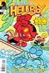
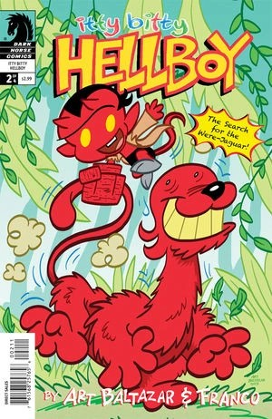
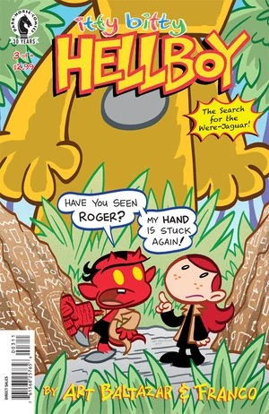
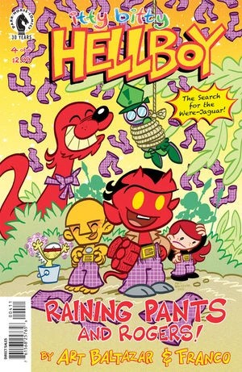

***Itty Bitty Hellboy: The Search for the Were-Jaguar!*** is an out-of-continuity children's comic book spinoff created by Art Baltazar and Franco Aureliani. It is a follow up to their previous series, *[Itty Bitty Hellboy](/entry/Itty_Bitty_Hellboy)*.

## Publisher's Summary

Art Baltazar and Franco return to Itty Bitty Hellboy! Hellboy, Abe, Liz, and friends are on a quest . . . to deliver underwear to the Island of Rogers! But their mission is interrupted by the discovery of the mysterious beast known as the were-jaguar! Collects Itty Bitty Hellboy: The Search for the Were-Jaguar \#1-#4!

## Synopsis

### Issue One

Aw yeah! Art Baltazar and Franco return to Itty Bitty Hellboy! This time, Hellboy, Abe, Liz, and friends are on a very special quest . . . to deliver underwear to the Island of Rogers! But their mission is suddenly interrupted by the discovery of the strange, mysterious beast known as the were-jaguar!

### Issue Two

The discovery of the Were-Jaguar distracts Hellboy and his friends from trying to explain the Right Hand of Doom to the island’s residents! What’s that button on Roger’s chest? Why is the Were-Jaguar so friendly? And what do evil Karl and Rasputin want with the beast?

### Issue Three

The Giant Roger takes over the island! What are Hellboy and his friends to do? What’s it mean for the Were-Jaguar? Why is Lobster Johnson stuck in that tree? The BPRD have their work cut out for them!

### Issue Four

Baba Yaga and Hecate show up with a bag full of pants for the Island of Rogers. Will Ben turn this into a mysteriously elusive cryptozoic mess? The answers to your burning Hellboy questions are right here, from Eisner Award–winning creators Art Baltazar and Franco!

## Gallery

TPB Collection

|Issue #1

|Issue #2

|Issue #3

|Issue #4
