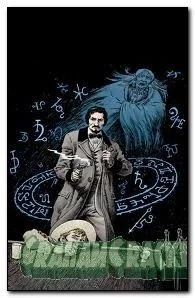

**John Severin** (December 26, 1921 - February 12, 2012) was an American comic book artist. He was originally planned to illustrate [Sledgehammer 44](/entry/Sledgehammer_44_%28series%29) before his passing.

## Interior Artist

- [War on Frogs \#2](/entry/War_on_Frogs)
- [Lost and Gone Forever](/entry/Lost_and_Gone_Forever)

## Cover Artist

## Gallery

|Lost and Gone Forever #1 Variant
