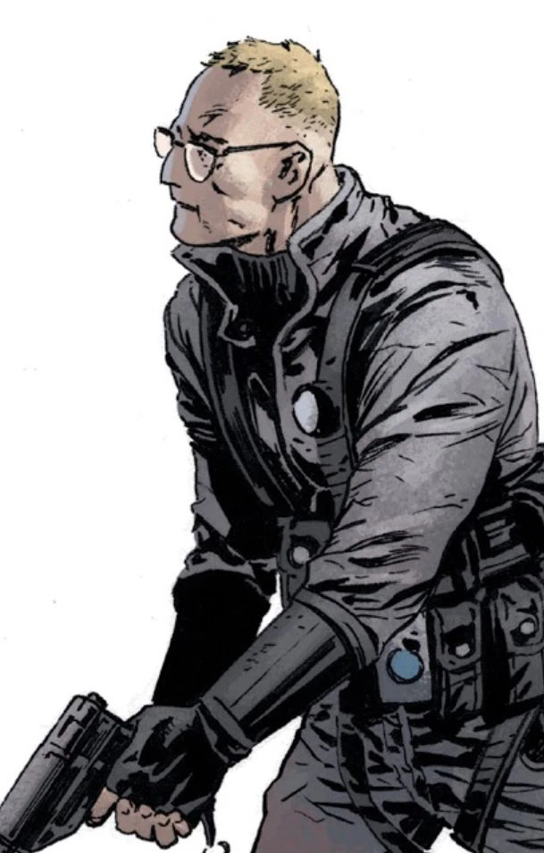

**Joseph Vaughn** was a field agent for the [Bureau for Paranormal Research and Defense](/entry/Bureau_for_Paranormal_Research_and_Defense). 

## History

Vaughn has been with the Bureau since at least 1981 and has worked alongside [Hellboy](/entry/Hellboy) only once. In 1983 Vaughn and an unnamed female agent accompanied Hellboy to New Brunswick, Canada to find and kill a lake monster. The mission proved to be more of a camping trip than terrifying adventure and they saw no signs of the monster.

In 1981, Agent Vaughn was investigating rumors of [werewolf](/entry/werewolf) attacks alongside B.P.R.D. agents [Abraham Sapien](/entry/Abraham_Sapien) and [Elizabeth Sherman](/entry/Elizabeth_Sherman). While Abe starts to check inside a seemingly abandoned shack, Vaughn attempts to peer through the doorway despite Abe telling him to stay back. A werewolf then jumps out and attacks the human agent. Vaughn is knocked unconscious but is not bit or scratched by the monster. After killing the werewolf, Liz and Abe help Vaughn to his feet and depart.[1]

Vaughn is a much more experienced agent by this point and leads rookie agent [Kris Peters](/entry/Kris_Peters) in investigating a strange fog in Pickens County, South Carolina. The two agents learn that the fog has some sort of connection with a strange glowing fungus that has started to grow in the area. Although they wear hazmat suits the fog still has some effect upon the two agents.

When exploring the fog and fungus further the agents are set upon by dark forms within the fog. Agent Peters is physically attacked and her hazmat suits rips, exposing her leg. However the two are saved thanks to the arrival of Professor [Ethan Thomas](/entry/Ethan_Thomas), a [vampire](/entry/Vampire_%28creature%29) historian who was staying in the area, studying a local family of vampires. Professor Thomas explained that the fog came in shortly after the fungus appeared. Screams can be heard coming from the fog and dark forms like the ones that attacked Vaughn and Peters can be seen roaming in it. However the Professor also explains that crosses are able to repel the fog, as does fire. While Vaughn recovers the Professor explains his research and some vampire history to Vaughn.

While resting in the other room, Agent Peters develops a horrible infection on her leg, which slowly spreads throughout her body. She appears to be some sort of undead creature and attempts to attack Vaughn and Thomas but they are able to temporarily hold her back thanks to a cross. Peters then completely dissolves into some sort of slime monster and flies about the room attacking the two men. Again Vaughn and Thomas are again able to hold her back, utilizing crosses showing that Peters condition is vampiric in nature. Peters then attacks a final time, killing Thomas before Vaughn is able to set fire to the whole cabin, killing the fungus vampire forms of Vaughn and now Thomas. 

Wearing his hazmat suit and clutching a large cross, Vaughn makes his way through the fog and by morning stumbles upon the former home of the local vampire clan. He finds most of the vampires dead, their bodies infected by the fungus. One remains, a boy vampire called Cole. Cole sits alone, also infected by the fungus, scared and unable to move. Vaughn sees Cole's now glowing green heart beating underneath his skin and asks the vampire what they have done. Vaughn then stakes Cole, killing him, and burns the vampire house and much of the surrounding forest down before departing[2]

Agent Vaughn appears in the ongoing *Abe Sapien* series. During the first arc, Vaughn is tasked with leading some fellow agents in the search for Abe but is hesitant about Abe's guilt and role in the end of the world. By the end of the first arc, Vaughn finally meets Abe but only to be stabbed in the back and straight through his chest by a mutated human. Agent Vaughn instantly dies from this wound.[3]

However, Vaughn is resurrected by the warlock [Gustav Strobl](/entry/Gustav_Strobl). Strobl is intent on finding Abe and tells Vaughn that if he helps him to do this then he might be able to bring Vaughn back to full life.[4]

When the occultist tracked Abe to Connecticutt, Vaughn tempted by a second life gives in to Strobl and told him the exact location where Sapien could be found, the old home of Professor Trevor Bruttholem. As Strobl began to set a mystical trap, Vaughn acted as bait to seduce Sapien into an air of safety. However Vaughn struggling with his moral complications warns his friend of the occultist's plan. Seeing this Strobl kills him, ending his life.

## References

<references />

[1] *[Casualties](/entry/Casualties)*

[2] [The Pickens County Horror](/entry/The_Pickens_County_Horror)

[3] *[Dark and Terrible](/entry/Dark_and_Terrible_%28story%29)*

[4] *[The New Race of Man](/entry/The_New_Race_of_Man)*
