**Julián Totino Tedesco** is a comics artist. He made his Hellboy Universe debut as a cover artist for the singles of *[Witchfinder: The Mysteries of Unland](/entry/The_Mysteries_of_Unland)* in June 2014.

## Interior Art

- *[B.P.R.D.: Hell on Earth—Modern Prometheus](/entry/Modern_Prometheus)*

## Cover Art

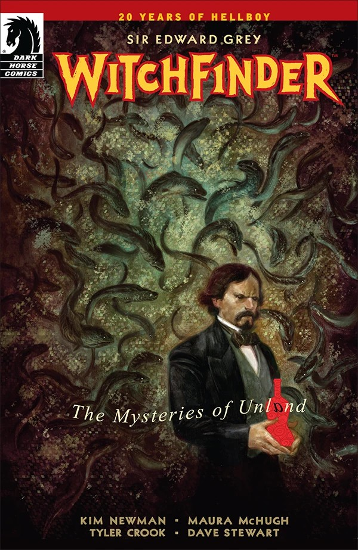

|Witchfinder: The Mysteries of Unland #1

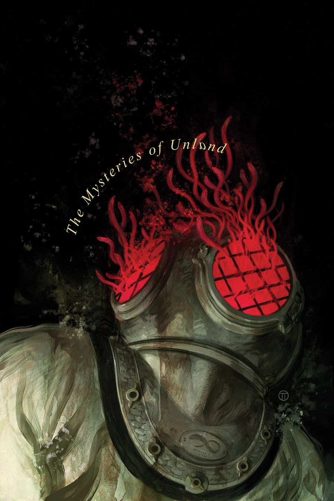

|Witchfinder: The Mysteries of Unland #2

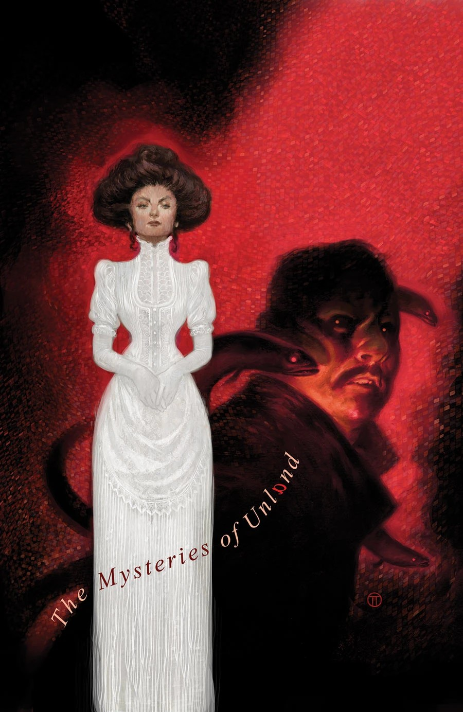

|Witchfinder: The Mysteries of Unland #3

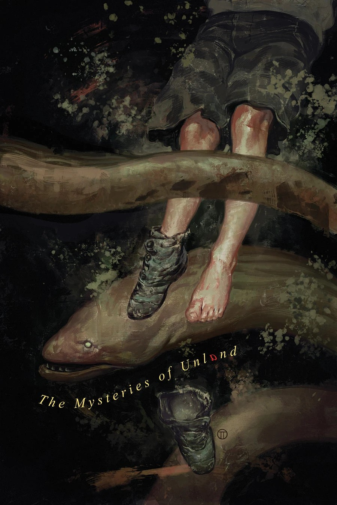

|Witchfinder: The Mysteries of Unland #4

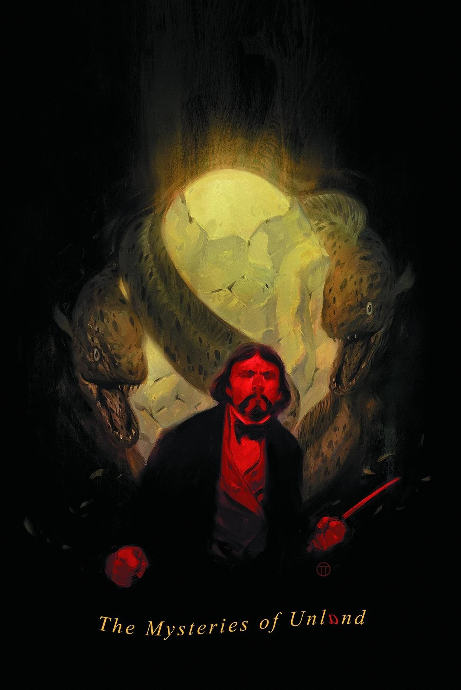

|Witchfinder: The Mysteries of Unland #5

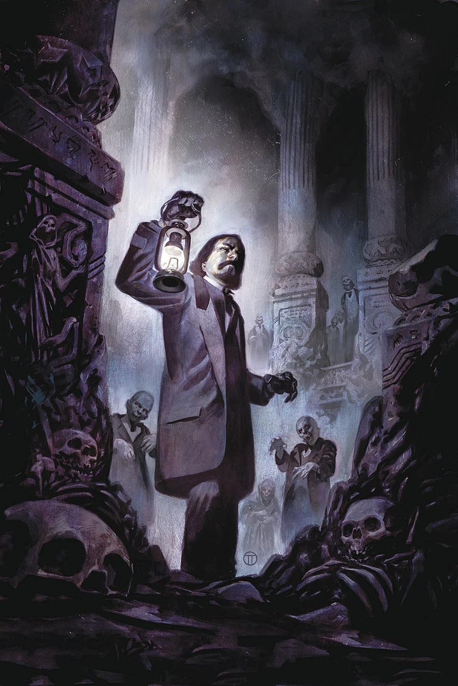

|Witchfinder: City of the Dead #1

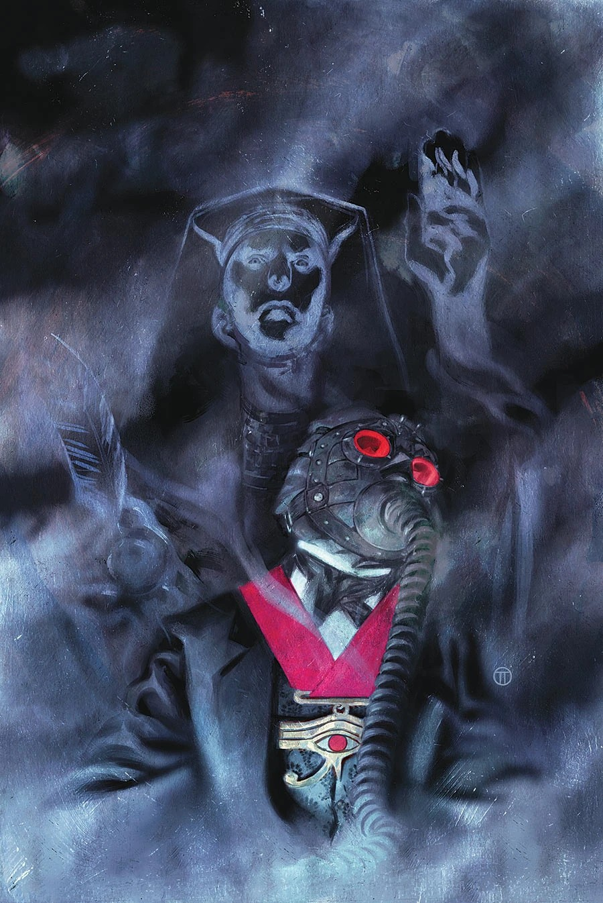

|Witchfinder: City of the Dead #2

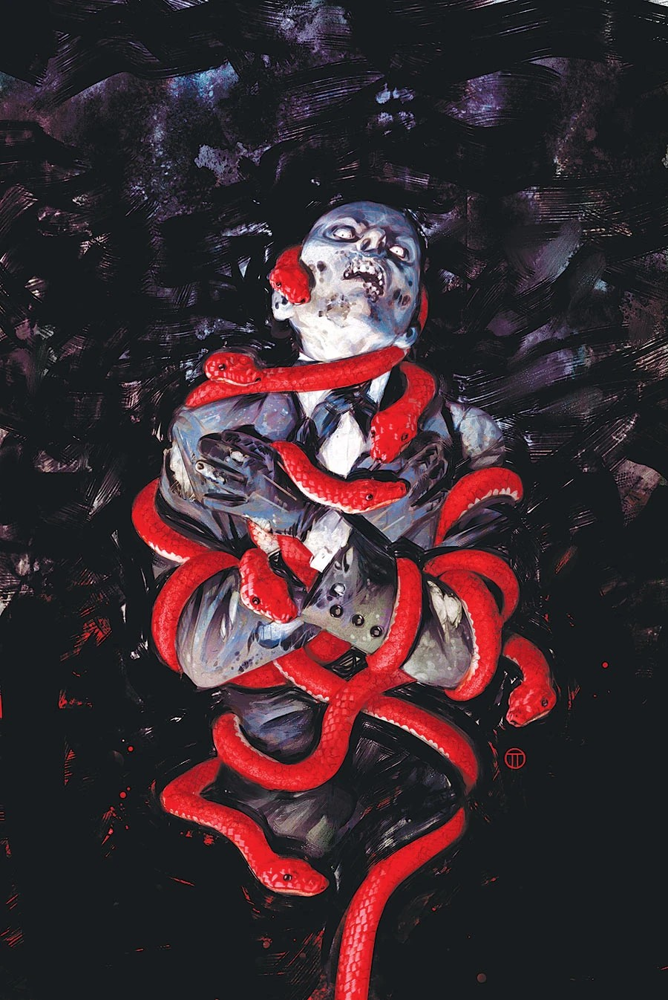

|Witchfinder: City of the Dead #3

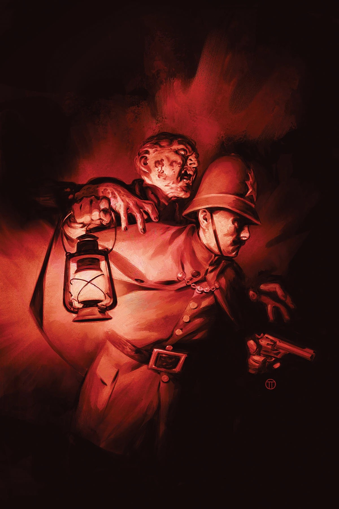

|Witchfinder: City of the Dead #4

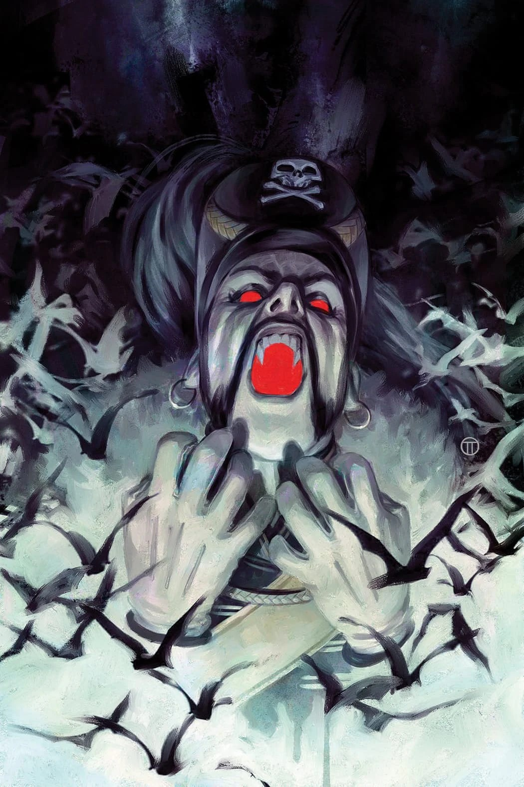

|Witchfinder: City of the Dead #5

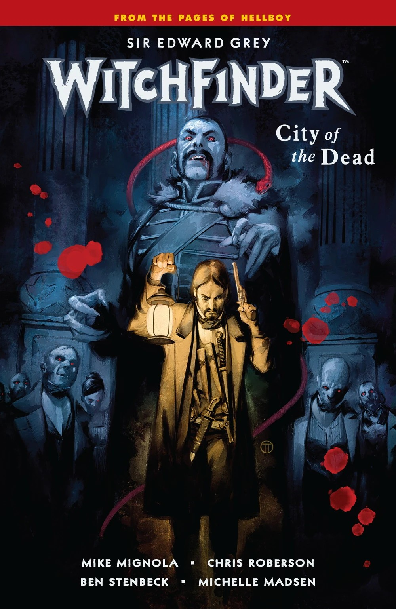

|Witchfinder – Volume 4: City of the Dead

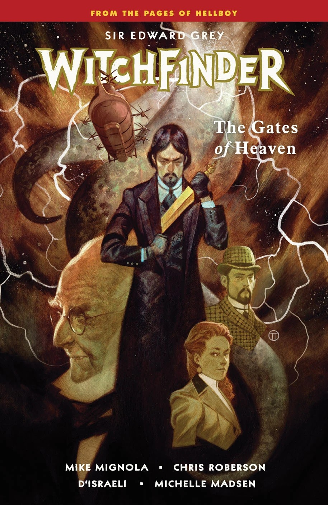

|Witchfinder – Volume 5: The Gates of Heaven
## External Links

- [**Comic Book DB:** Julián Totino Tedesco](http://comicbookdb.com/creator.php?ID=21137)
