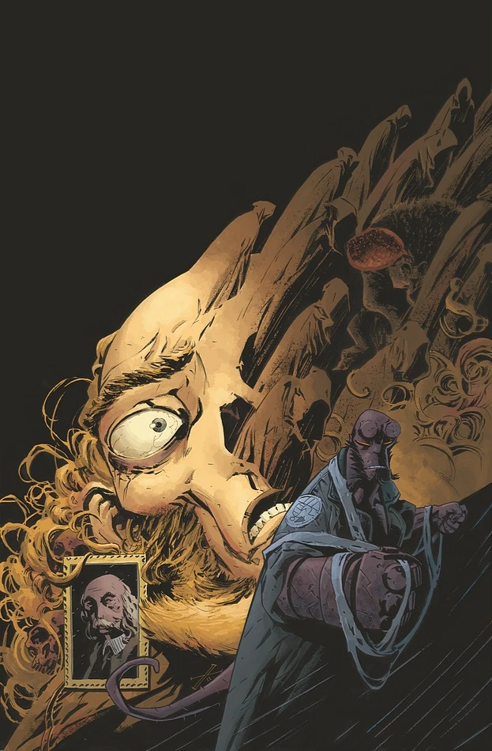

***The Transformation of J.H. O’Donnell*** is a one-shot published May 2012.

## Publication History

*The Transformation of J.H. O’Donnell* is part of the [*Hell on Earth* cycle](/entry/BPRD%3A%E4%BA%BA%E9%97%B4%E5%9C%B0%E7%8B%B1)), but it is a side story, focusing mainly on flashback events. It features a cover by [Max Fiumara](/entry/Max_Fiumara) with a "[Year of Monsters](/entry/Year_of_Monsters)" variant by [Mike Mignola](/entry/Mike_Mignola).

## Synopsis

Twenty-four years ago, Hellboy took mild-mannered [Professor J.H. O’Donnell](/entry/J%C2%B7H%C2%B7%E5%A5%A5%E5%94%90%E7%BA%B3%E6%95%99%E6%8E%88)) to the secret library of a recently dead necromancer. Since that day, O’Donnell has been the Bureau’s expert on the powerful ancient forces intent on ending the age of man. Find out what O’Donnell saw in this supernatural thrill ride.

## Gallery

 \#1

 \#1 variant
