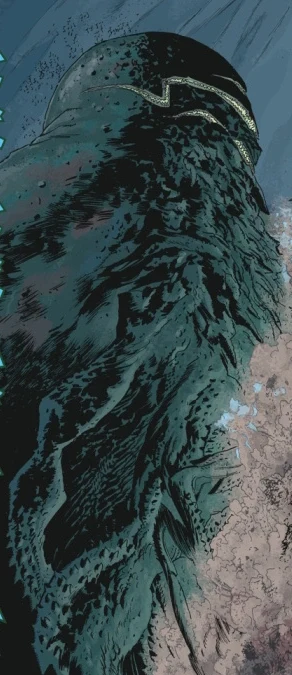

**Katha-Hem** was is a one of the 369 [Ogdru Hem](/entry/Ogdru_Hem), the children of the [Ogdru Jahad](/entry/Ogdru_Jahad) & the major antagonist from the *B.P.R.D*.-comics. It was immensely powerful, being the only known Ogdru Hem who could alter nonliving objects with it's breath, and larger than even the 7 Ogdru Hem which served the third [Black Flame](/entry/The_Black_Flame).

## History

Katha-Hem was the fourth of the Ogdru Hem to be set loose upon the world, and by far the most powerful. While [Sadu-Hem](/entry/Sadu-Hem) was foretold to bring about the Plague of Frogs, the arrival of Katha-Hem was an indication that the world would begin to change.

Summoned out of the earth by the occult rituals of the [frog monsters](/entry/frog_monster) and CEO of [Zinco Corporation](/entry/Zinco_Corporation) [Landis Pope](/entry/Landis_Pope) (also known as the [Black Flame](/entry/The_Black_Flame_%28character%29)), Katha-Hem was unlike the Ogdru Hem encountered before- it wasn't a spirit that created a new form for itself with the matter around it, but was one of those imprisoned beneath the Earth and thus emerged at his true strength. At first it emerged as a slug-like creature with green slit-like mouths, barrelling across the landscape before destroying a town with its breath. Military-grade weapons were totally unable to stop the thing, helpless to watch as the larval beast stood atop a tripod of spidery legs to continue its advance. Katha-Hem now resembled a twisted, tentacled tree, its canopy an inferno of hellish blue fire, and numerous, green-toothed maws lining its trunk.

American artillery failed to make a dent in the mammoth creature, while any humans who ventured too close were turned into flaming-headed monsters by a strange green gas emitted from its mouth; a "thousand years of change" which also destroyed buildings. Just as the U.S. President was about to resort to a nuclear strike, [B.P.R.D.](/entry/Bureau_for_Paranormal_Research_and_Defense) agent [Liz Sherman](/entry/Liz_Sherman) managed to burn Katha-Hem to ashes, using an [ancient artifact](/entry/Spiked_Cylinder) that mysteriously amplified her powers a thousand times.

Katha-Hem's destruction (and the apparent mass suicide of the frog monsters) appeared to bring the plague of frogs to a conclusion. Appearances, however, can be deceiving, and the frogs merely retreated underground to resurface months later.

## Appearance

Katha-Hem, like most Ogdru Hem, bear a resemblance to Great Old Ones from the Cthulhu-mythos. The entity towered as large as a mountain and stood tripod of spidery legs. It's top was tentacled and has numerous green-toothed maws lining down his trunk.

## Trivia

- His appearance bears a resemblance to Dunwich Horror.

## Links

- [Katha-Hem](https://villains.fandom.com/wiki/Katha-Hem) - [Villains Wiki](https://villains.fandom.com/)
- [Katha-Hem](https://darkhorse.fandom.com/wiki/Katha-Hem) - [Dark Horse Database](https://darkhorse.fandom.com/)
- [Katha-Hem](https://lovecraft.fandom.com/wiki/Katha-Hem) - [The H.P. Lovecraft wiki](https://lovecraft.fandom.com/)

## Gallery

Katha-Hem.png

|
