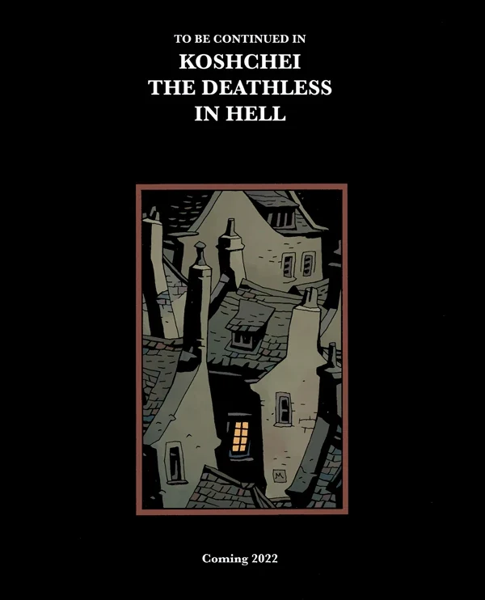

***Koshchei*** is a line of comic books about the character [Koshchei](/entry/Koshchei_(character)). It is a spinoff of the *[Hellboy](/entry/Hellboy_(series))* series.

## Publication History

*see also List of **Koshchei** stories*

*Koshchei the Deathless* originally [debuted as a six-issue miniseries](/entry/Koshchei_the_Deathless_(story)) written by Mike Mignola with art by Ben Stenbeck. It was announced for San Diego ComiC Con in 2017 with the first issue published January 2018.

In December 2021, *[Sir Edward Grey: Acheron](/entry/Acheron_(story))* teased a second *Koshchei* miniseries for 2022, *[Koshchei in Hell](/entry/Koshchei_in_Hell)*.

## Collections

### Trade Paperbacks

*see also Koshchei the Deathless Trade Paperback Collections*  

All in-continuity *Koshchei* stories are collected into trade paperbacks eventually. The trades contain a sketchbook section.
