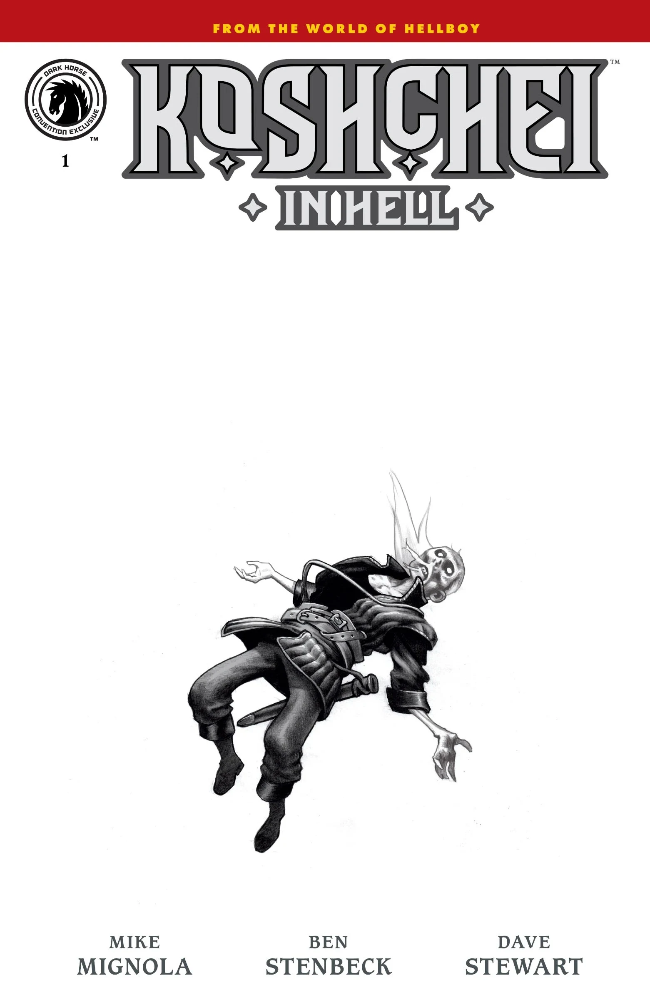
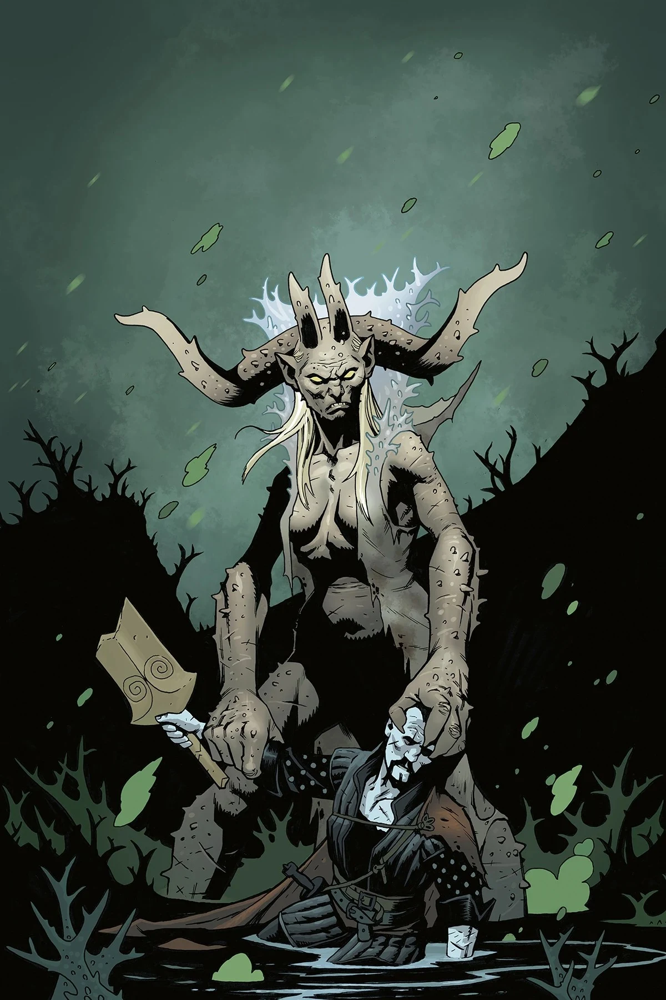
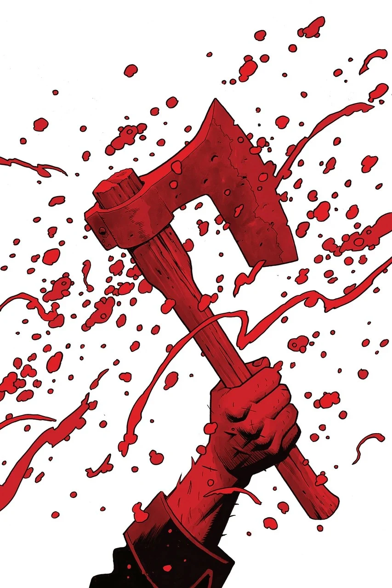
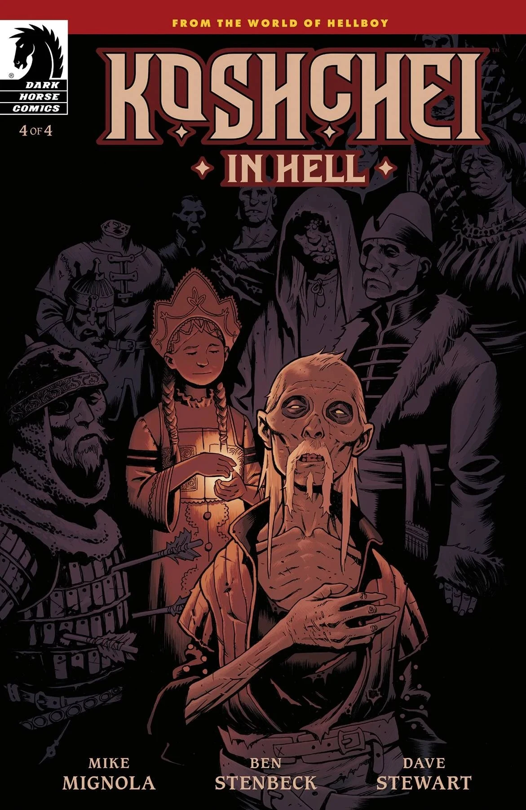

***Koshchei in Hell*** is the four-issue second arc of the [*Koshchei* series](/entry/Koshchei_(series)), picking up from the events of *[Sir Edward Grey: Acheron](/entry/Acheron_(story))*. It will be written by Mike Mignola with art by Ben Stenbeck.

## Synopsis

### Part One

The world above may be over, and Hellboy gone with it, but Koshchei is still in Hell content with his wine and his books—until an [old face](/entry/Edward_Grey) arrives and brings Koshchei a critical task. An [old and power foe](/entry/Pluto) returning, and Koshchei must take up his sword and defend the city from destruction.

### Part Two

After reaching the ruins of Pandemonium, Koshchei the Deathless comes face-to-face with [someone](/entry/Gamori) from Hellboy's past. Hope grows thin when they reveal their plans for the ruined realm, and Koshchei once again finds himself in the fight of his life or death, as the case may be.

### Part Three

Koshchei uncovers a plan to release a long-hiding evil that seeks power over Hell. An unlikely companion, possibly [The last Demon in Hell](/entry/The_last_Demon_in_Hell), could be either a friend or a foe.

### Part Four

Koshchei's sojourn through Hell intensifies! After being betrayed by Hell's last demon, an exhausted Koshchei is ready to give up. . . But someone from his distant past appears to help him answer for his crimes and, in doing so, prepare him for his next phase of existence.

## Content

### Characters

#### Humans

- [Koshchei](/entry/Koshchei_(character))
- Mister Jenks and Mister Dean
- [Baba Yaga](/entry/Baba_Yaga_(character)) (flashback)
- [Vasilisa](/entry/Vasilisa) (flashback)

#### Other denizens of Hell

- [The Snake](/entry/The_Snake)
- Unnamed talking snail
- Unnamed talking raven
- Hellboy's Wife

#### Rivers of Hell

- Sir [Edward Grey](/entry/Edward_Grey)/[Acheron](/entry/Acheron_(river))
- [Styx](/entry/Styx)
- [Phlegethon](/entry/Phlegethon)
- [Cocytus](/entry/Cocytus)
- [Lethe](/entry/Lethe)

#### [Demons](/entry/Demon)

- [Gamori](/entry/Gamori)
- [Satan](/entry/Satan) (flashback)
- [Angels of Destruction](/entry/Angels_of_Destruction)

### Locations

- [Hell](/entry/Hell)
  - [Pandemonium](/entry/Pandemonium_(location))

## Gallery

Covers by Ben Stenbeck.

Teaser from [*Sir Edward Grey: Acheron*](/entry/Acheron_(story))  
by Mike Mignola

*Koshchei in Hell* \#1

*Koshchei in Hell* \#1  
(SDCC 2023 variant)

*Koshchei in Hell* \#2

*Koshchei in Hell* \#3

*Koshchei in Hell* \#4

|Koshchei in Hell #1 (SDCC 2023 variant)

|Koshchei in Hell #2

|Koshchei in Hell #3

|Koshchei in Hell #4
