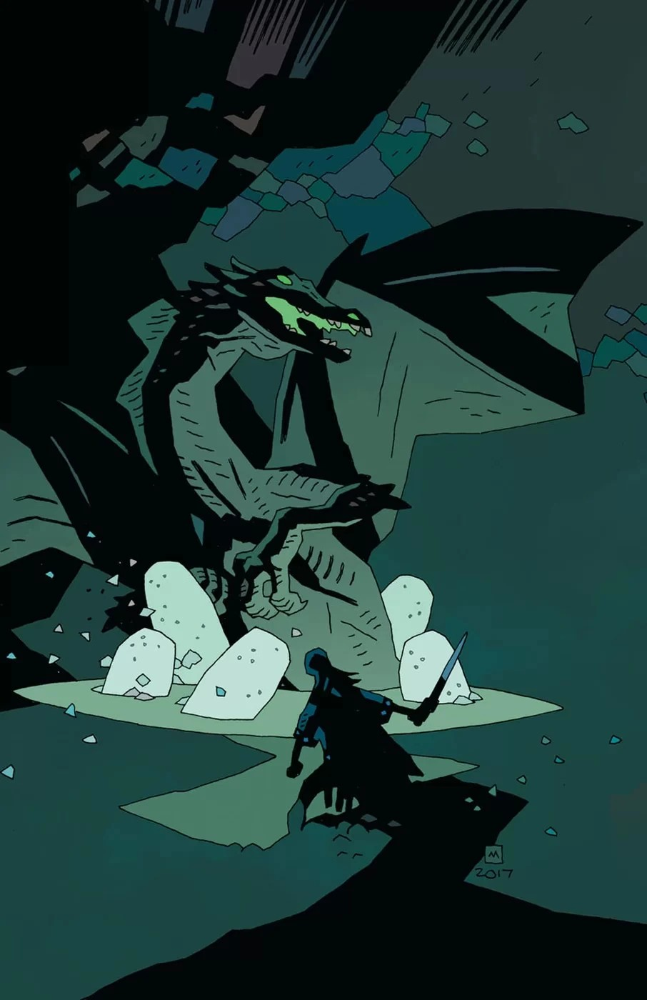
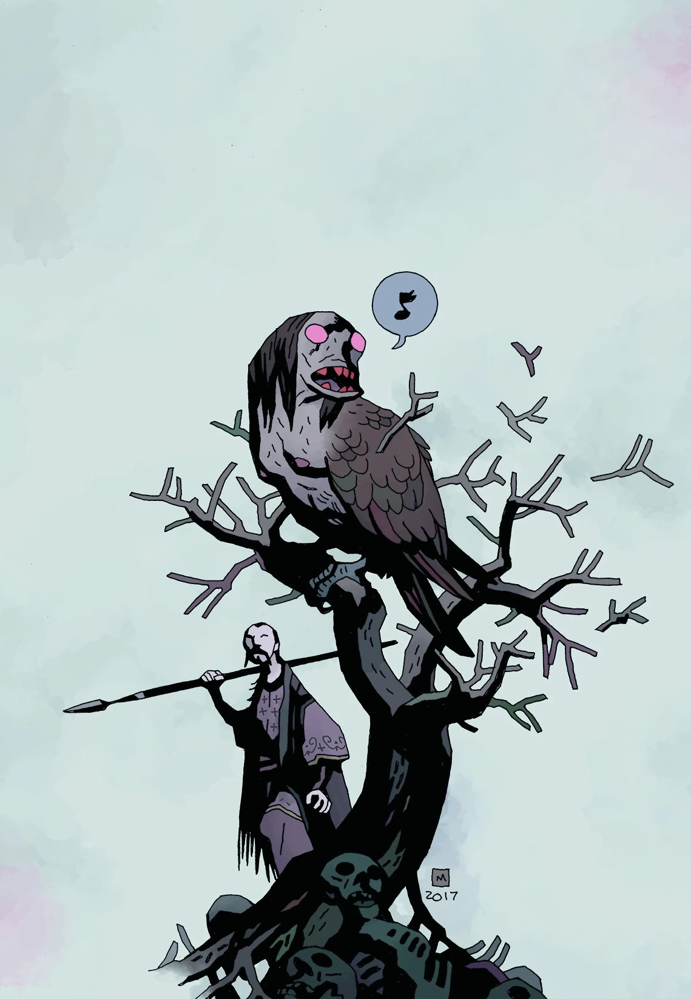
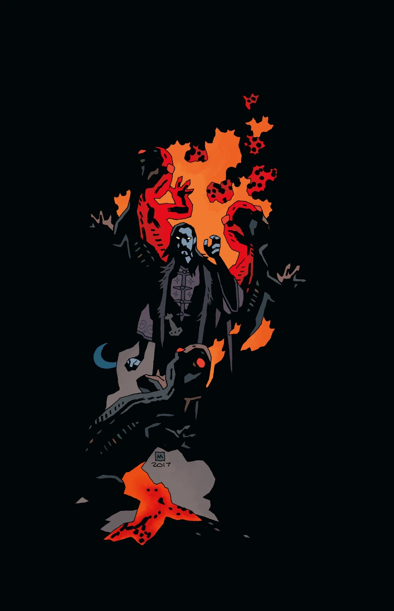
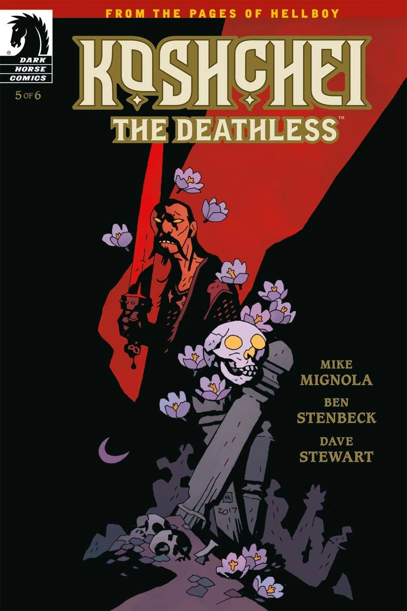
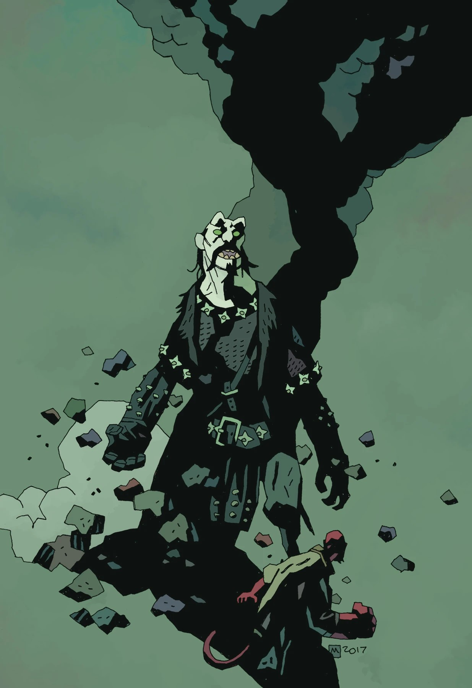

***Koshchei the Deathless*** is a six-issue miniseries written by Mike Mignola with art by Ben Stenbeck.

## Synopsis

### Part One

Sent to kill Hellboy by the Baba Yaga in *[Darkness Calls](/entry/Darkness_Calls)*, Koshchei the Deathless hinted at a long and tragic life before being enslaved to the Russian witch. Now Koshchei relives every horrible act on his road to immortality and beyond, with none other than Hellboy himself—in Hell.

### Part Two

Sent to kill Hellboy by the Baba Yaga in Darkness Calls, Koshchei the Deathless hinted at a long and tragic life before being enslaved to the Russian witch.

Now, in a pub somewhere in Hell, Koshchei tells Hellboy about a dangerous mission when the witch sent him to hunt and destroy the last dragons before their eggs hatch.

### Part Three

Koshchei tells Hellboy of the last dragon, a kingdom terrorized by an avian creature, and the tragic choices he had to make in the Baba Yaga's service.

### Part Four

An encounter at a witches’ Sabbath leads Koshchei down a road of betrayal, and in his revenge he comes face to face with the enemy he least expects.

### Part Five

Koshchei attempts to defy Baba Yaga, but it comes at an unbearable cost.

### Part Six

Koshchei retells his final encounters with the Baba Yaga, and he and Hellboy part ways.

## Gallery

|Issue #2

|Issue #3

|Issue #4

|Issue #5

|Issue #6
