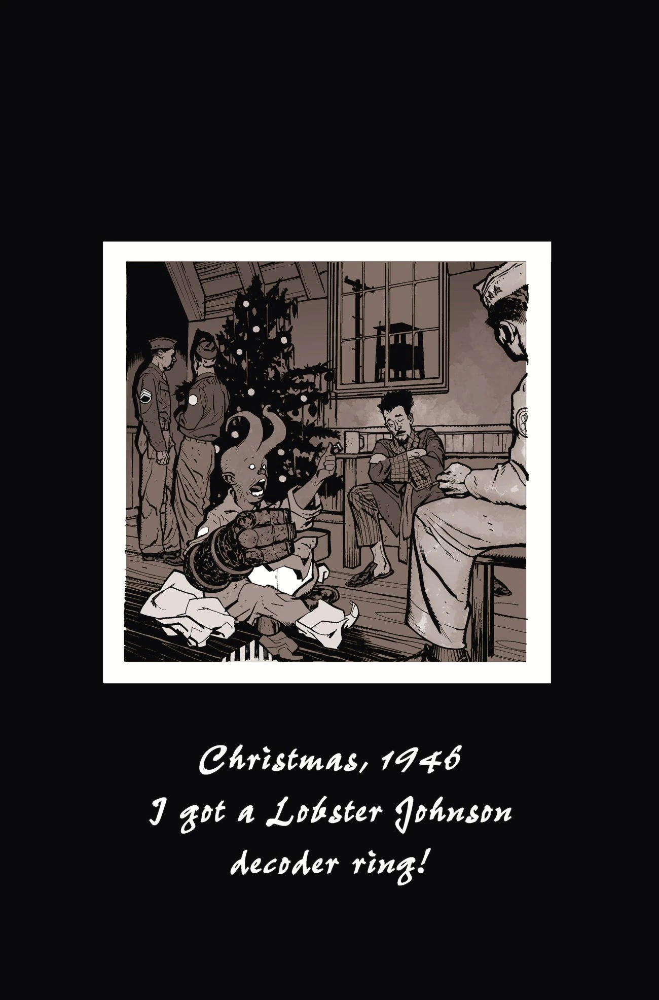
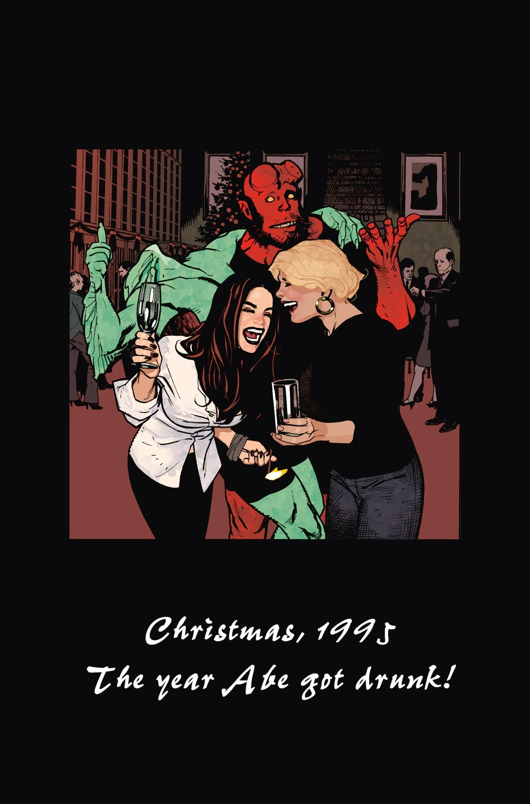
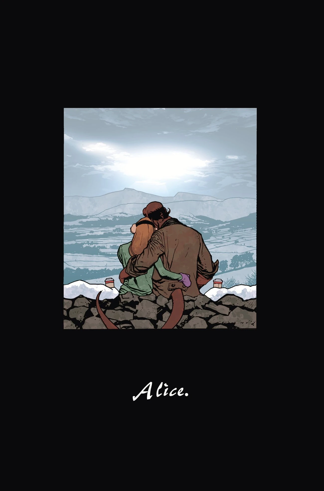
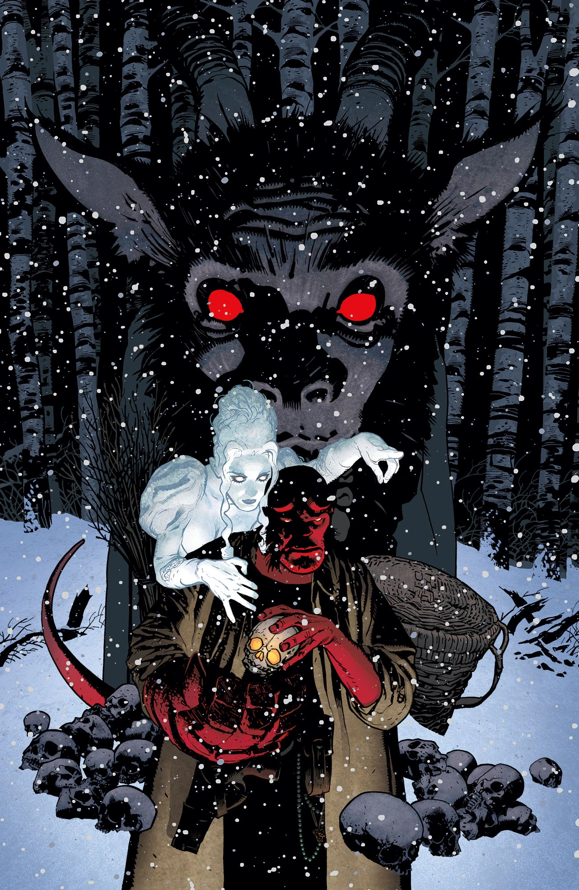
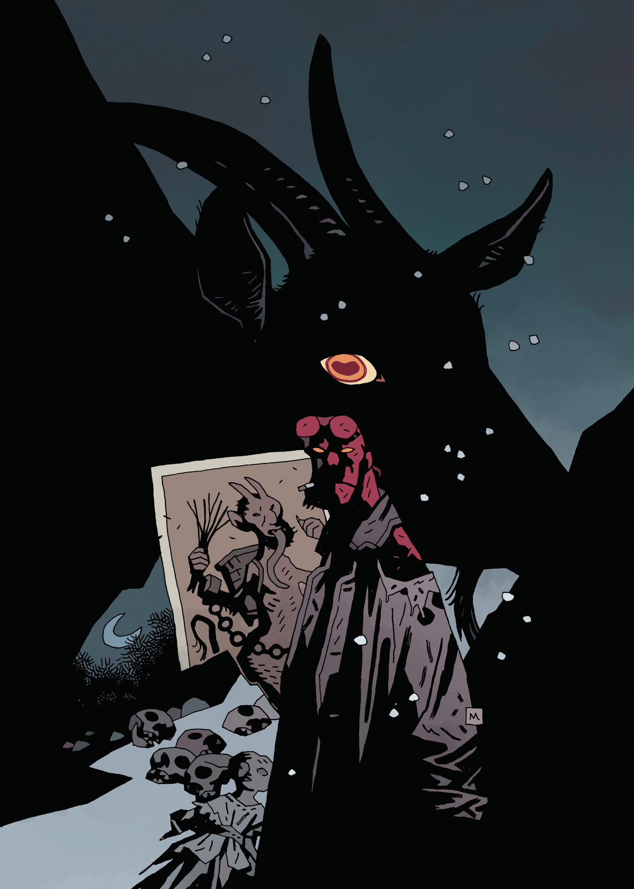
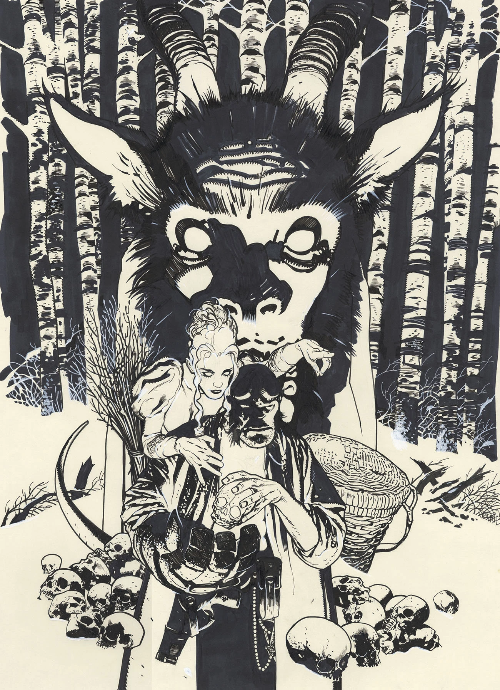

***Krampusnacht*** is a 2017 one-shot by [Mike Mignola](/entry/Mike_Mignola) and [Adam Hughes](/entry/Adam_Hughes). It won the [Eisner Award](https://www.comic-con.org/awards/eisner-awards-current-info) for Best Single Issue / One-Shot in 2018.

## Publication History

*Krampusnacht* was originally announced as the third *[Hellboy Winter Special](/entry/Hellboy_Winter_Special)*. However, when the final book came out, it had none of the standard *[Hellboy Winter Special](/entry/Hellboy_Winter_Special)* trade dress.

This issue marks [Adam Hughes's](/entry/Adam_Hughes) debut on the Hellboy Universe books. The story is set in 1975, the same year as the Christmas in the short story *[Mood Swings](/entry/Mood_Swings)*.

## *Christmas Memories*

*Hellboy: Krampusnacht* contains a section titled "Christmas Memories". It featured a collection of three pinups done in the style of photographs from Christmases of [Hellboy](/entry/Hellboy_%28character%29)'s past.

|"Christmas, 1946 - I got a [ Lobster Johnson](/entry/Lobster_Johnson_%28character%29) decoder ring!"

|"Christmas, 1995 - The year [ Abe](/entry/Abraham_Sapien) got drunk!"

|"[ Alice](/entry/Alice_Monaghan)"

## Gallery

 Hughes cover

 Mignola variant cover

 variant cover

## External Links

["Christmas Memories" on BloodyDisgusting.com](http://bloody-disgusting.com/comics/3475363/exclusive-hellboy-shares-christmas-memories-hellboy-krampusnacht-images/)
