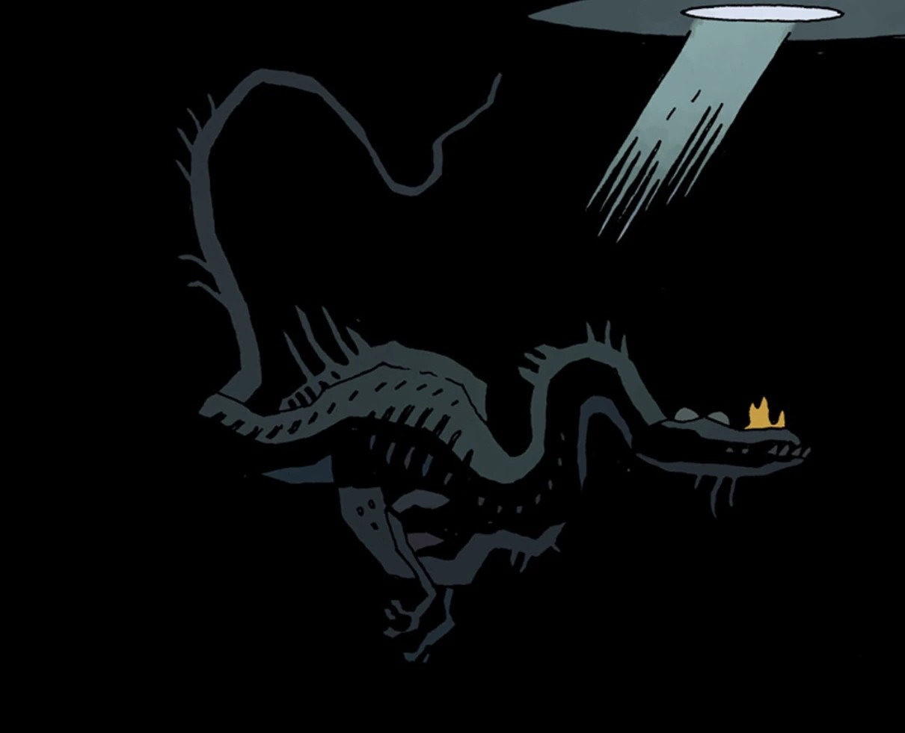

**The Leviathan** is a demonic beast who held an age-long grudge with the demon [Astaroth](/entry/Astaroth) over an unknown dispute.

## History

During [Hellboy](/entry/Hellboy_%28character%29)'s reunion with his uncle and his two brothers, [Gamon](/entry/Gamon) and [Lusk](/entry/Lusk), the Leviathan appeared and consumed both Astaroth and his nephews before any further business could be done, ending the grudge between the two demons.

After the majority of the demonic hierarchy is killed by a titan in the visage of Hellboy, Leviathan emerged from the seas to fight the adversary but was killed by Hellboy after he used his hellfire powers. Its death was soon followed by its brother [Behemoth](/entry/Behemoth)'s death.

## Other Works

In the out-of-continuity novel *[On Earth as it is in Hell](/entry/On_Earth_as_it_is_in_Hell)* by Brian Hodge, the Leviathan appears briefly in league with the daemon [Moloch](/entry/Moloch), whose minions kidnap Hellboy from the deck of a freighter in the Atlantic Ocean. The Leviathan carries Hellboy across the sea in its belly, before spitting him out onto the coast of the same Scottish isle where he was "born."

## Gallery

LeviathanUnderWater.jpeg

|
## Trivia

- The Leviathan resembles a [Spinosaurid](https://en.wikipedia.org/wiki/Spinosauridae).
