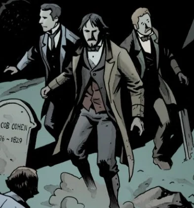

**Dr. Manley** worked in the Saint John of the Cross Police Hospital in London throughout the 1880s. He and [Dr. Lewis](/entry/Lewis) often lent assistance to [Sir Edward Grey](/entry/Edward_Grey), the occult detective. While predominantly acting as medical and scientific consultants for Grey, the pair found themselves facing the undead on a few occasions, but with the aid of Sir Edward, they never suffered any serious physical harm. However, an encounter with vampires had a lasting effect on Dr. Manley and he refused to aid Sir Edward in the field thereafter.
