**Matt Smith** is an American comic artist. He is not to be confused with the other [Matt Smith](/entry/Matthew_Dow_Smith) who worked in the Hellboy Universe briefly in the 1990s.

## Interior Artist

- *[Hellboy and the B.P.R.D.: Long Night at Goloski Station](/entry/Long_Night_at_Goloski_Station)*
- [*Hellboy: The Bones of Giants* \#1–4](/entry/The_Bones_of_Giants_%28comic_miniseries%29)
- [*Hellboy in Love: Goblin Night* \#1–2](/entry/Goblin_Night)
- [*Hellboy in Love: Shadow Theater* \#1–2](/entry/Shadow_Theater)
- [*Hellboy in Love: The Key to It All*](/entry/The_Key_to_It_All)

## Cover Art

### *Hellboy* issues

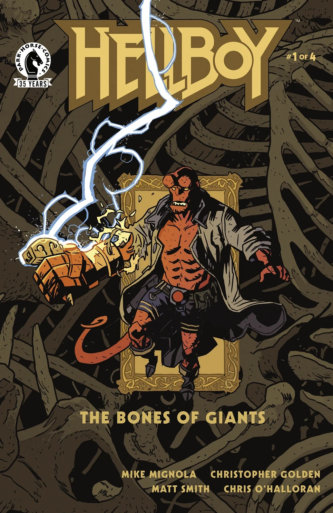

|*Hellboy:
The Bones of Giants* \#1

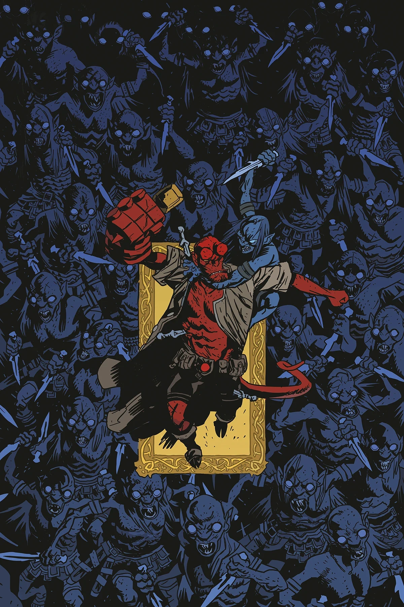

|*Hellboy:
The Bones of Giants* \#2

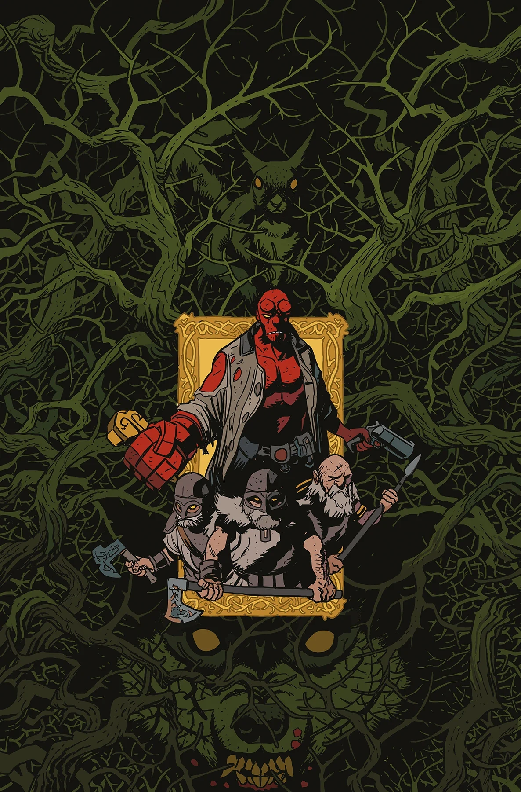

|*Hellboy:
The Bones of Giants* \#3

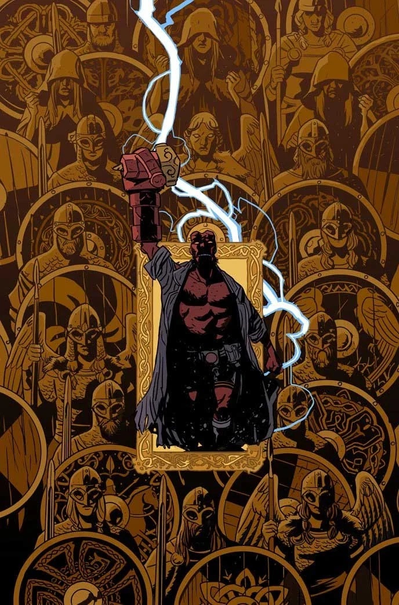

|*Hellboy:
The Bones of Giants* \#4

### *Young Hellboy* issues

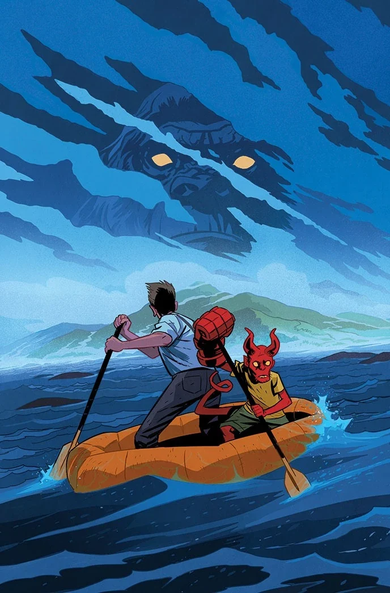

The Hidden Land* \#1

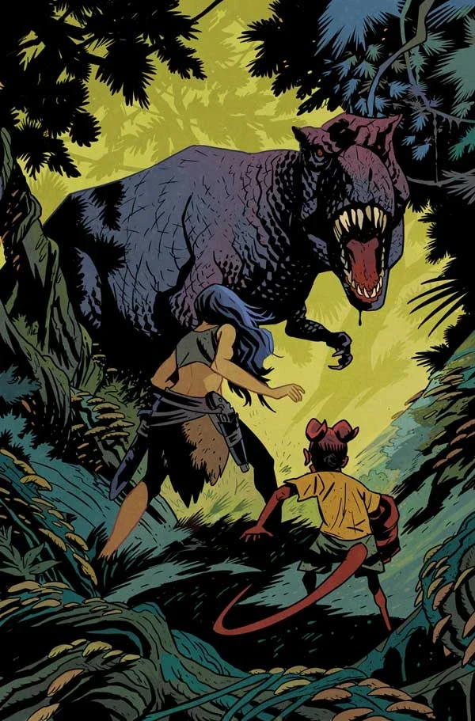

The Hidden Land* \#2

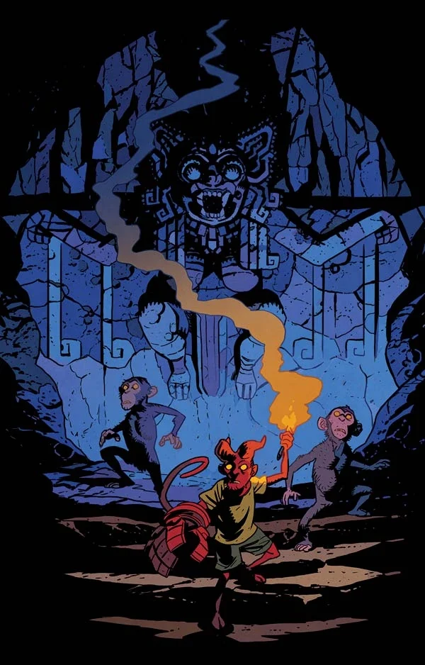

The Hidden Land* \#3

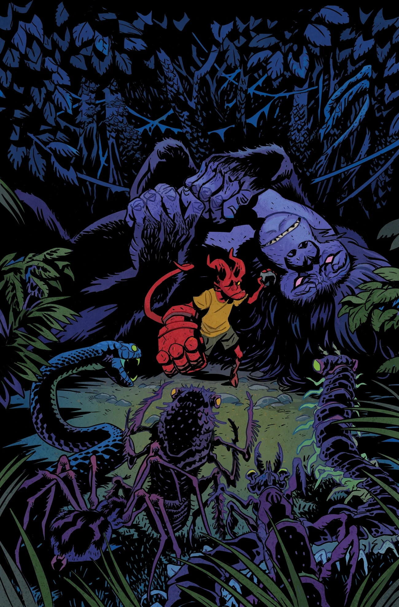

The Hidden Land* \#4

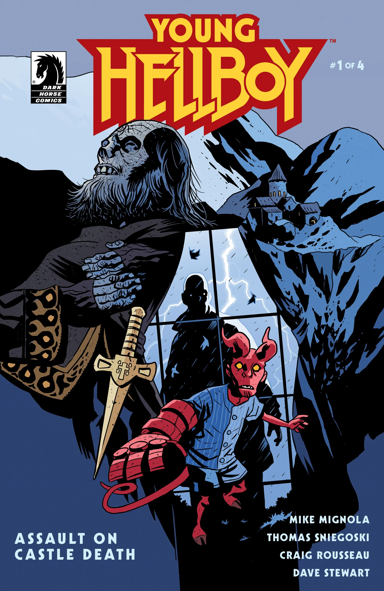

Assault on Castle Death* \#1

Assault on Castle Death* \#2

Assault on Castle Death* \#3

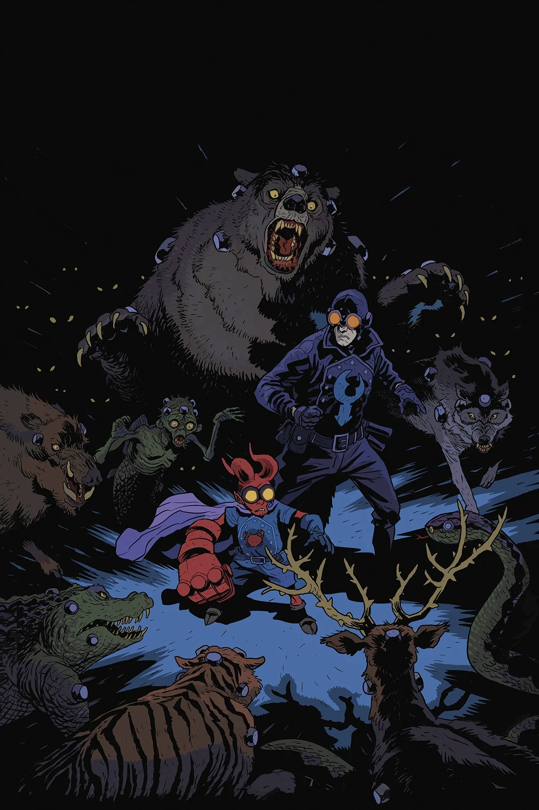

Assault on Castle Death* \#4

### *Hellboy in Love* issues

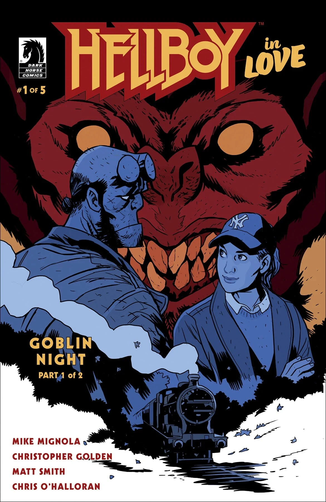

*Goblin Night* (Part 1)

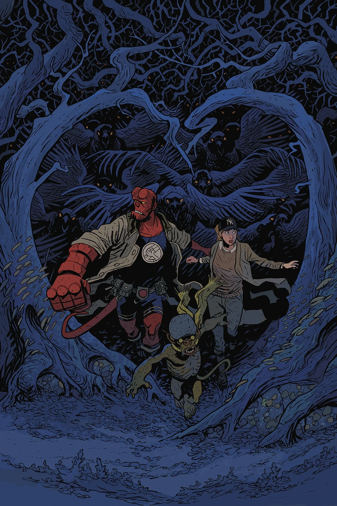

*Goblin Night* (Part 2)

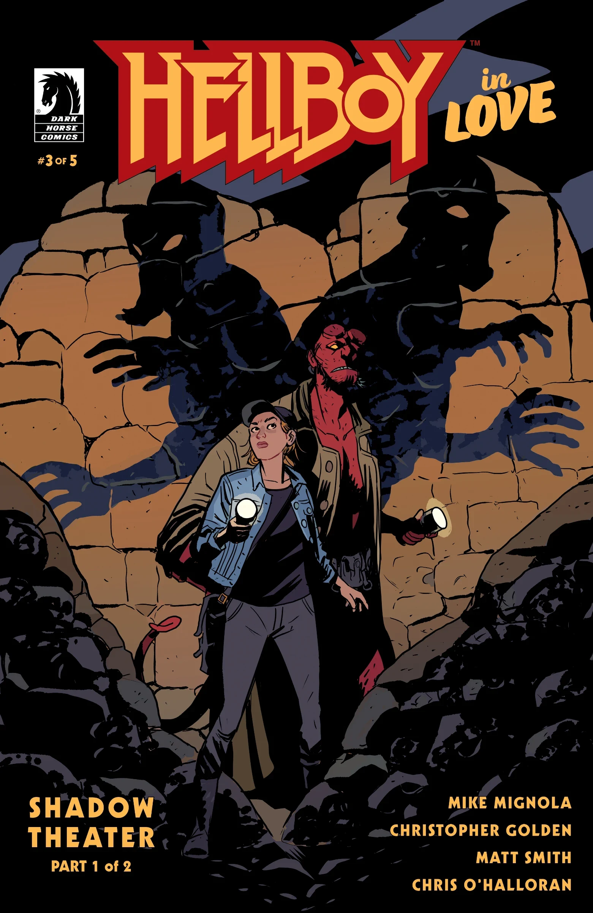

*Shadow Theater* (Part 1)

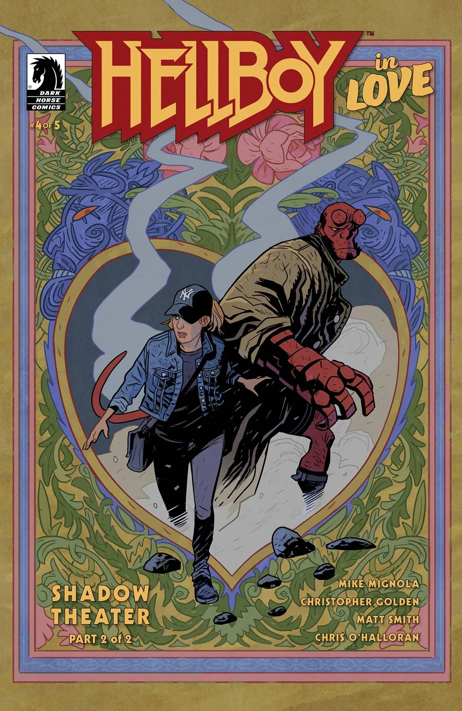

*Shadow Theater* (Part 2)

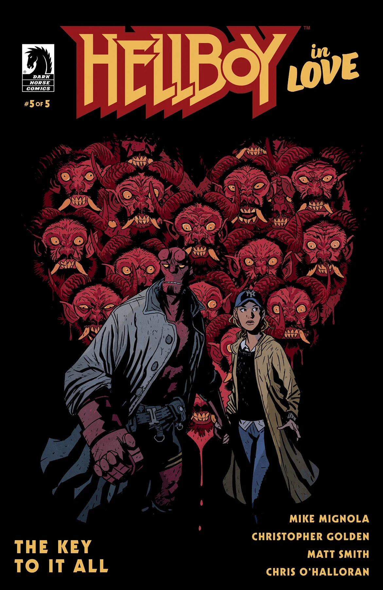

*The Key to It All*

## External Links

- [**Wikipedia:** Matt Smith](https://en.wikipedia.org/wiki/Matt_Smith_(illustrator))
