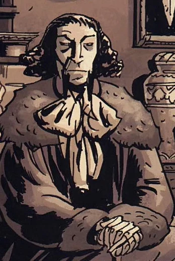
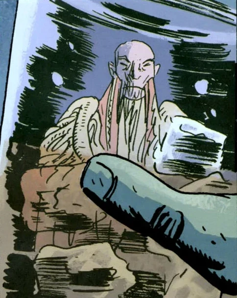
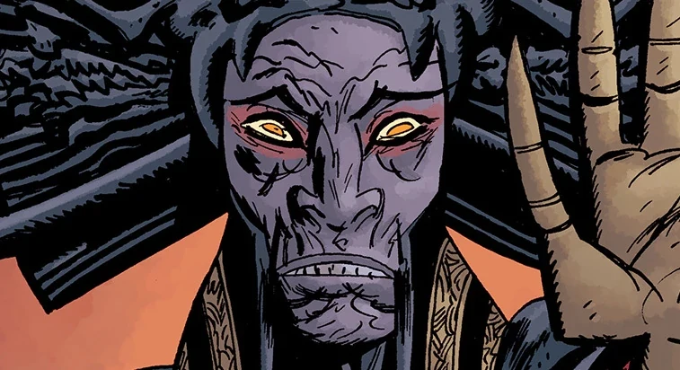

**Memnan Saa**, born **Martin Gilfryd**, is a mysterious sorcerer who acknowledged the secret history of the world, including the [Ogdru Jahad](/entry/Ogdru_Jahad).

## History

### Origins

Martin Gilfryd was the head curator of the British Museum's Egyptology Department during the mid-nineteenth century. He later became associated with the [Heliopic Brotherhood of Ra](/entry/Heliopic_Brotherhood_of_Ra), due to his position and connections with Egyptology. However, Gilfryd possessed an ambitious mania that alienated the Brotherhood.

Martin Gilfryd

Gilfryd met [Panya](/entry/Panya_%28character%29) the living mummy after she was unwrapped in 1859 and frequently asked her about her miraculous resurrection in which she uncomfortably declined to answer him. Because of Gilfryd's social contact with Panya, the Brotherhood grown very wary of Gilfryd and consequently banned him from their society forever. Not much later Gilfryd entered a rough period and became a disciple of occultist [Gustav Strobl](/entry/Gustav_Strobl), who taught him the dark arts. But filled with greed and mania, Gilfryd killed his mentor and was subsequently caught by the London authorities and sentenced to Bedlam Royal Hospital in May 18th, 1867. In 1879, Gilfryd was contacted by Witchfinder Sir [Edward Grey](/entry/Edward_Grey), who needed his help in stopping a resurrected Hyperborean creature. After the creature was killed, Gilfryd attempted to flee, but was shockingly confronted by the ghost of Gustav Strobl, who mockingly told him that Gilfryd was incapable in harnessing the magic that he had taught him. Gilfryd then fell unconscious out of duress and was returned to his cell.

### As Memnan Saa

After a long sentence, Gilfryd was discharged on July 17th, 1890, after responding to treatment. In a new fast paced world, he was dissatisfied with Western society and went on a journey to Asia in search of new wisdom, which then he has disappeared from all public records. At Beijing, Gilfryd learned about Agartha, a secluded monastery inhabited by monks, and traveled there where he learned the secret history of Hyperborea and the [Ogdru Jahad](/entry/Ogdru_Jahad), and later renaming himself as Memnan Saa. However, his stay didn't last long as he strongly disagreed with the monks' inactive beliefs of leaving the world as it was. Saa soon left Agartha and was lost in a blizzard until he was found by a sect of monks that opposed Agartha's views and worshiped the [Black Goddess](/entry/Hecate). They saw him as their prophetic leader who would return Hyperborea to its former glory; in their words, "He will raise the old cities, and make them new again, and tame fire to breed dragons." He lived at the hidden city of Thadrethes where Saa learned more about the secret history of the world, and subsequently spoke to their wisest monk, who let him see the future the Ogdru Jahad was responsible for, the power of [Vril](/entry/Vril), and that his actions would save the world. Although, he saw in his vision that he was not the man destined to wield the power of Vril that would create the new era.

In 1913, Saa helped a Mongol warlord in a successful battle that routs a Russian battalion. In June 14th, 1937, Memnan Saa made his first confirmed appearance in an armory in New York City where he was caught on film before it exploded. By November he commanded an army of Chutt warriors to kidnap Professor [Kyriakos Gallaragas](/entry/Kyriakos_Gallaragas) and his daughter [Helena](/entry/Helena_Gallaragas) for the [Vril Energy Suit](/entry/Vril_Energy_Suit) (V.E.S.) that possessed the power source, Anum's Fork, which would be used to create an army of Vril-empowered dragons and revive the Hyperborean empire. However, Gallaragas' assistant [Jim Sacks](/entry/Jim_Sacks) escaped with the V.E.S. and discovered that Nazi agents were also after the suit. After capturing Sacks and the V.E.S., Memnan Saa came into conflict with [The Lobster](/entry/The_Lobster), and Saa warned him not to interfere in his affairs. Possessing the suit, Memnan Saa killed Gallaragas and had his followers construct a prototype replica of Anum's Fork and used it on a follower, transforming him into a dragon-like creature that killed Jim Sacks. However, Sacks returned to life as a super-powered being at the hand of the Vril power and foiled Memnan Saa's plans and killed his followers. Memnan Saa was the sole survivor of Sack's attack and was then chased and shot by The Lobster. Given his mystical nature, Memnan Saa escaped and became an enemy of the Lobster.

The Lobster and his allies sought out after Memnan Saa. But all of their leads on Memnan Saa resulted in tragedy, leaving The Lobster and his ally [Harold McTell](/entry/Harry_McTell) the only survivors. The Lobster gave up his search in fear that McTell would come to harm. McTell, however, sought revenge for his friends' deaths, which resulted in the loss of his right leg.

### Modern Day

By the early twenty-first century, Memnan Saa discovered [Liz Sherman](/entry/Liz_Sherman) to be capable of wielding the Vril power and confronted her in a dream, telling her that the [B.P.R.D.](/entry/B.P.R.D.)'s war on the [frog monsters](/entry/frog_monster) was far worse than they could imagine. This warning revealed to be about [Katha-Hem](/entry/Katha-Hem), one of the [Ogdru Hem](/entry/Ogdru_Hem). Memnan Saa was confronted by Liz via [Johann Kraus](/entry/Johann_Kraus), which she demanded he help her and her team destroy Katha Hem. Memnan Saa revealed an artifact found by [Roger the Homunculus](/entry/Roger) which would destroy the Ogdru Hem and instructed her to use the artifact to unleash the power of Vril to kill Katha Hem. The death of Katha-Hem, however, does not mean the end of the things to come for Memnan Saa, as he continuously haunt Liz into convincing her to join his cause against the Odgru Hem by showing her visions of the apocalypse and distrusting her own team, especially [Ben Daimio](/entry/Ben_Daimio)'s revelation as a were-jaguar. Liz eventually allows him to spirit her away after Saa sent visions to the B.P.R.D. prominents to warn them against crossing him or seeking Liz.

An expedition of B.P.R.D. armed forces led by [Kate Corrigan](/entry/Kate_Corrigan) traveled to Thadrethes following a accurate route-map provided by Harold McTell from his time as an intelligence officer in Asia. Once they arrive they are greeted by a monk who asks that the majority of the troops stay outside, including Johann Kraus to everyone's surprise. He then leads them to Liz and Memnan Saa whom the latter expresses his exasperation at them ignoring his warnings and traveling to Thadrethes. When Thadrethes was besieged by the frog monsters and their subhuman Hyperborean allies, Saa demonstrated his control over Liz in creating dragons from the frog monsters into fighting the invaders. Saa eventually reveals them on his plan to save humankind without any help from the B.P.R.D. as he saw their cause already doomed from the beginning.

This does not sit well with the agents. Johann in the meantime illegally entered the city compound killing a monk in the process and attacked Saa. Saa smashed him against the wall, leading to The Lobster to materialize and attack him. These attacks lead to a breakdown of the negotiations and a battle between Saa and the B.P.R.D. that was ended by Liz who woke up from her trance to incinerate Saa.

Although dead, Saa's spirit returned to again torment Liz when he showed her another vision of the apocalypse that included the total decimation of the B.P.R.D. all due to her responsibility for Saa's death.

## Powers and abilities

Memnan Saa had studied under the mystic Gustav Strobl but was stripped of most of said knowledge. He then trained in Agartha where presumably he picked up the basis at least of his later powers: telekinesis, astral projection, mental combat, power sensing, and many others.

## Gallery

