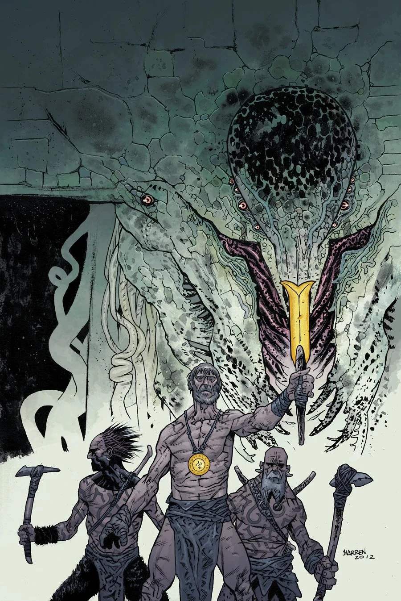

**Mera-Hem** was one of the 369 [Ogdru Hem](/entry/Ogdru_Hem), the children of the [Ogdru Jahad](/entry/Ogdru_Jahad).

## [The Abyss of Time](/entry/The_Abyss_of_Time)

The prehistoric tribe led by [Gall Dennar](/entry/Gall_Dennar) encountered Mera-Hem while pursuing a clan of the [Cold People](/entry/Vampire_(creature)). The hunt led the tribe into a valley where they found an ancient crumbling temple dedicated to the [Black Goddess](/entry/Hecate). A leader amongst the Cold People mocked Gall Dennar and his tribe before a great battle broke out between the two sides. A prehistoric scout, Karr, was injured early in the battle and stumbled bleeding upon the ground of the temple. This blood, combined with the ferocity and violence of the battle summoned the spirit of Mera-Hem to the temple, who began attacking and killing both cavemen and Cold People. Things looked bleak until Gall Dennar managed to kill the leader of the Cold People which caused Mera-Hem to dissipate into the air.

## [The Sword of Hyperborea](/entry/The_Sword_of_Hyperborea_(story))

TBA

## Gallery

|
