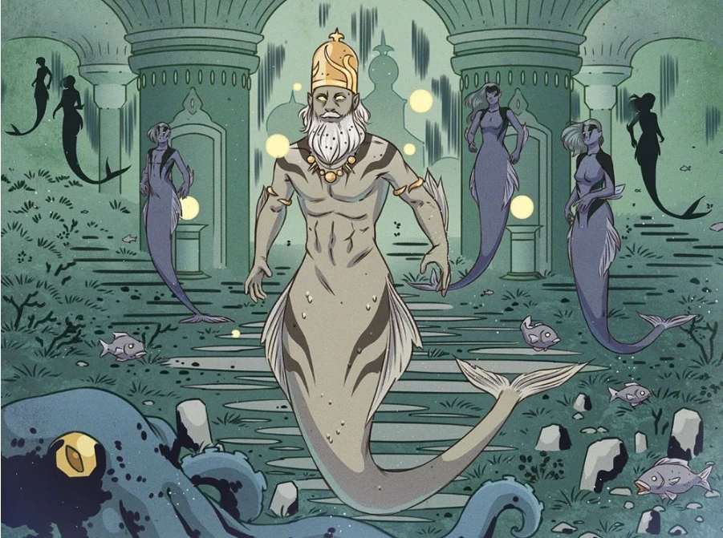

The **Merfolk** are a race of aquatic humanoids that live beneath the seas.

## Background

The merfolk are the descendants of the survivors of the [Hyperborean](/entry/Hyperboreans) Empire from the city of Atlantis. Through some miracle of science or magic, the inhabitants of the great city were turned into a fish-tailed race of the sea. They survived well into the modern era, though their culture has regressed into tribalism.

## History

In 1834, the [Oannes Society](/entry/Oannes_Society) agents managed to recover a frozen corpse of a merman. They transported the specimen to Latvia, but agents from the [Heliopic Brotherhood of Ra](/entry/Heliopic_Brotherhood_of_Ra) learned of it and wished to steal it. In the ensuing conflict the corpse was destroyed leaving its origins as a prehuman species a mystery.

In 1956 a mermaid was caught by [King Vold](/entry/King_Vold_(character)) during one of his hunts whilst [Hellboy](/entry/Hellboy) watched over one of his wolves.

The sea witch known as the [Bog Roosh](/entry/Bog_Roosh), employs three mermaids to capture Hellboy who was lost at sea. They brought him to her domain, and offered to grant their wishes. Two of the three mermaids gave in to selfish wishes and were killed by the black heart of the witch. The third, being wiser, selflessly only wished for her father's war spear. She was allowed to return safely, but the spirit of her father was disgusted by her actions, stating that she dishonored him for taking the life of one who done her no harm, condemning him to Hell. The mermaid, guilty for what she had done, returned to free Hellboy who killed the Bog Roosh, but the hag placed a curse on the mermaid, making her the new Bog Roosh. She willingly freed Hellboy, allowing him to return back to the surface, while the spirit of her father comforted her, stating he would always be with her.

When one of the [Ogdru Jahad](/entry/Ogdru_Jahad) had broken free from its prison and made its way to Earth in North America, the merfolk had since abandoned Atlantis, guided by the new Bog Roosh to move south for safety.
