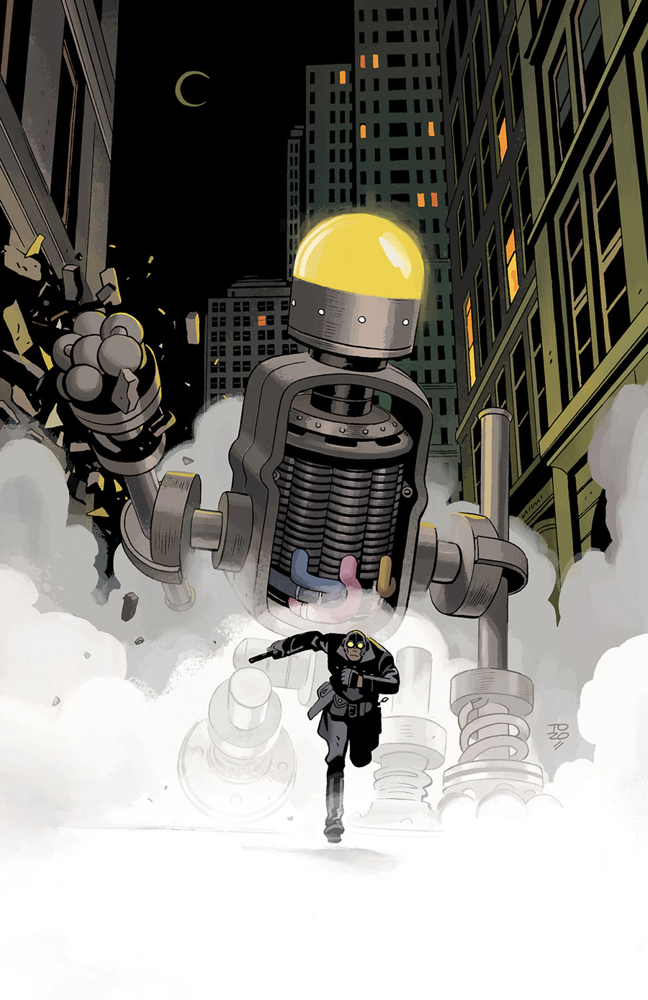

***Metal Monsters of Midtown*** is a story takes place in the middle of [the Lobster's](/entry/The_Lobster) career as a crime fighter in the 1930s.

## Publication History

This three-issue miniseries will be published in May to July 2016, featuring covers and art by Tonči Zonjić.

## Synopsis

### Part One

A trio of skyscraping robots crash into a Manhattan bank and leave Lobster Johnson with two mysteries to solve: what is behind the massive machines, and why would the robots pull a heist without taking a penny?

### Part Two

The face-off against giant robots continues as Lobster Johnson’s investigation leads him to a woman whose story reveals the ancient origins behind the machines’ gleaming exteriors.

### Part Three

The giant robot invasion of New York comes to a showdown when the Lobster has to get into a machine’s head to drive it out of the city.

## Gallery

 \#1

 \#2

 \#3
