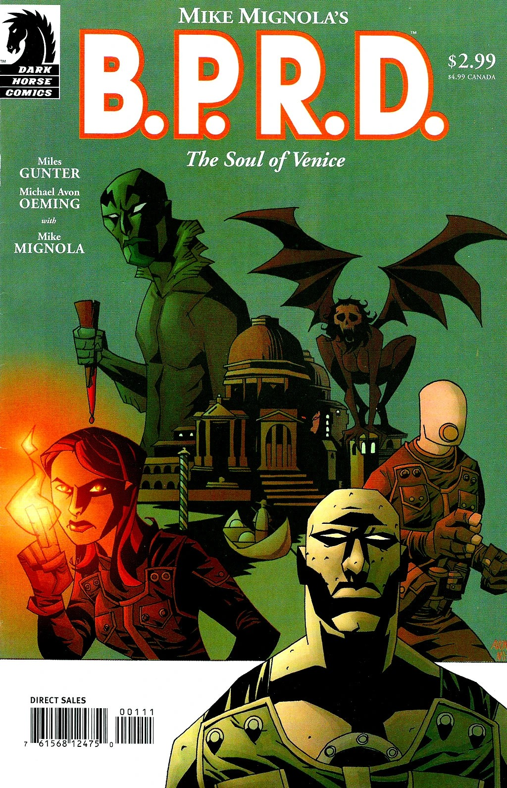
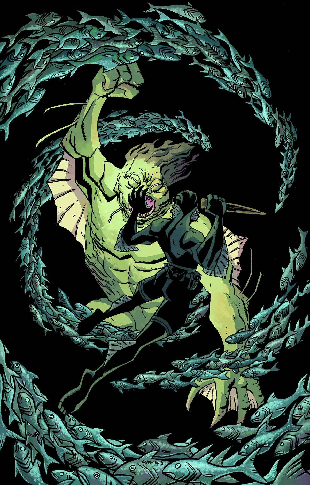

**Michael Avon Oeming** is a comics artist and writer. He made his Hellboy Universe debut in May 2003 with *[B.P.R.D.: The Soul of Venice](/entry/The_Soul_of_Venice)*.

## Interior Art

- *[B.P.R.D.: The Soul of Venice](/entry/The_Soul_of_Venice)*
- *[Abe Sapien: The Land of the Dead](/entry/The_Land_of_the_Dead)*
- *[Mood Swings](/entry/Mood_Swings)*
- *[Hellboy and the B.P.R.D.: 1956](/entry/1956)* (with [Yishan Li](/entry/Yishan_Li) and [Mike Norton](/entry/Mike_Norton))

## Writer

- *[B.P.R.D.: The Soul of Venice](/entry/The_Soul_of_Venice)* (with [Miles Gunter](/entry/Miles_Gunter) and [Mike Mignola](/entry/Mike_Mignola))

## Cover Art

|The Soul of Venice

|The Land of the Dead (Variant)
## External Links

- [**Comic Book DB:** Michael Avon Oeming](http://comicbookdb.com/creator.php?ID=937)
