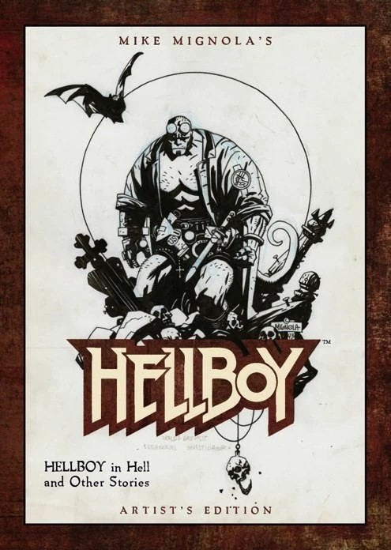
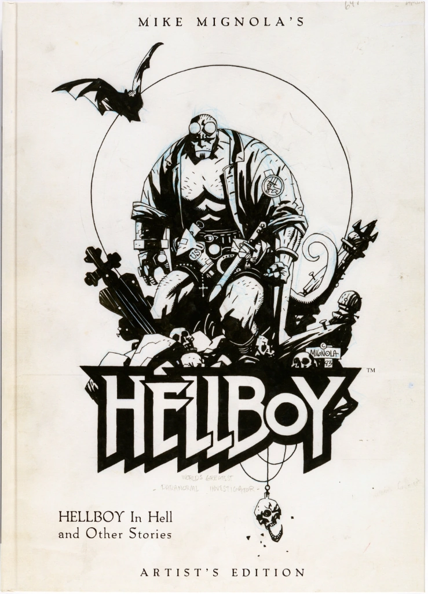
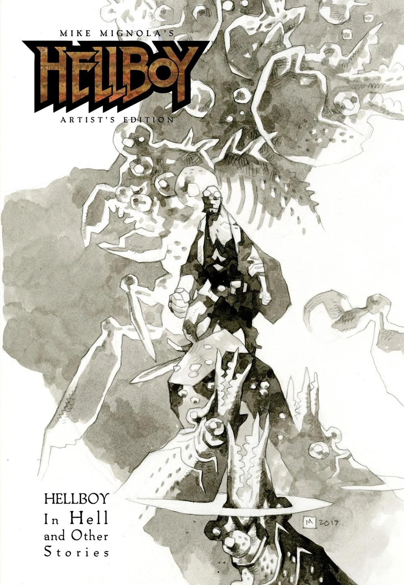

**Mike Mignola's *Hellboy Artist's Edition: Hellboy in Hell and Other Stories*** is an oversized, hardcover art book published by [IDW](https://en.wikipedia.org/wiki/IDW_Publishing) as \#23 in their *Artist's Edition* line. It collects both *[Hellboy in Hell](/entry/Hellboy_in_Hell)* \#1–5 along with some of the earliest *[Hellboy](/entry/Hellboy_%28series%29)* stories published. As with all the books in the *Artist's Edition* line, the goal of the publication is to provide the reader an experience as close as possible to viewing the original art.

## Publisher's Summary

> **See Mike Mignola’s art as you never have before–presented in IDW’s Artisan Edition format!**
>
> *Mike Mignola has been (and remains!) one of the preeminent comics creators of the past several decades. His career was already firmly established for his outstanding work on characters like Batman, Wolverine, a myriad of beautiful covers and more… And then came Hellboy. Mignola’s iconic creation struck a meteoric chord with fans from the very start and has not abated in the 25-plus years since the character’s debut.*
>
> *This Artisan Edition features the first five issues of Hellboy in Hell as well as a wealth of historic supplementary material: the first three Hellboy stories–the two initial four-pagers, produced for promotional purposes, and the 10-page story from John Byrne’s Nextmen \#21–plus The Corpse, and two other tales selected by Mignola for inclusion. Nearly every page has been scanned from Mignola’s original art and showcases the artist's gorgeous work as closely as possible to the physical page–this is a book for fans of great storytelling and students of the craft.*
>
> *An Artisan Edition endeavors to mimic as closely as possible the experience of viewing the actual original art–for instance, corrections, blue pencils, paste-overs, all the little nuances that make original art unique. Unless you are holding Mike’s art in your hands, there is no way to better experience his original art.*

## Publication History

 The first edition was published by IDW in July of 2014. At the same time, a limited run of 250 variant editions were published. The variant editions are all signed, remarqued and hand number by [Mike Mignola](/entry/Mike_Mignola). The variant edition additionally features a different cover than the standard first edition.

Later in 2014, IDW made another limited edition print run of the book. This time to be distributed exclusively at that year's San Diego Comic Con (SDCC). They reused the artwork from the variant edition for the SDCC exclusive edition but this time printed it full bleed, dropping the border present on the variant edition and first edition.

In November of 2017, a little over three years after the first edition was released, IDW published a second edition. Outside of the new cover the book is identical to the first edition.

### Artisan Edition

In May of 2022 a smaller, soft cover version of the book was released. This soft cover version was given the slightly different title of **Mike Mignola's *Hellboy Artisian Edition: Hellboy in Hell and Other Stories***. Additionally, it features a new cover from [Mignola](/entry/Mike_Mignola). The contents of the book are unchanged.''

## Contents

The book collects:

- [*Hellboy in Hell* \#1-4](/entry/Hellboy_in_Hell_%28first_story_arc%29)
- [*Hellboy in Hell: The Three Gold Whips*](/entry/The_Three_Gold_Whips)
- [Mike Mignola's *Hellboy*](/entry/World%27s_Greatest_Paranormal_Investigator_%28SDCC%29)
- [Mike Mignola's *Hellboy: World's Greatest Paranormal Investigator*](/entry/World%27s_Greatest_Paranormal_Investigator_%28CBG%29)
- *Faith*, an excerpt from John Byrne's [*Next Men* \#21](/entry/Next_Men__Faith_%E2%80%93_Part_3)
- *[The Corpse](/entry/The_Corpse)*
- [*The Ghoul*, or, *Reflections on Death and the Poetry of Worms*](/entry/The_Ghoul)
- [*The Troll-Witch*](/entry/The_Troll_Witch)

The stories are presented with all but three pages scanned from the original art, with the black and white page printed in color to mimic as closely as possible the experience of viewing the actual original art. Each page is printed the same size as drawn, and the paper selected is as close as possible to the original art board.

The three pages of origional art that could not be scanned for this volume are page 16 from *Hellboy in Hell* \#2, and pages 7 and 19 from *The Corpse*. They are presented as uncolored back and white scans.

The *Hellboy in Hell* stories are unlettered, as the lettering was done digitally for these stories.

## Cover Gallery

|Variant Edition

|2014 San Diego Comic Con Exclusive Edition

|2nd Edition
## Packaging

 All books in [IDW](https://en.wikipedia.org/wiki/IDW_Publishing)'s *Artist's Edition* line come come encased in a specially designed cardboard box that features a sticker bearing a black and white, slightly rasterized image of the book's cover. The boxes themselves have become collector's items when paired with the books. Online auctions including the box typically fetch higher bids than books in similar condition without the box. The variant edition's packaging also denotes the number of the book in the limited print run. The San Diego Comic Con exclusive edition's packaging does not feature a sticker on the cover.
