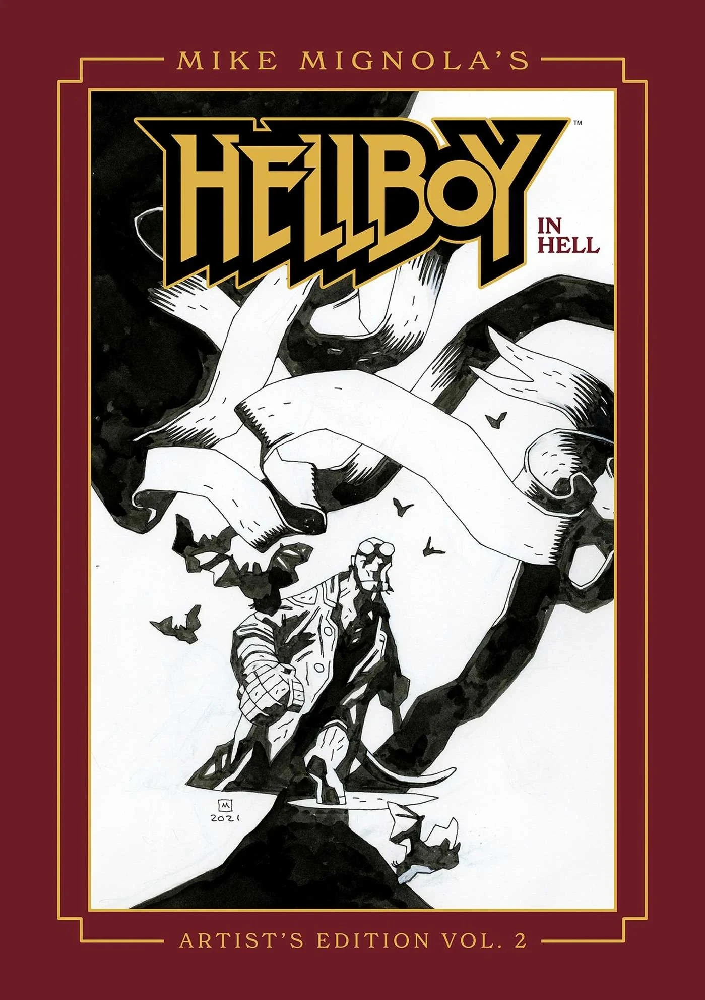

**Mike Mignola's *Hellboy in Hell Artist's Edition – Volume 2*** is an oversized, hardcover art book published by Image Comics, supervised by Scott Dunbier. The previous volume in the series was [Mike Mignola's *Hellboy Artist's Edition: Hellboy in Hell and Other Stories*](/entry/Mike_Mignola's_Hellboy_Artist's_Edition%3A_Hellboy_in_Hell_and_Other_Stories) published by IDW.

## Publisher's Summary

> Mike Mignola is the critically acclaimed creator of the beloved, demonic hero Hellboy!
>
> Mike Mignola remains one of the preeminent comics creators of the past several decades. His career was already firmly established for his outstanding work on characters like Batman, Wolverine, a myriad of beautiful covers, and more… And then came Hellboy. Mignola’s iconic creation struck a meteoric chord with fans from the very start and hasn’t abated in the 30-plus years since the character’s debut.
>
> This Artist's Edition features the concluding five issues of *Hellboy in Hell*, issues \#6–10, as well as many covers and illustrations.
>
> Although appearing to be in black and white, all the art is scanned in color, enabling the reader to see the work as close to the original as possible—ink gradients, blue pencil, and all the unique nuances that make original art so special—are all clearly visible and printed at the same size as drawn.
>
> The Artist’s Edition of Mike Mignola’s work is an art book disguised as a comic collection. The only better way to see these pages is by looking over Mignola’s shoulder at his drawing board.

## Cover Gallery

1st Edition

|Direct Market Exclusive Edition
