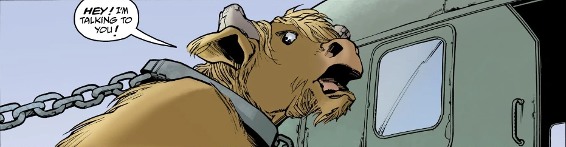

The **Minotaur** is a monster from Greece that resembles an upright bull on hooves.

## History

In 1962, Thessaly, Greece, [Hellboy](/entry/Hellboy_(character)) fought and defeated a Minotaur, breaking its horns. As it was being transported back to Athen into custody by the helicopter by the [Bureau for Paranormal Research and Defense](/entry/Bureau_for_Paranormal_Research_and_Defense), the Minotaur complained to a non-chalant Hellboy about the loss of his horns. After the monster was out of sight, Hellboy gave Agent Dryades a pair of horns from the Minotaur he broke off, stating that the Mintoaur could have them back when he behaves.

## Sources

1.  [↑](#cite_ref-1) [Night of the Cyclops](/entry/Night_of_the_Cyclops)
