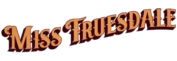

***Miss Truesdale*** is a line of comic books about the character [Margaret Truesdale](/entry/Margaret_Truesdale), a Victorian woman with ties to the Heliopic Brotherhood of Ra, and [Anum Yassa](/entry/Anum_Yassa), a Hyperborean gladiator, and how their lives are connected. It is a spinoff of the *[Hellboy](/entry/Hellboy_(series))* series, exploring the history of the Hellboy Universe.

All the stories of the series are written by [Mike Mignola](/entry/Mike_Mignola) with [Jesse Lonergan](/entry/Jesse_Lonergan) on art, the series made its debut on May 17, 2023.

## Stories Published

- *[Miss Truesdale and the Fall of Hyperborea](/entry/Miss_Truesdale_and_the_Fall_of_Hyperborea) \#1-4 (May–August 2023)*
- [Miss Truesdale and the Rise of a man](/entry/Miss_Truesdale_and_the_Rise_of_Man) \#1-4 (December 2025 – March 2026)

## Collections

*see also [**Miss Truesdale** Trade Paperback Collections](/entry/Trade_Collections)*  
*see also List of **Miss Truesdale** stories*

*Miss Truesdale* is collected in a series of hardcovers.
