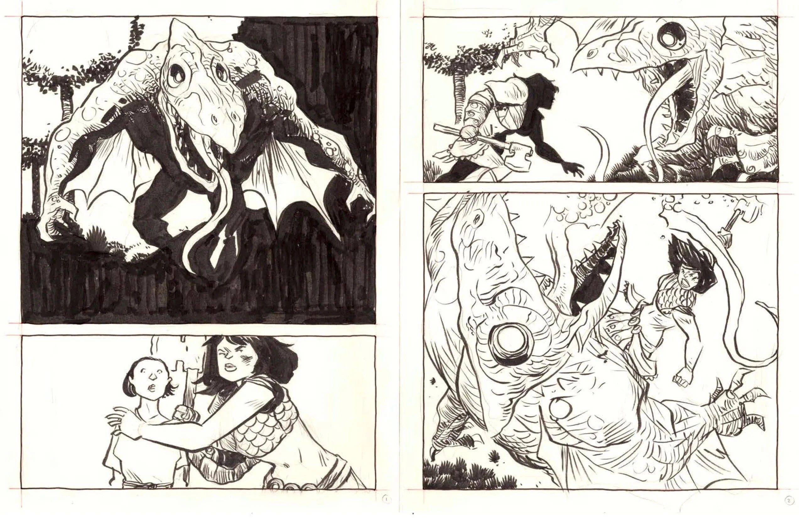
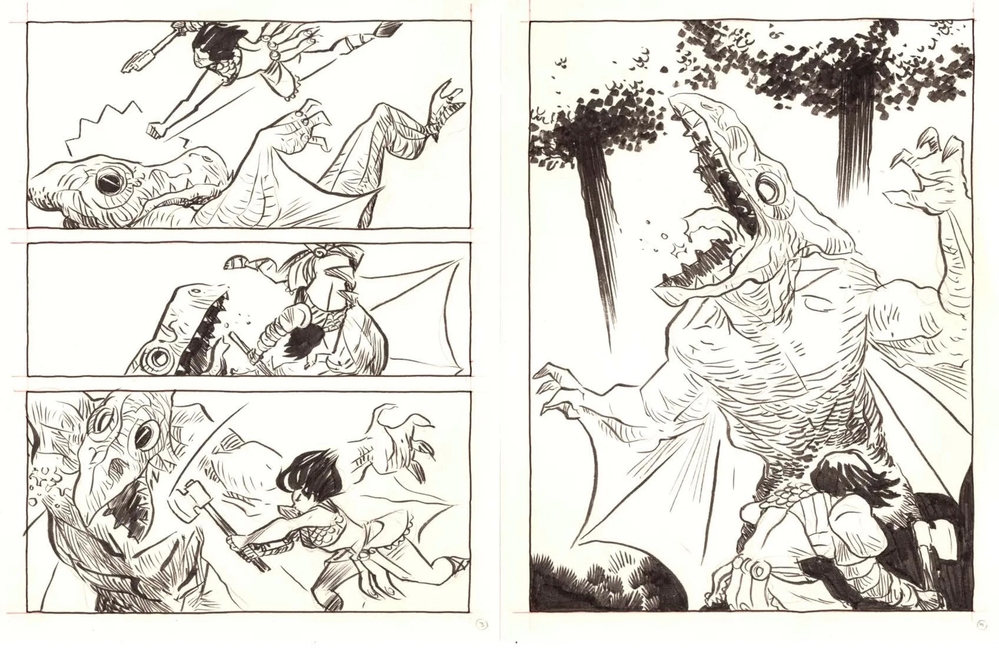
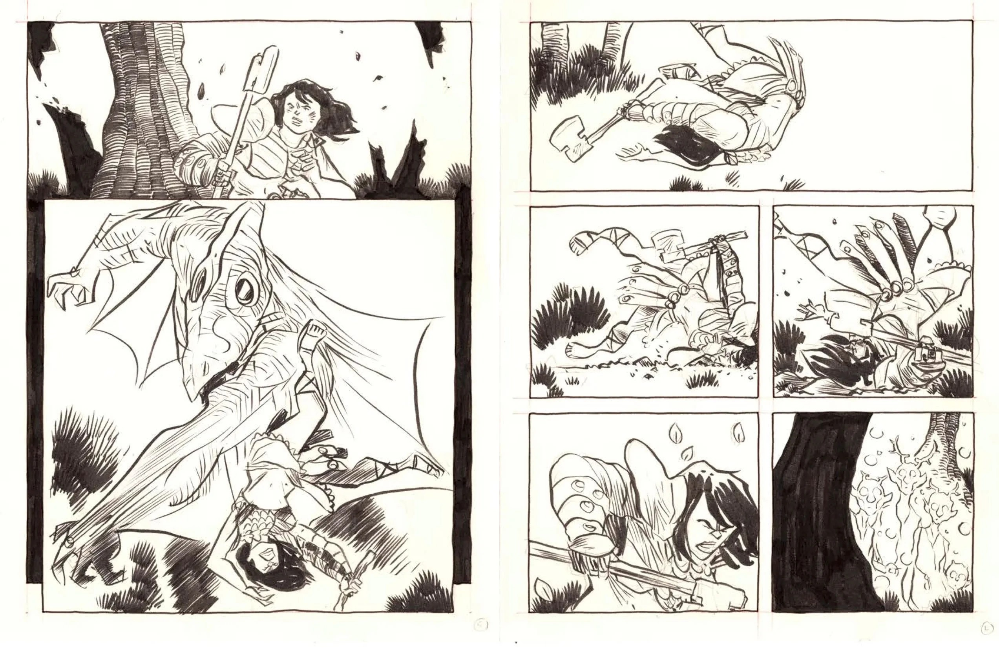
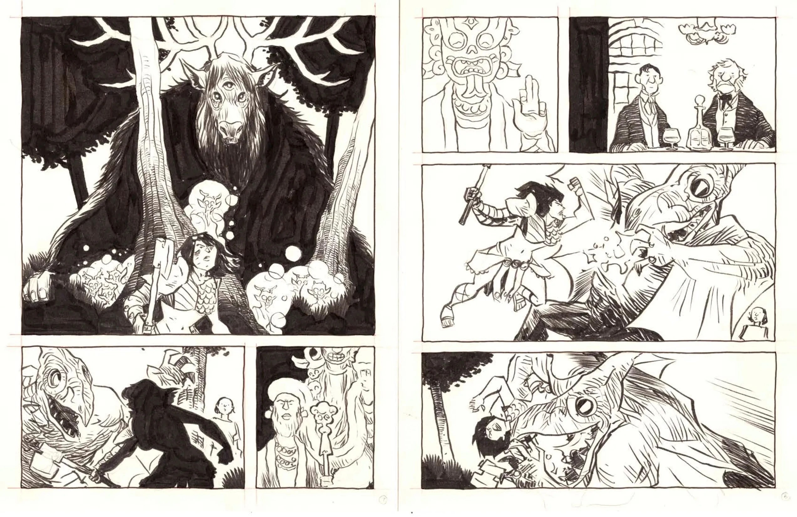
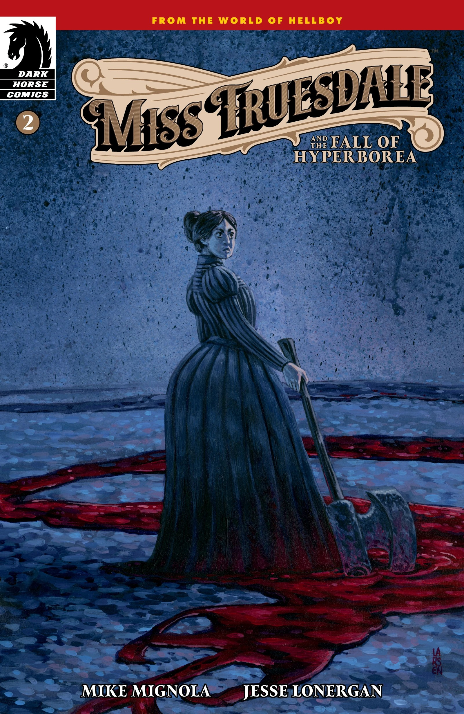
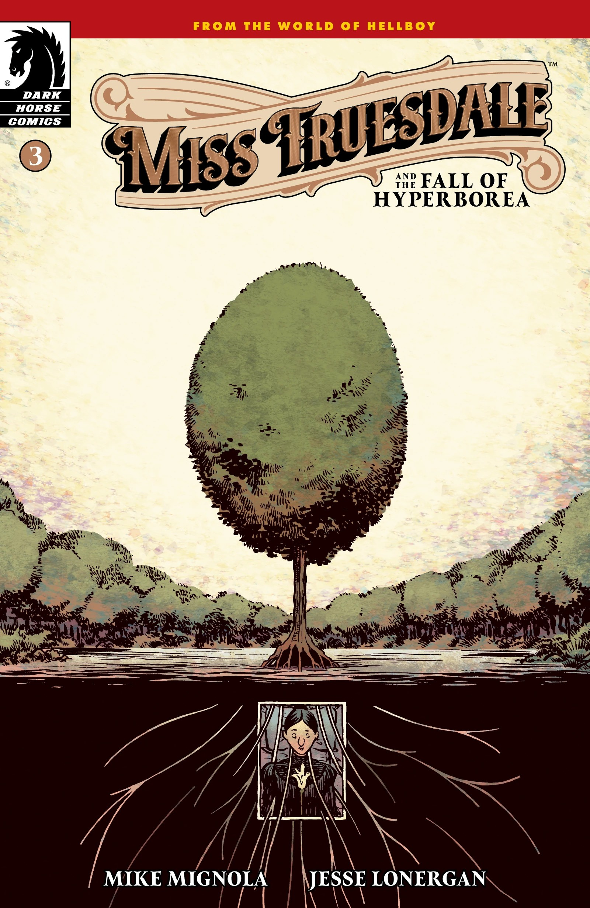
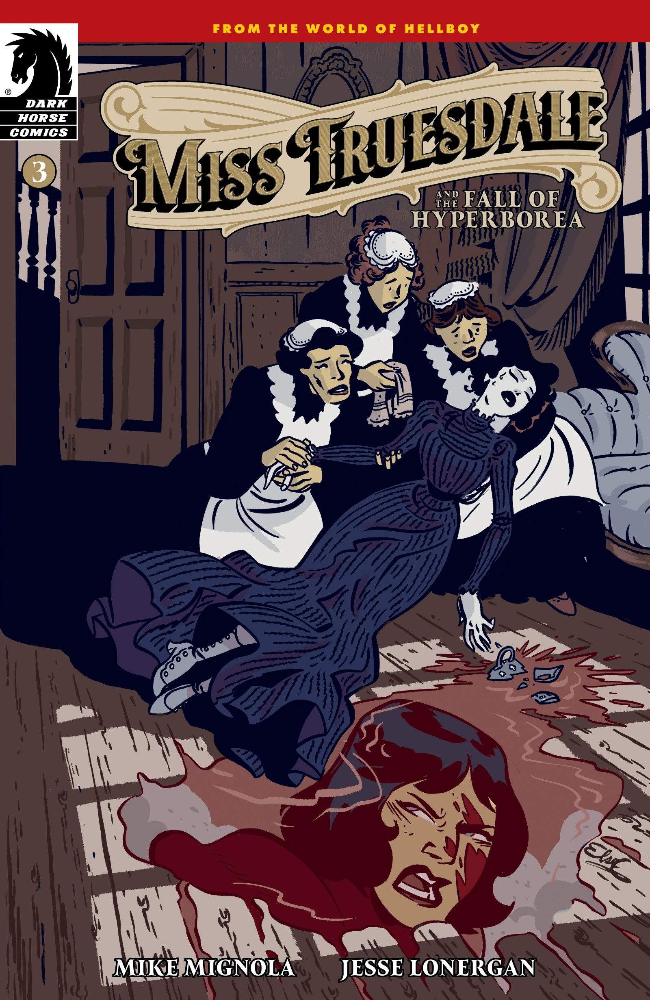
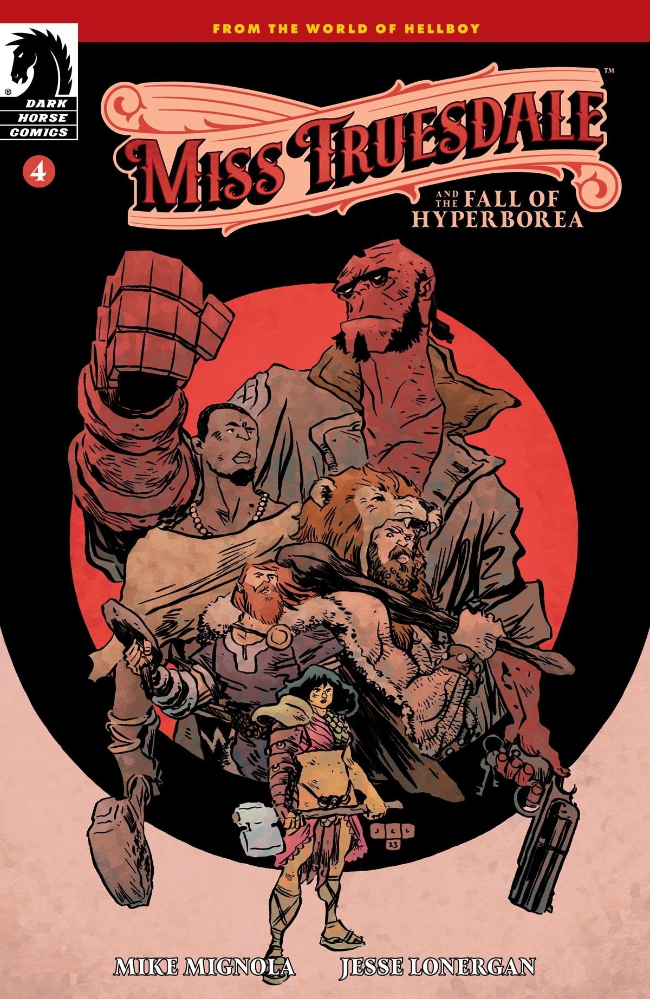
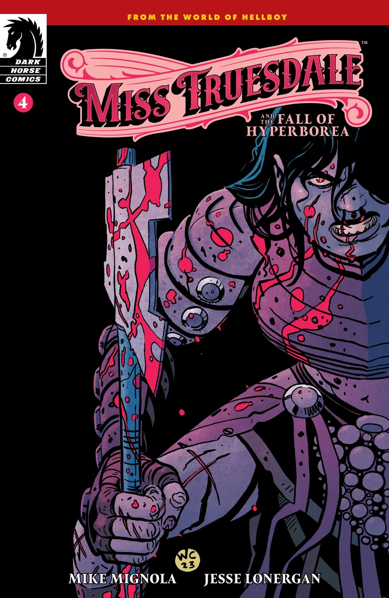

***Miss Truesdale and the Fall of Hyperborea*** is a four-issue miniseries written by [Mike Mignola](/entry/Mike_Mignola) and drawn by [Jesse Lonergan](/entry/Jesse_Lonergan). It is Lonergan's debut in the Hellboy Universe and the first arc of the [*Miss Truesdale* series](/entry/Miss_Truesdale_(series)). The story follows [Miss Truesdale](/entry/Margaret_Truesdale), a woman living in Victorian-era London, and her past life, [Anum Yassa](/entry/Anum_Yassa), a gladiator in the latter years of the Hyperborean Empire.

## Publication History

*Miss Truesdale and the Fall of Hyperborea* was announced February 2023. Mignola wrote the project loosely so that Lonergan could more fully express his sense of pacing, which was part of Mignola's attraction to his work.

## Synopsis

### Part One

One of the last followers of a failing Heliopic Brotherhood of Ra, the unassuming Miss Truesdale, finds herself on the receiving end of Brotherhood leader Tefnut Trionus’s final vision. Connecting her life in Victorian London to a young gladiator’s in ancient Hyperborea, Truesdale discovers she now has the chance to change the future by altering the bygone past.

### Part Two

After discovering a shocking truth connecting her to a gladiator from Ancient Hyperborea, the timid Victorian Miss Truesdale is forced to confront the horrifying evils and mysteries that lurk in what once felt like ancient history...

### Part Three

Hyperborea is burning, torn asunder by the fury of the first angel. As the city falls, Anum Yassa’s and Miss Truesdale’s lives intertwine, and they are drawn to face their destinies and the wrath of gods.

### Part Four

Miss Truesdale’s past, present, and future collide in a battle with a terrifying creature. Will the Victorian-era Miss Truesdale be able to claim her power, or is she doomed to be consumed by her past?

## Test pages

As a warm-up for his work on *Miss Truesdale*, Jesse Lonergan drew a sequence with Anum Yassa fighting against a monster. Lonergan did this in part to get comfortable drawing the characters, but also to study how Mike Mignola breaks down fight sequences—the test pages are constructed and composed around Mignola's own fight sequence in [*Hellboy: The Wolves of Saint August*](/entry/The_Wolves_of_Saint_August) when [Hellboy](/entry/Hellboy_(character)) fights [the werewolf William Grenier](/entry/William_Grenier).

## Cover gallery

Standard covers by [Jesse Lonergan](/entry/Jesse_Lonergan).

Issue \#1

Issue \#1 variant cover  
by Mike Mignola  
with Dave Stewart

Issue \#2

Issue \#2 variant cover  
by Christine Larsen

Issue \#3

Issue \#3 variant cover  
by Elsa Charretier

Issue \#4

Issue \#4 variant cover  
by Wes Craig  
with Chris O'Halloran

## Gallery

|

|

|

|

|Issue #2 variant cover by Christine Larsen

|Issue #3

|Issue #3 variant cover by Elsa Charretier

|Issue #4

|Issue #4 variant cover by Wes Craig with Chris O'Halloran
