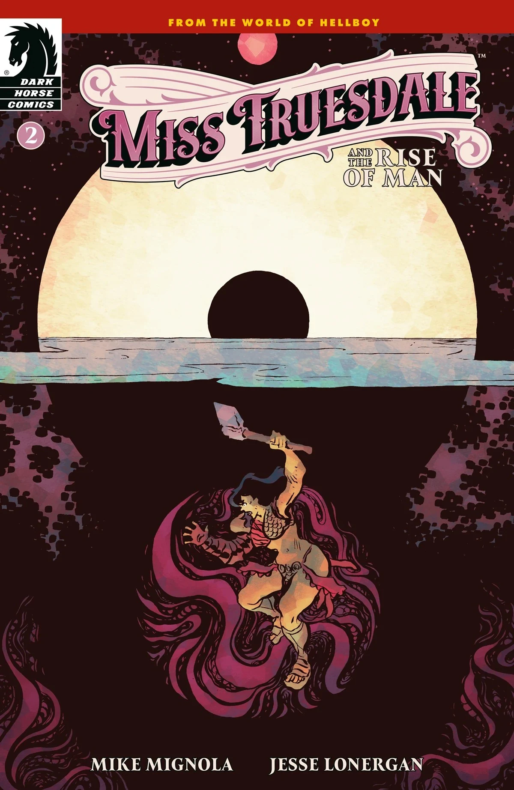
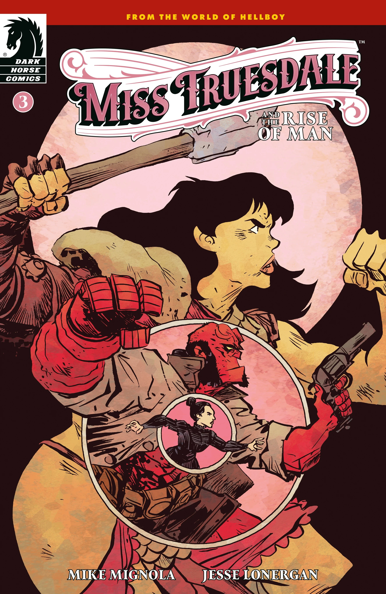
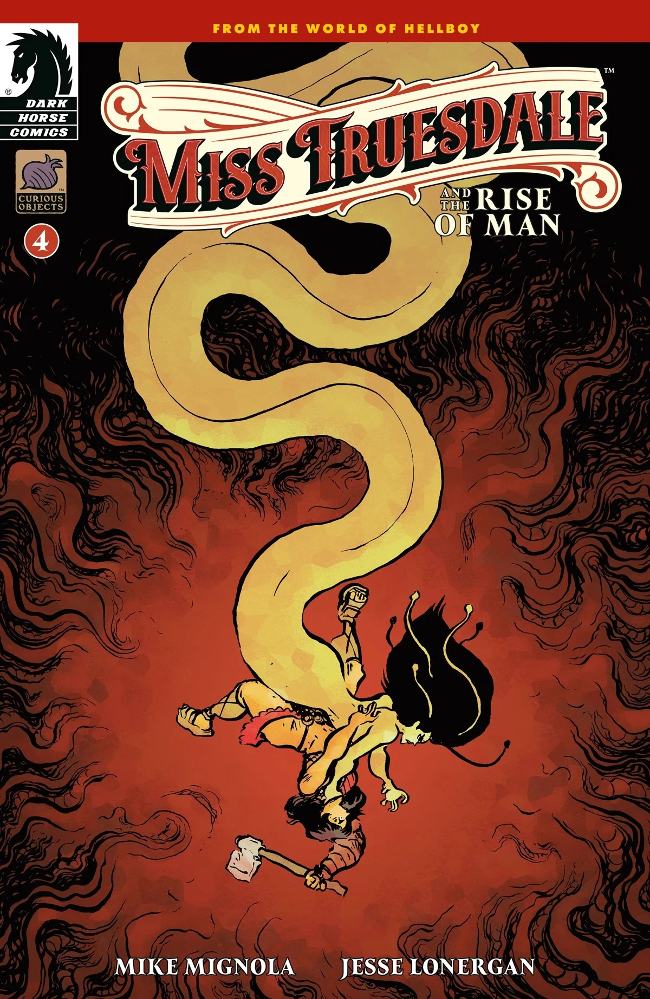
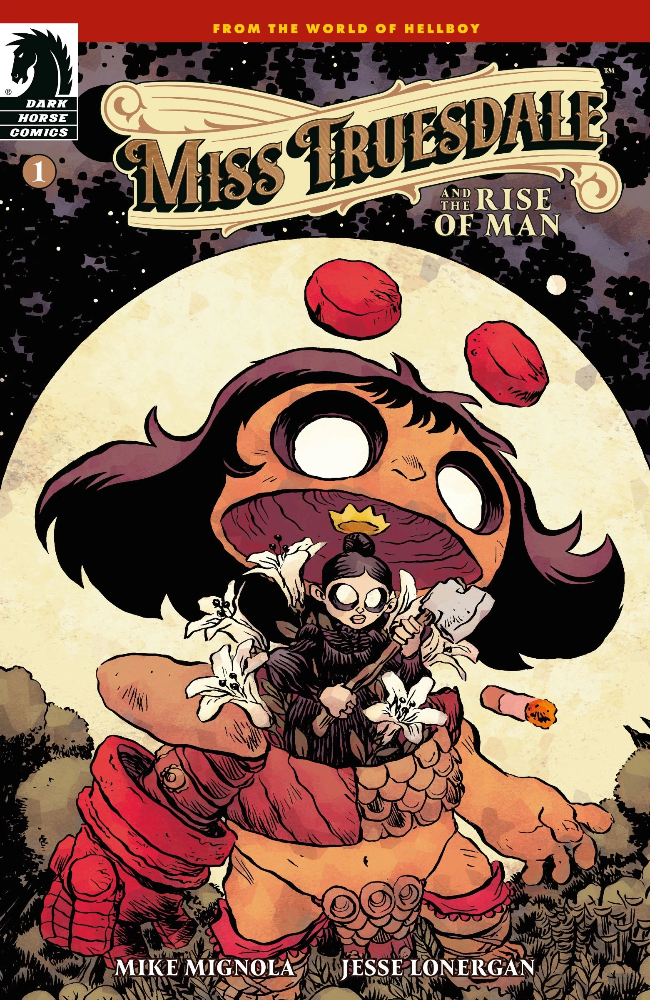
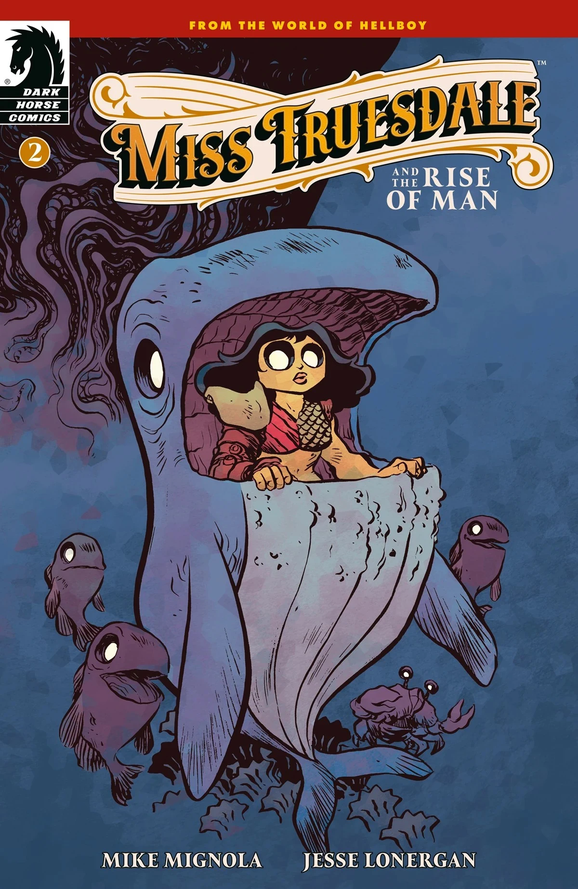
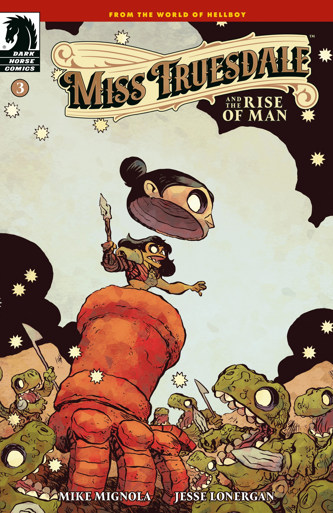
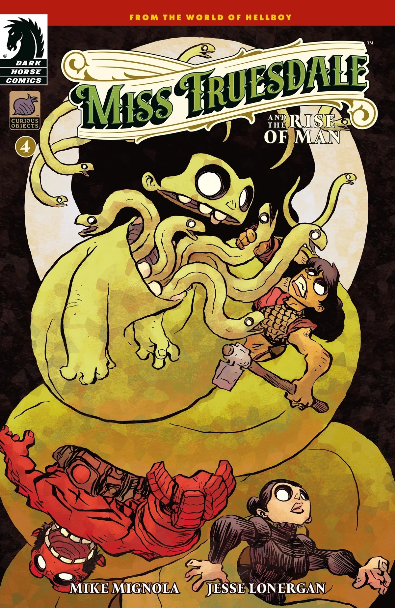

***Miss Truesdale and the Rise of Man*** is a four-issue miniseries written by [Mike Mignola](/entry/Mike_Mignola) and drawn by [Jesse Lonergan](/entry/Jesse_Lonergan). It the second arc of the [*Miss Truesdale* series](/entry/Miss_Truesdale_(series)).

## Publication History

*Miss Truesdale and the Rise of Man* was announced August 2025. Mike Mignola said the idea stemmed from his increasing interest in the origins of the Hellboy Universe since the [*B.P.R.D.* series](/entry/B.P.R.D._(series)) wrapped up.

## Synopsis

### Part One

The gladiator Anum Yassa wanders the forest to learn about her lives—past, present, and future. But she isn’t a hero to all, as one darker entity will hunt her until she can be stopped—and the fate of man stopped with her.

### Part Two

Anum Yassa manages to evade defeat once, but only until another tries to intervene in her destiny.

### Part Three

After being attacked by a horde of monstrous creatures, Anum Yassa is dragged before their king who is part of an even darker legacy than she can imagine.

### Part Four

Gladiator Anum Yassa comes face to face with the one who has been trying to defeat her in a final battle that will determine the fate of mankind.

## Cover gallery

Covers by [Jesse Lonergan](/entry/Jesse_Lonergan).

Issue \#1

Issue \#2

Issue \#3

Issue \#4

### Variant covers

Issue \#1 variant cover
Issue \#2 variant cover
Issue \#3 variant cover
Issue \#4 variant cover

|Issue #2

|Issue #3

|Issue #4

|Issue #1 variant cover

|Issue #2 variant cover

|Issue #3 variant cover

|Issue #4 variant cover
