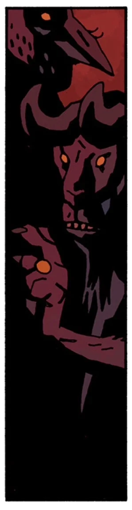

**Moloch/Molech/Molek** was a [demon](/entry/Demon) and a prince of [Hell](/entry/Hell).

## History

### Punishing Azzael

Moloch was one of the many princes of Hell angry at [Azzael](/entry/Azzael) for putting the [Right Hand of Doom](/entry/Right_Hand_of_Doom) on [his son](/entry/Hellboy_(character)), and send the [Angels of Destruction](/entry/Angels_of_Destruction) to destroy his castle.

### [In the Chapel of Moloch](/entry/In_the_Chapel_of_Moloch)

[Hellboy](/entry/Hellboy_(character)) described Moloch as *"one of the old Middle Eastern God-Monsters,"* who is mentioned in the Bible a few times. The ancient Canaanites and Phoenicians worshiped Moloch as a sun god, and appeased him with sacrifices of children, a practice which was reviled by the Israelites.

During the Middle Ages, a cult built a chapel to Moloch in Tavira, in southern Portugal, before they were purged by the [Order of the Knights of Saint Hagan](/entry/Order_of_the_Knights_of_Saint_Hagan). The Knights slaughtered the cultists and destroyed their idols, but, as Hellboy also said, *"a lot of the time, the **really** bad stuff... it doesn't go away completely."*

In 1992, Hellboy answered a call from an art agent whose friend, a struggling painter named Jerry, had rented the house attached to the chapel, and converted the chapel into a studio. Hellboy discovered that, under the influence of a minor [demon](/entry/Demon), coming up from a hole in the floor, Jerry had sculpted a huge clay statue of Moloch, with a real beating heart at its center. Hellboy destroyed the statue and drove the demon below ground, recommending to Jerry and the agent that the landlord tear down the chapel - or, at the very least, plug the hole in the floor.

### [Hellboy in Hell](/entry/Hellboy_in_Hell_(series)) ([The Spanish Bride](/entry/The_Spanish_Bride))

Following the death of [Satan](/entry/Satan) at the hands of Hellboy, as well as the death of Grand-Duke [Astaroth](/entry/Astaroth), the realm of [Hell](/entry/Hell) fell into chaos, with many of the slave-demons rising up against the countless princes and duke of Hell. Moloch, alongside [Shax](/entry/Shax), Usiel, Raum, Semyaza, Belial and Dagon were killed during these uprisings.

## Non-Canon Story

### [Hellboy: On Earth as it is in Hell](/entry/Hellboy__On_Earth_as_it_is_in_Hell)

***N.B.**: This information is not canon.*

Much of what is known (or thought to be known) about Moloch comes from later generations' attempt to understand references to it in Biblical-era texts, and some of the "research" ranges from the questionable to the outright sensationalist. For instance, French novelist Gustave Flaubert wrote a best-selling novel called "Salammbô" taking place in ancient Carthage (the cultural descendants of the Phoenicians) describing the sacrifice of infants using a mechanized statue with a fire pit in its belly.

According to [Katherine Corrigan](/entry/Katherine_Corrigan), Flaubert's novel is largely responsible for the popular image of Moloch as a man with the head of a bull, since that is how Flaubert described the statue.

The last documented instance of Moloch worship was a cult named *Der Horn Ordern* (the Order of the Horn) founded in Weimar Republic Germany by Matthias Herzog, a World War I veteran-turned-occultist. The cult abruptly disappeared without trace before the rise of the Thule Society and the cabal led by [Grigori Rasputin](/entry/Grigori_Rasputin) that summoned [Hellboy](/entry/Hellboy_(character)), but eyewitness accounts suggest that Herzog had as many as 870 followers.

Moloch was later identified by the [B.P.R.D.](/entry/Bureau_for_Paranormal_Research_and_Defense) as the architect of a plot to steal the **Masada Scroll**, a controversial document in the Vatican's archives supposedly proving that Jesus Christ actually lived for several decades after the date of his crucifixion. Moloch planned to use it to start a holy war, eventually causing so much bloodshed and hatred on Earth that Hellboy *"saw the doorway to Hell swinging wide open."* Hellboy retrieved the scroll and destroyed the temple to Moloch that Herzog and his followers had built.

## Background Information

Moloch (or Molech) appears in the Bible, in connection with child sacrifice. For example, Leviticus 18:21, *"And you shall not let any of your seed pass through l'Molech, neither shall you profane the name of your God: I am the Lord."*

The image of Moloch presented in the comics developed out of later medieval traditions attempting to understand the biblical text. Modern scholarship continues to debate the exact identity and historicity of the figure. Some even suggest the term refers not to a deity, but rather to a type of sacrifice.

## External Links

- Moloch at Wikipedia
