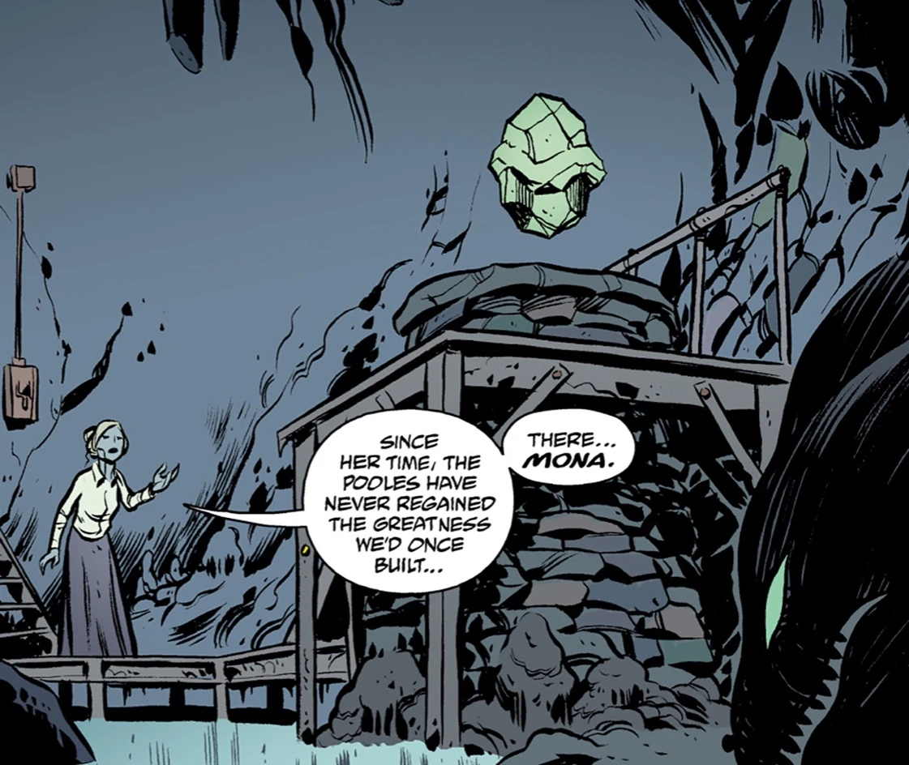

The **Mona** is a crystalline egg worshiped by the Unlanders. Using its power the artefact could control the waters around Hallam Halt. Only the cult leader of the Unlanders, the Mere, is allowed access to the Mona. Later its revealed to be a vessel for one of the [Ogdru Hem](/entry/Ogdru_Hem), [Istra-Hem](/entry/Istra-Hem).

## History

In 1881 the Mona was used by the Unlanders in an attempt to flood Hallam Halt as revenge for the Britains for violating their land.

In 2004 Abraham Sapien was sent to negotiate with the Unlanders again. Seeing his aquatic nature the Mere brought him to see Mona. Abe seeing it similar to the entity that changed him senses there was a connection before he could examine it further the [Huang eels](/entry/Guardians_of_Mona) attacked him. They declared him as a threat to Mona and was a herald to the end. The cave contained Mona was flooded and Abe was left with more questions than answers.
