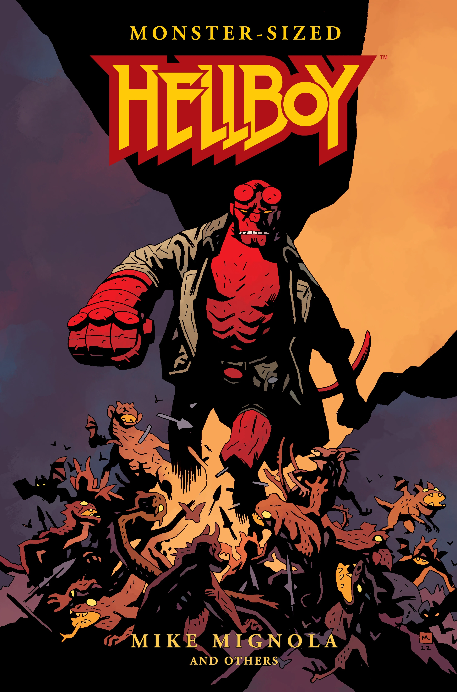

*This article is a stub. You can help Hellboy Wiki by expanding it.*

Monster-Sized Hellboy is an oversized hardcover book that collects the contents of the four numbered [Hellboy](/entry/Hellboy_(series)) [Omnibus Editions](/entry/Omnibus_Editions) (Seed of Destruction, Strange Places, The Wild Hunt and Hellboy in Hell). The book doesn't include the supplementary material (sketchbook sections), or any of the Hellboy stories set before [Seed of Destruction](/entry/Seed_of_Destruction), excluding the contents of [The Complete Short Stories](/entry/Omnibus_Editions) omnibuses and both of the untitled "World's Greatest Paranormal Investigator" promo stories form [San Diego Comic Con](/entry/World's_Greatest_Paranormal_Investigator_(SDCC)) and the [Comic Buyer's Guide](/entry/Trade_Collections) (typically collected with Seed of Destruction). It was released on November 1st, 2023.

## Contents

- [Seed of Destruction](/entry/Seed_of_Destruction)
- [The Wolves of Saint August](/entry/The_Wolves_of_Saint_August)
- [The Chained Coffin](/entry/The_Chained_Coffin)
- [Wake the Devil](/entry/Wake_the_Devil)
- [Almost Colossus](/entry/Almost_Colossus)
- [Right Hand of Doom](/entry/Right_Hand_of_Doom)
- [Box Full of Evil](/entry/Box_Full_of_Evil)
- [Being Human](/entry/Being_Human)
- [Conqueror Worm](/entry/Conqueror_Worm_(story))
- [The Third Wish](/entry/The_Third_Wish)
- [The Island](/entry/The_Island)
- [Into the Silent Sea](/entry/Into_the_Silent_Sea)
- [The Mole](/entry/The_Mole)
- [Darkness Calls](/entry/Darkness_Calls)
- [The Wild Hunt](/entry/The_Wild_Hunt)
- [The Storm](/entry/The_Storm) and [the Fury](/entry/The_Fury)
- [Hellboy in Hell Chapters 1 to 4](/entry/Hellboy_in_Hell_(first_story_arc)) ("The Descent", "Pandemonium", "Family Ties" and "Death Riding an Elephant")
- [The Three Gold Whips](/entry/The_Three_Gold_Whips)
- [The Death Card](/entry/The_Death_Card) (Excluding the prologue from the [Trade Paperback Collection](/entry/Trade_Collections))
- [The Hounds of Pluto](/entry/The_Hounds_of_Pluto) (With the first chapter renamed to "The Trials of Dr. Hoffmann", like in other collected editions)
- [The Spanish Bride](/entry/The_Spanish_Bride)
- [For Whom the Bell Tolls](/entry/For_Whom_the_Bell_Tolls)
- [The Exorcist of Vorsk](/entry/The_Exorcist_of_Vorsk)
- [The Magician and the Snake](/entry/The_Magician_and_the_Snake)
