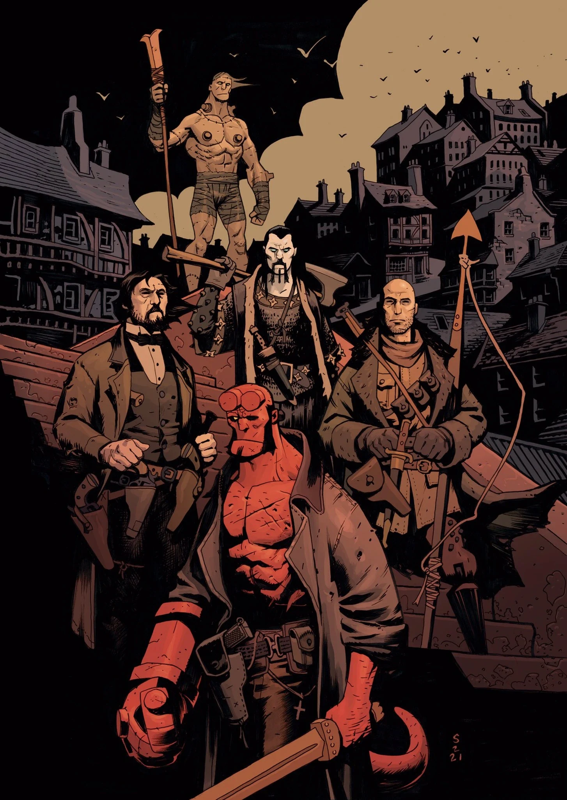

***Frankenstein: New World*** is a four-issue miniseries written by [Mike Mignola](/entry/Mike_Mignola), [Christopher Golden](/entry/Christopher_Golden), and [Thomas Sniegoski](/entry/Thomas_E._Sniegoski) with art by [Peter Bergting](/entry/Peter_Bergting). It is the first arc in the [*Frankenstein: New World* story cycle](/entry/New_World_(Frankenstein_story_cycle)).

## Publication History

*Frankenstein: New World* was announced May 17, 2022. The story was originally inspired by an image drawn by [Ben Stenbeck](/entry/Ben_Stenbeck) as a stretch goal for the Mike Mignola: Drawing Monsters documentary Kickstarter which depicted Frankenstein holding the Hyperborean blade affixed to a staff.

## Synopsis

### Part One

Safely tucked away inside the hollow earth where humanity survived after Ragna Rok, precocious young Lilja receives visions of a new darkness taking root on the surface. Defying her elders, Lilja awakens the timeless oracle—once known as Frankenstein—to investigate the warnings and, perhaps, even explore the new world above.

### Part Two

As Lilja and Frankenstein explore the vibrant world around them, they rescue someone who introduces them to the new race of man. But unbeknownst to them, evil lurks within the shadows, tracking our heroes while sowing seeds of death and destruction.

### Part Three

Having made contact with some of the new worlds mysterious inhabitants, Frank and Lilja continue their search for the "Star Lady." But the danger they're trying to prevent has already caught their scent literally and now it's a race for what could be the fate of the reborn world.

### Part Four

Lilja and Frankenstein's exploration of the surface world takes a dangerous turn—between monstrous people and genuine monsters, not everyone will survive.

## Gallery

All covers by [Peter Bergting](/entry/Peter_Bergting) unless otherwise stated.

Issue \#1

Issue \#1 variant cover by Mike Mignola and Dave Stewart

Issue \#2

Issue \#2 variant cover by David Hitchcock

Issue \#3

Issue \#3 variant cover by Laurence Campbell and Quinton Winter

Issue \#4

Issue \#4 variant cover by Ben Stenbeck
