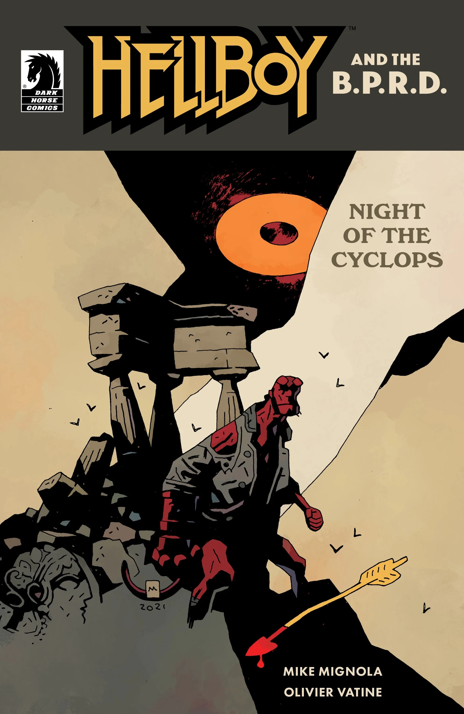

***Night of the Cyclops*** is a one-shot arc of *[Hellboy and the B.P.R.D.](/entry/Hellboy_and_the_B.P.R.D.)* written by Mike Mignola and Olivier Vatine. Vatine also illustrated the issue.

## Synopsis

Just as he finishes up one job in Greece, Hellboy is detoured into another adventure by. . . a goat? Join Hellboy in a strange hidden land of treachery and togas as he takes on the wrath of a jealous god.

## Gallery

*Hellboy and the B.P.R.D.:  
Night of the Cyclops*  
by Olivier Vatine

*Hellboy and the B.P.R.D.:  
Night of the Cyclops*  
by Mike Mignola and Dave Stewart

|Hellboy and the B.P.R.D.: Night of the Cyclops by Mike Mignola and Dave Stewart
## Content

### Characters

#### B.P.R.D.

- [Hellboy](/entry/Hellboy_(character))
- Agent Dryades

#### Greek mythology

- The cursed satyrs
  - [Ælita](/entry/%C3%86lita)
  - Sibyl
- Greek monsters
  - [Minotaur](/entry/Minotaur) (cameo)
  - Cyclops
- Greek gods
  - [Aphrodite](/entry/Aphrodite)
  - Eros

### Location

- Greece
  - Thessaly
