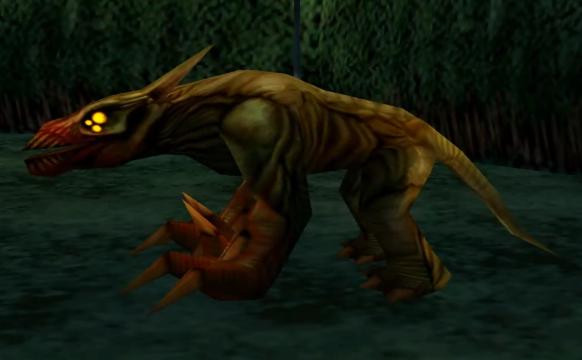

The **Nohox Kanis** are the demons from the *[Hellboy: Dogs of the Night](/entry/Hellboy%3A_Dogs_of_the_Night)* game.

## Background

These ancient demons are said to be "older than God" and wait at the edge of our reality, waiting for evil to overturn the present order. Physically, they resemble large dogs, with ferocious claws and teeth. They assume many forms, but are universally regarded as one of the great lurking threats to humanity.

Nearly 700 years ago, the Nohox Kanis attempted to enter our world and bring about eternal night. At that time a monk named [Kalin](/entry/Kalin) embraced the ancient evil of the Nohox Kanis, and has allied himself with them to create a portal between Hell and Earth. They were defeated by Kalin's brother, [Mitri](/entry/Mitri).

Later, an imminent eclipse of the moon offered the Nohox Kanis another chance enter our world. Ultimately, [Hellboy](/entry/Hellboy_(character)) defeated Kalin and Nohox Kanis.

## Gallery

|
