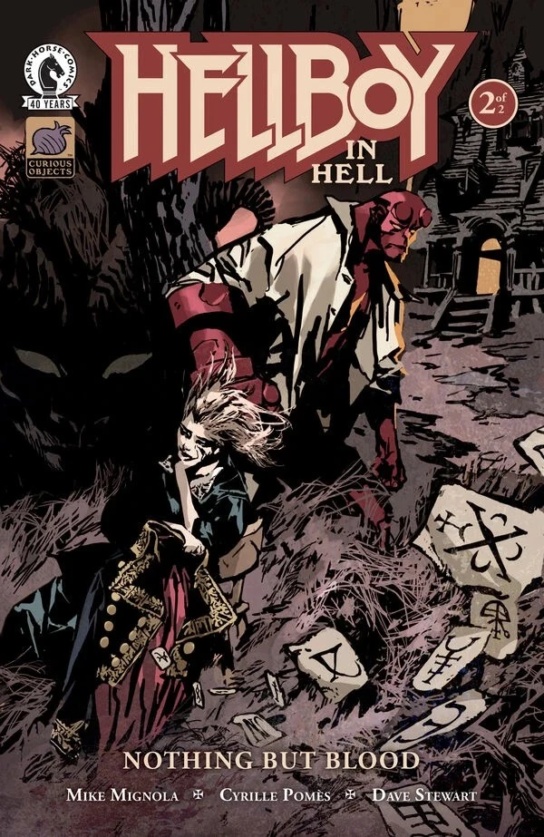

***Nothing But Blood*** is a two-issue miniseries written by [Mike Mignola](/entry/Mike_Mignola) and illustrated by [Cyrille Pomès](/entry/Cyrille_Pom%C3%A9s) in his Hellboy Universe debut. The story is set between [*Hellboy in Hell* \#8](/entry/The_Hounds_of_Pluto) and [\#9](/entry/The_Spanish_Bride).

## Synopsis

### Part One

Hellboy steps in to save a young woman being chased by winged beasts deep in Hell in the midst of an uprising against the most powerful demons. But nothing—and no one—are what they seem to be.

### Part Two

After mistakenly falling in with a demon in his quest to save an innocent, Hellboy finds himself at the center of Hell in the midst of the fallout from Satan’s murder.

## Gallery

*Hellboy in Hell: Nothing But Blood* \#1  
by Cyrille Pomès

*Hellboy in Hell: Nothing But Blood* \#1  
variant by Mike Mignola with Dave Stewart

*Hellboy in Hell: Nothing But Blood* \#2  
by Cyrille Pomès

*Hellboy in Hell: Nothing But Blood* \#2  
variant by Marc Riou

|Hellboy in Hell: Nothing But Blood #2 variant by Marc Riou
