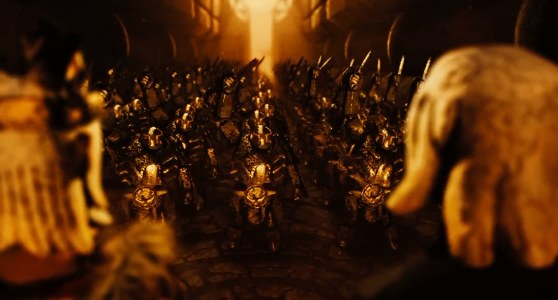
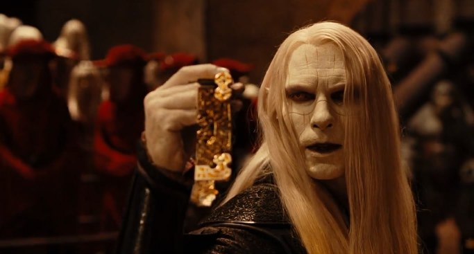
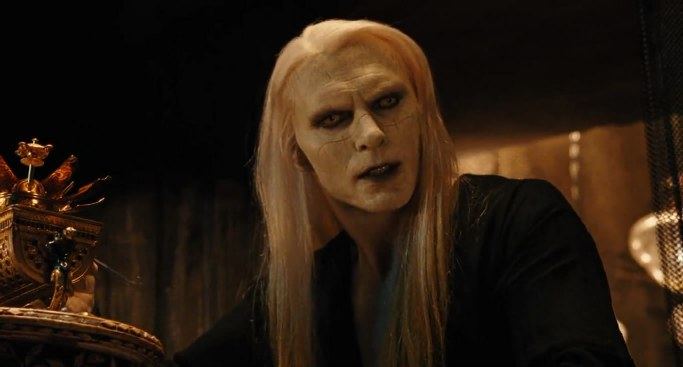
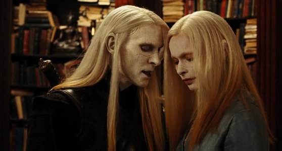
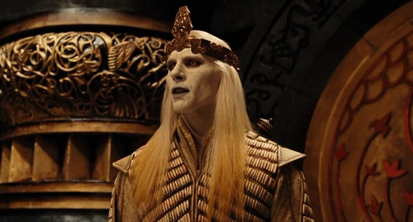

**Nuada Silverlance** is the Crown Prince of the Bethmoora clan (also known collectively with other magical races as the 'sons of the earth'), he is also the main antagonist in the second *Hellboy* film, *[Hellboy II: The Golden Army](/entry/Hellboy_II__The_Golden_Army)*, and the last warrior of the elves. He is the only son of the King, [Balor](/entry/Balor), and the twin brother of [Nuala](/entry/Nuala). He attended creation and the reception of the [Golden Army](/entry/Golden_Army). Nuada is anti-humanistic and focused on preserving only his own kind and other non-human lives, destroying all people, but is not an absolutely evil being; rather, he blames humanity for all the unhappiness of man to life and considers their destruction will benefit non-humans.

## Biography

### War against Humankind

According to the beliefs of the magical realm, humans and the races of elves, goblins, ogres, fairies, trolls, and other creatures once lived in harmony. The greed of humanity, however, caused a great desire for conquest in them and they warred against the mystical woodland creatures. King Balor (Prince Nuada's father), who ruled the elves and the magical races, watched his people undergo slaughter at the hands of the humans. Nuada likely participated in the battles and, as seen at the beginning of the film *Hellboy II: The Golden Army*, bears many scars on his back and shoulders from battling for the protection of his kind.

The newly created Army

One day, a master goblin blacksmith came to King Balor to offer the construction of a mechanical army -- [the Golden Army](/entry/the_Golden_Army). Nuada persuaded his father to accept the offer. The Golden Army then butchered the humans, not dividing innocent from warrior or male from female or adult from child. The destruction, Balor realized, surpassed what the humans had done to them. Horrified by this massacre, the King sealed the Golden Army away and declared a truce with humanity by dividing the [magic crown](/entry/Crown_of_Bethmora) controlling [them](/entry/The_Golden_Army) into three pieces; keeping two for the elves and giving one to humanity.

Nuada was enraged by this act, believing not only that the humans could not be trusted, but that he could have commanded the army more efficiently. He went into self-imposed exile, swearing to return the day when his people would most need him. Alongside him was his companion, a one-eyed one tusked cave [troll](/entry/troll) named [Mr. Wink](/entry/Mr._Wink), as he prepared for the day when he would rise up once more.

### Return

Nuada trod the earth pondering his own life and watching the lives of man and magical creature. The prince saw mankind slaughter one another in the name of greed and watched all the other magical races receded into obscurity. Resolved that he must end the silent destruction of the magical world and sensing that the planet was reaching a crossroads leading to destruction (in the movie novelization Nuada references that the wiser humans have sensed the need to act as well, possibly commenting on the fact he was aware of environmentalist activity, but was not impressed enough with it to find humans worth saving at all). He decided to reclaim the Golden Army and do what should have been done centuries before.

Nuada reveals his intentions

The prince tracked the crown until, centuries later, he followed it into an auction house to steal it. He then proceeded to kill the entire attendance of the auction by releasing a swarm of [Tooth Fairies](/entry/Tooth_Fairies) and leaving behind two markings that would symbolize to humanity that he had declared war. He went to his father's palace and revealed his intention to re-awaken the Golden Army and wage war on the human world. He pointed out the humans' commercialization, conquest, and 'rape' of the world. He knew that the magical races will fade and points out that they are already living in squalor and have nowhere else to go. Then the king, willing to resign themselves to such a fate years before relocating to the Americas, decided to have his son executed. Nuada, heartbroken (knowing that his father is also killing his innocent twin sister, Nuala), then killed all the guards in the room, before impaling his father. He wept momentarily and claimed his father's piece of the crown, then turned around, but his sister was gone along with the last crown piece.

Nuada learns of Mr. Wink's death

While preparing an odd seed of life in a mechanical holder (Nuada was apparently versed in goblin machinery and tinkering), Nuada heard from a two-headed creature that his servant [Mr. Wink](/entry/Mr._Wink) was defeated by Hellboy. Furious, Nuada came up to the surface to kill Hellboy and unleash the seed into a forest god that would purge the area of humans and their buildings. When Hellboy aims to destroy the 'forest god' or 'forest elemental', Nuada taunted him to either spare or kill the towering tree, for it was the last of its kind. He said Hellboy had more in common with the magical beings than the humans. The forest spirit was killed and Nuada disappeared as his sister, still bearing her own crown piece and determined to keep her brother from succeeding, followed along with Hellboy and the BPRD agents around him, specifically [Abraham Sapien](/entry/Abraham_Sapien).

Nuada found his sister

Nuada tracked his sister to [BPRD](/entry/Bureau_for_Paranormal_Research_and_Defense) headquarters. She attempted to burn the map leading to Bethmoora that would give him the secret location of the Golden Army. However, Nuada revealed that the real map was on the canister she obtained, not the paper map as she had presumed. Hellboy tried to fight the bellicose prince, but is thoroughly thrashed and mortally wounded by the cunning Nuada. He wounded the demon with a shard of his magical silver spear (apparently the reason for his film-based epithet, Silverlance). He took his sister, demanding to Abe Sapien, with whom Nuala had become very fond and tender, to give him the last piece of the crown since it remained hidden in the BPRD library.

### Final confrontation

Challenge accepted

He vanished with Nuala and traveled to the [resting place](/entry/Bethmora) of the Golden Army. Fearing for Nuala's life, Abe and the others followed to Ireland where Hellboy was healed. To the dismay of the others, Abe had brought the last piece of the crown and gave it willingly to Nuada. Hellboy, a prince of sorts himself, challenged Nuada's right to the crown in a duel (Nuala reminded her brother that the demon was considered royalty in Sheol).

After a fierce fight, Hellboy claimed victory without claiming Nuada's life, but the prince would not live so disgraced. He attempted to attack Hellboy with his back turned, only for his sister to take her life to end his, stabbing herself with a dagger. Dying, Nuada warns Hellboy that his place is not among humans and he will never be accepted by them. He mourned and stated that the world would be poorer for losing both himself and his sister. Nuada then walks away towards the balcony his sister is laying on in Abe's arms. Uttering the last words "Nuala, my sister", Nuada turns to stone, falls to his knees and crumbles into pieces.

## Personality

Nuada was a complex character. His desire to better the lives of his people and the lives of other magical races were by no means evil, but his plans to achieve this and hatred of all humankind were more malevolent. Nuada was a fierce and courageous warrior and proud of his heritage. His hatred of humans stems from the devastating war between them and his own race, as well as the humans destruction of the planet. Although his intentions were noble, Nuada was still willing to go to extreme lengths to achieve his goals and had no issue whatsoever with killing potentially millions of humans, many of whom were innocent or ignorant of the crimes against his people, or with killing anyone who got in his way. He was even willing to kill his own father, whom he professed to love, and use his beloved sister in his plans, letting nothing deter him.

Nuada was reasonably intelligent and could be quite cunning and manipulative, which he used to his full advantage. He was vengeful, stubborn to a fault and genuinely believed his actions would lead to a better world, seeming to be of the opinion that 'the ends would justify the means'. Nuala was the person Nuada seemed to love most in the world - he seemed genuinely concerned when his own injuries affected her and was caring of her. He seemed shocked and hurt when Nuala - in his eyes - betrayed him in the end, his last words being "Nuala, my sister". It is hinted throughout the film (and explicitly stated by Luke Goss, the actor who portrays him) that Nuada's feelings for Nuala go beyond that of familial love and that actually he harboured an incestous romantic attraction towards her (which Nuala did not reciprocate - at least during the timespan the film deals with; she does speak to him differently than to others, including Abe Sapien). This is implied by his overly close proximity to her in their scenes together and by his reaction to her burgeoning relationship with Abe Sapien, which some felt was closer to that of a jealous lover than an overprotective brother.

Despite his flaws, Nuada did have good traits. He seemed very tolerant and accepting of other races (save for humans), clearly loved his sister and was also genuinely caring towards his followers, in particular Mr Wink. He attempted to sway Hellboy to his way of thinking, believing that the humans would never accept them and that he had more in common with Nuada than them. It is implied that he doesn't harm animals as he killed the guards outside the BPRD building but spared the guard dog. However, his narrow-sightedness when it came to humans - believing them all to be monsters incapable of reasoning and tolerance - obsession with vengeance and inability to let go of his rage and bitterness ultimately made him a villainous character and led to his downfall.

## Other Facts About Prince Nuada

### Weaponry

Nuada carries a sword and spear (or lance) forged by magical silver. The spear is also retractable, and bears a special tip that can inflict a mortal wound even on immortal creatures. The spear's lethality is increased with its ability to magically detach the tip of its spearhead when impaled to a living being's flesh at the user's will and regenerate the lost tip. The detached spearhead cannot be removed by conventional means as slight disturbances on it will cause the spearhead to move closer to the victim's heart. His sword, has a special shape with a groove cut at its center to catch and dispatch the blades of enemies.

### Hobbies and Interests

Nuada differed greatly from the majority of his own kind in his appreciation for the other magical races. He seemed to enjoy time among trolls, goblins, ogres, and other breeds of fairy (yet somehow felt humans were vile creatures). He also bears a distinct fascination with goblin-mechanics. Nuada can be seen, therefore as a sort of magical 'techno-geek' who loved making and fixing things himself (the film shows an array of tools in his possession including an anvil). It can be inferred by the viewers of the film and readers of the novel that he also created the mechanical hand for his man at arms, Wink.

### Age

Nuada appears to be nearly middle-aged for an elf, but still fairly young in strength and focus. It is generally accepted that he is the human equivalent of the actor portraying him (Luke Goss at age 40) and could be seen between 4,000 and 8,000 years by human standards. His twin seems far younger in appearance at times, but this is attributed to her lack of experience by comparison.

### Markings

Nuada bears the trademark 'royal scar' that all of the ruling class of elves show (see Nuala wiki for details) but also bears distinguishing differences between himself and the rest of his kind. Nuada's eyes and mouth are tinted very dark, appearing very deep blue or black depending on light and health. There is no explanation in the film, novelization, or comic about Nuada's strange markings, but several people have attempted to explain it. The actors and several fans have attributed the dark markings to being a physical embodiment of the darkness that consumed his mind and spirit. Other fans speculate that it was a spell, a rite of passage among the trolls, or a personal preference to heighten both the ferocity of his appearance and to magnify his ability to see and move about in the dark.

The novelization mentions that to most of their kind, Nuala and Nuada both appear strange and somewhat unattractive (the other elves seem 'flawless as porcelain' by comparison) but the general consensus among humans is that both the prince and princess are extremely attractive because of their unusual markings. Nuada is also said in the novelization to find his sister's royal scar (apparently unusual for a female) quite attractive and most female fans (all human) find Nuada's darkened eyes and lips slightly frightening as well as both vampiric and inviting.

### Position and Power

Nuada is heir to the throne, but does not raise any other claims to power past wanting to purge the earth and reclaim his people's peace and birthright. Nuada's seeking of the crown is primarily to oversee the destruction of humanity, not to rule in his father's place. As the only son of King Balor, Nuada had the right to claim the crown from his father should the court feel that the king was no longer acting in their best interests (according to Celtic tradition) especially considering the prince's superior skill as a warrior.

### Sibling

Nuala is his only sibling (a twin and polar opposite) and seems to at one time have been his closest friend. The two share a preternatural link that binds them spirit, mind, and body (when terribly harmed). The link can either help to 'bear one another's burdens' or to help the one locate the other and know that they are in danger, safe, or acting out of sorts. The link seems to be strongest when they are in close proximity to one another.

### Lifestyle

Nuada was trained as a warrior and dignitary from birth (as was customary for royalty of the old world). He lived in the palace and served in the war against humanity both in the battles and in the strategizing. After a great disagreement with his father (the real reason seems to be unknown as he references in the book, "What drove me from the court is past..." and the prince does not remind his father that this was why he left in the first place), Nuada left the court of Bethmoora and wandered the earth as a nomad with a troll companion. While his father's court relocated, the prince lived in several places watching humanity (and had even learned to speak fluent English). He found permanent quarters in the Troll Market after many years keeping remnants of his life as a groomed royal and managing to maintain the life of a rogue. Nuada seems unused to the idea of forest-life which is the antithesis of what he pursues.

### Character origin

Nuada Silverlance is loosely based on the Irish Mythological figure Nuada (Nuadha or Noo-ah as pronounced with little variation across the three primary Irish dialects) Airgetlám (Airgeadlámh), the full name of which is believed by scholars to translate as "uses/acquires a silver hand/arm". Balor (the name of the leader of the Formorians who, after a series of battles and Balor's ultimate death, yield and join the Tuatha Dé Danann) who is portrayed as Nuada's one-armed father in the film, was actually a mortal enemy of King Nuada and severed his left arm. Dian Ciacht prepared a silver arm so that Nuada could remain a king. In the end, Balor decapitates Nuada in battle, but he is avenged by his surviving nephew (grandson of Balor) the famous 'Lugh'. Lughnasadh (Loon-ahsa) celebrates Lugh's victory and remembers the story of Nuada held on August 15 (sometimes 16) and also known as the festival of Lammas. Luke Goss, portraying Nuada, has been in the role of royalty trying to rise above their father and confront issues with intimacy in *One Night With the King*, where his tone of voice and mannerisms are similar to his portrayal of Nuada. Goss comments that he enjoys portraying characters that are 'physically strong and emotionally fragile'.

## Gallery

820b722c1736bc2135ccb1479190516f-d5ee6l7.jpg BethmooraChristmas.jpg D8.jpg D9.jpg FaceBookCover2.jpg FaceBookCover8.jpg FaceBookCover8b.jpg FB2.jpg FB41.jpg fb-cover-m1.jpg Hellboy_II\_\_\_Prince_Nuada_by_Verdego.jpg news.jpg Nuada 10.PNG Nuada capture 2.PNG Nuada capture 3.PNG Nuada capture 4.PNG Nuada capture 5.PNG Nuada capture 6.PNG Nuada capture 7.PNG Nuada capture 8.PNG Nuada capture 9.PNG Nuada capture 10.PNG nuada_silverlance\_\_\_wallpaper_by_emmyxogats-d3j5kgi.jpg nuada-21.jpg PNP15-300x240.jpg prince_nuada\_\_\_moonlight_pass_by_gabhmoleithsceal-d5hb1dj.jpg Prince-Nuada-Maneuvers.jpg wall1.jpg wall2.jpg wall3.jpg wall4.jpg wall6.jpg wall9.jpg wall10.jpg wall11.jpg wall12.jpg
