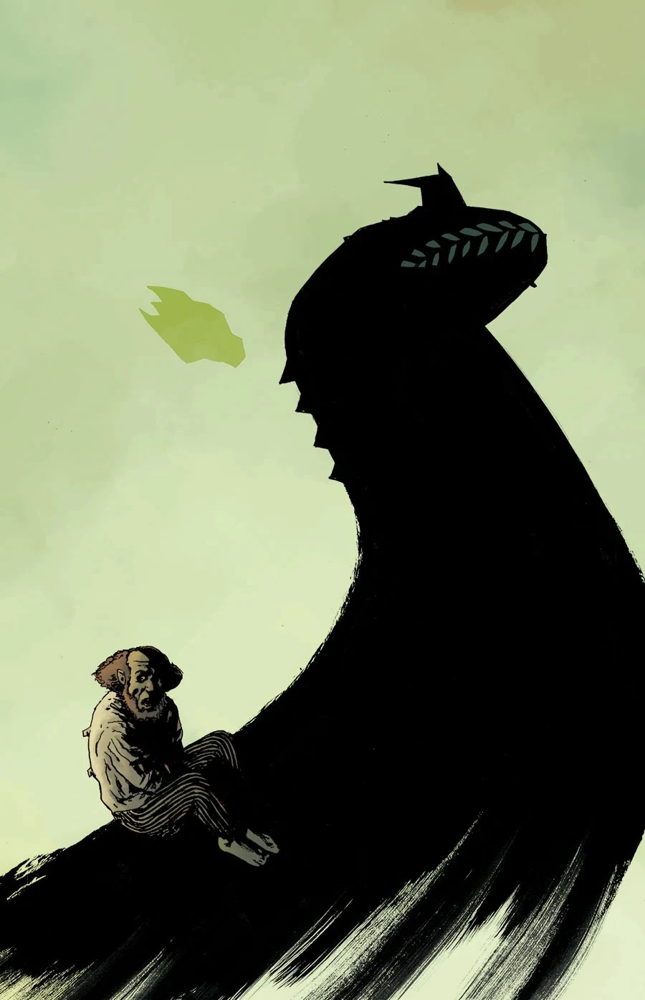
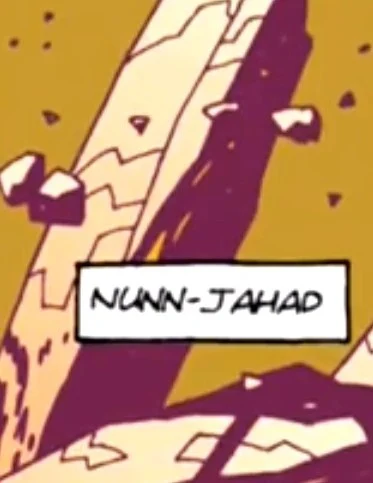
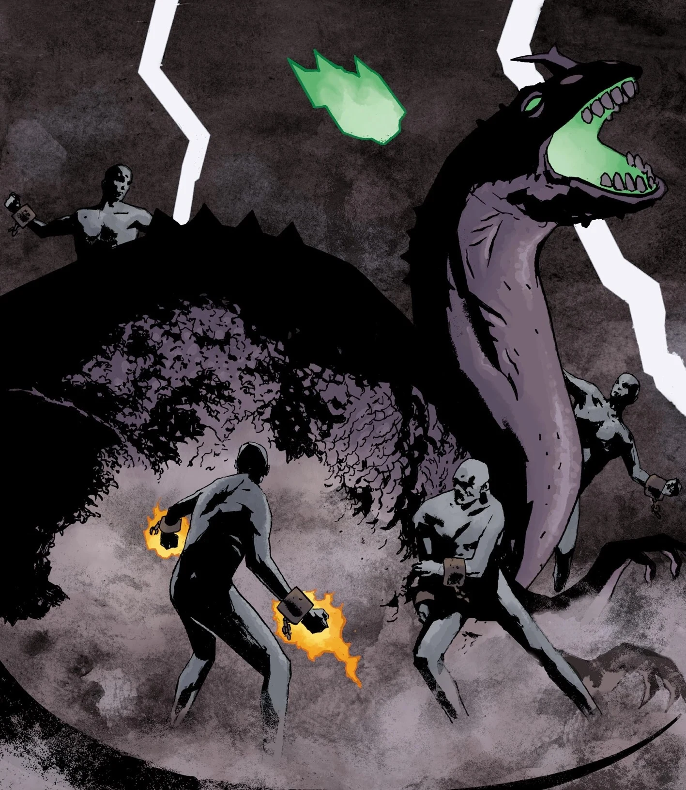
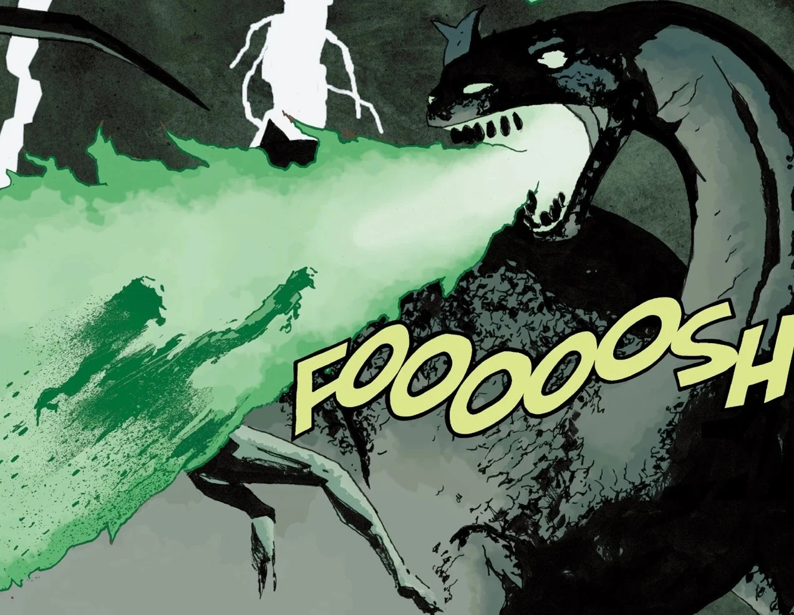
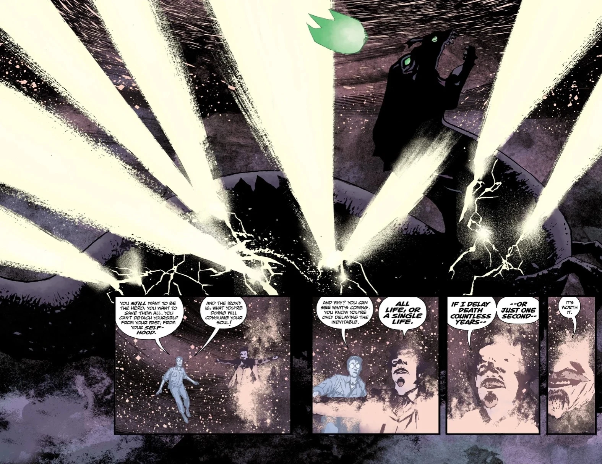

Nunn**-Jahad** is one of the [Ogdru Jahad](/entry/Ogdru_Jahad), the Seven Gods of Chaos. Who served as the final antagonist in the Hell on Earth story cycle of the *B.P.R.D.* series.

## Biography

### Origin

Nunn-Jahad was created alongside its six siblings by the great spirit [Anum](/entry/Anum) at the beginning of time, using some of [God's](/entry/God) powers. After the Seven Gods of Chaos awoke, they spawned the demonic [Ogdru Hem](/entry/Ogdru_Hem) into existence, who went to war with the spirits. The Hem were disposed by the Spirits, the Seven Gods of Chaos were sealed in gold crystal-cocoons and cast into [the abyss](/entry/Abyss). The only way to release them would be Anum's [Right Hand of Doom](/entry/Right_Hand_of_Doom).

He, alongside the six others, would influence individuals from afar, such as [Grigori Rasputin](/entry/Grigori_Rasputin).

### Arrival on Earth

Nunn-Jahad escaped from its crystal prison ahead of the other six and crash-lands in Argent, Kansas, decimating the surrounding region for miles. Nunn-Jahad immediately spawns a number of Ogdru Hem as both the SSS and the [B.P.R.D.](/entry/B.P.R.D.) mobilize. Liz and [Johann](/entry/Johann_Kraus) destroy the Ogdru Hem but are unable to damage the dragon itself, forcing a retreat. Its arrival also links it to the psychic network that powers [The Black Flame](/entry/The_Black_Flame).

After the Black Flame is defeated, Nunn-Jahad begins moving, bringing with it a storm of fire and lightning. It spits out dozens more Ogdru Hem by the hour, overwhelming Liz and Johann's attempts to stymie the tide. The army fires every available nuclear warhead at it and it survives unscathed. It eventually passes by B.P.R.D. headquarters and destroys it with a fireball that kills [Kate](/entry/Katherine_Corrigan) and [Panya](/entry/Panya_(character)). Afterwards it is confronted by several Watchers from Hell, who have been summoned by Varvara. Despite their efforts, Nunn-Jahad incinerates them. The dragon is finally destroyed when Johann channels the infinite power of Vril to shatter it, sacrificing himself in the process. With its death, Ogdru Hem around the globe cease moving or showing any signs of life, giving the world a small respite.

The resurrected Grigori Rasputin would later claim to be "The Ogdru Jahad on Earth". Fans have theorized the power of Nunn-Jahad entered him, which would explain the resurrection of the Ogdru-Hem.Ragna Rok (story arc). 

## Appearance

Nunn-Jahad bears a resembles to an outdated depiction of the dinosaur-genus *ceratosaurus*, notably possessing a horn on it's snout.

The body of Nunn-Jahad was also round, which could give the illusion of ineffective mobility, which still did not hinder the dragon's destructive capabilities.

## Gallery

|

|

|Revenge on Anum & the watchers for imprisoned him and his six siblings

|

|Nunn-Jahad destroyed by Johann Kraus.
## Apperance

- [End of Days](/entry/End_of_Days)
- [Cometh the Hour](/entry/Cometh_the_Hour)
- [Messiah](/entry/Messiah) (Flashback)
- [Pandemonium](/entry/Pandemonium_(story_arc)) (Footage on monitors)

## Tirvia

- Nunn-Jahad bears a resemblance to a Ceratosaurus, or South Korean movie monster Yongary.
