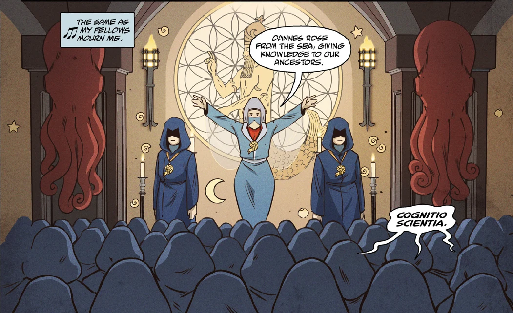

 The **Oannes Society** was a splintered group of former members of the [Heliopic Brotherhood of Ra](/entry/Heliopic_Brotherhood_of_Ra) that believed that the god [Atum](/entry/Atum) originated from the seas.

## History

In the 18th century, the [Heliopic Brotherhood of Ra](/entry/Heliopic_Brotherhood_of_Ra) underwent an arguable and heated debate on the origins of Atum between two groups, on which the other side steadfastly believed that Atum was "born from the sea." This debate led to those that supported the sea theory left the Brotherhood and formed the Oannes Society, which although shared the Brotherhood's goals but maintains that life and all knowledge having come from the sea. However, the Society fares little members in comparison to the Brotherhood.

In the 19th century, the Oannes Society admitted [Langdon Everett Caul](/entry/Langdon_Everett_Caul) into their group. During this era, the Oannes Society performed an arcane ritual concerning a cocoon containing a [deity](/entry/Water_Spirit) that led to Caul's transformation into an *Ichthyo sapien*. Right after Caul's transformation, the Society believed him to be the embodiment of Oannes and kept him in a preservation tank. Apparently the Society was somehow connected to President Abraham Lincoln's assassination, and was forced to leave America and abandon Caul in their hidden American headquarters in Washington, D.C. in which a century later, Caul would be discovered by the [B.P.R.D.](/entry/Bureau_for_Paranormal_Research_and_Defense) and adopt the name [Abraham Sapien](/entry/Abraham_Sapien).

Sometime after leaving America, the Society was contacted by the ancient mummy [Panya](/entry/Panya_%28character%29) in helping her escape from the Heliopic Brotherhood. Instead of freeing her, the Society kidnapped her and renamed her Naunet after the Egyptian sea goddess. They stole her away to an island in Indonesia, where they lived and operated in secrecy for over 140 years. Over the years the same members kept themselves alive through the arts of "dark science" by transferring their frail bodies in crude, cybernetic bodies.

By the early 21st century, the Society believed that the world would come to an end and attempted to "save" and reunite at least most of humankind with divinity by killing millions of people and absorbing their spiritual essence by having machines, that are capable of creating earthquakes, placed geographically to create artificial tsunamis which would devastate the southern hemisphere; which the souls of whose population could then be harvested by the Society in vat-grown bodies made expressly for the purpose, granting them god-like powers. Panya, however, contacted Abe Sapien and brought him to be reunited with the Society and, refusing to let their plan come into fruition, Abe single-handedly destroyed the Society.

However, one of the Society's members, McWhirter, survived after being nearly blown up and falling into the nearby sea, where the Society's Victorian era submarine was docked. He used it to escape, and was last seen observing a televised news about the latest sighting of a [Ogdru Hem](/entry/Ogdru_Hem) that appeared in California's Salton Sea.

## Members

- [Lord Hodgson](/entry/Lord_Hodgson)
- [Langdon Everett Caul](/entry/Langdon_Everett_Caul)
- Edward Musgrove Sundborne (Biological body) (deceased)
- Phillip Ensner (Golden mechanical suit) (deceased)
- Dameron (Grey mechanical suit) (deceased)
- McWhirter (Bronze mechanical suit)
