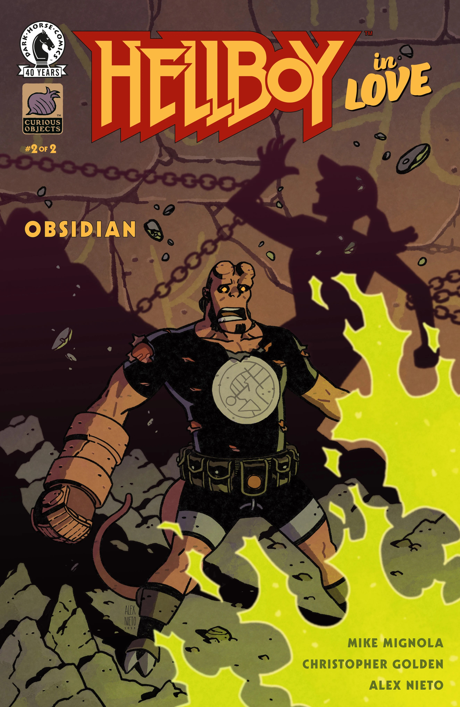

***Obsidian*** is a two-issue arc of *[Hellboy in Love](/entry/Hellboy_in_Love)* written by [Mike Mignola](/entry/Mike_Mignola) and [Christopher Golden](/entry/Christopher_Golden). It is the sixth arc in the series.

## Synopsis

### Part One

Anastasia is called to Crete when an excavation team unearths a tomb with striking similarities to the engraved skull stolen from her by a witch in India. The trail for proof of the mysterious Suaren Artea society may not have gone as cold as she thought, but danger still lurks behind every turn.

### Part Two

Anastasia and Hellboy are chasing down a cult to get the answers they need to stop apocalyptic disaster, but the cult may catch up with them first. But their problems are only beginning, as the Greek dig site becomes suddenly scarier when something larger than life emerges from the ancient caverns.

## Gallery

All covers by Alex Nieto.

*Hellboy in Love: Obsidian* \#1

*Hellboy in Love: Obsidian* \#2

|Hellboy in Love: Obsidian #2
