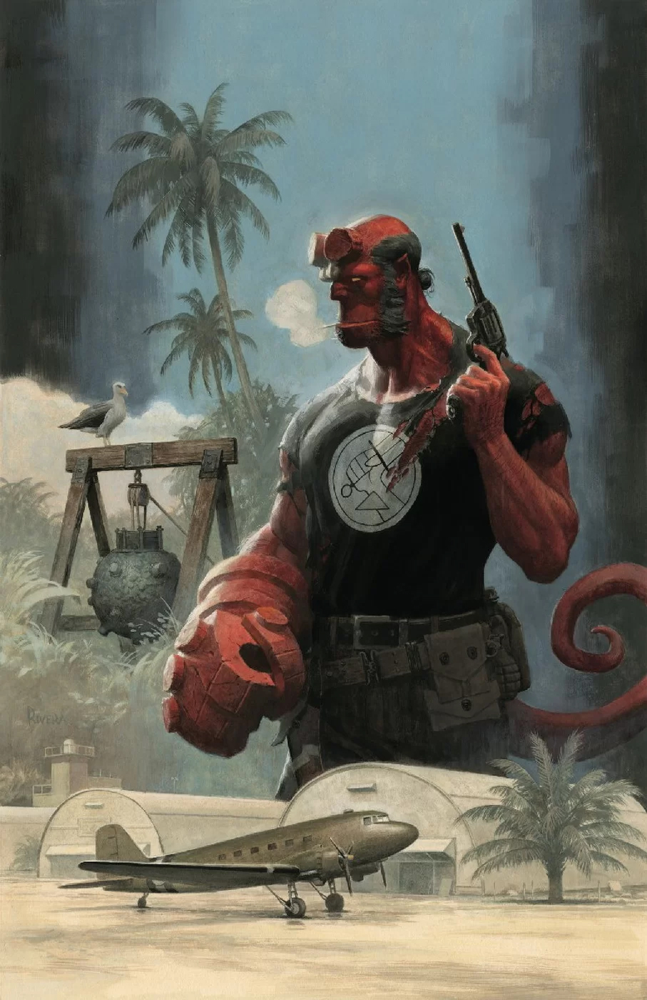
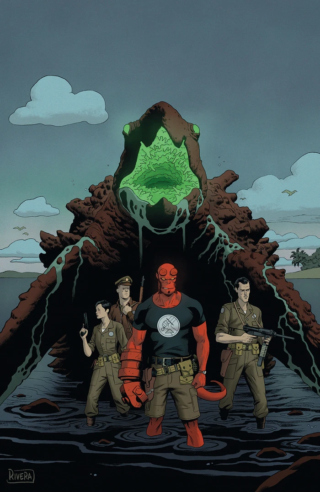
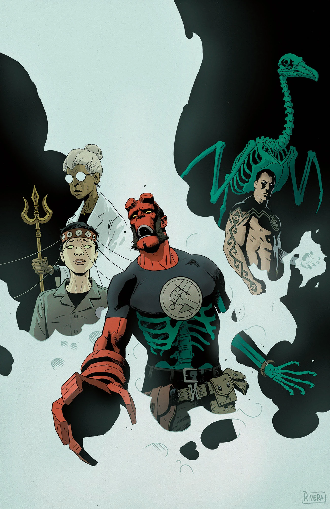

***Occult Intelligence*** is a three-issue arc of *[Hellboy and the B.P.R.D.](/entry/Hellboy_and_the_B.P.R.D.): 1955* written by Mike Mignola and Chris Roberson, and illustrated by Brian Churilla.

## Synopsis

### Part One

A layover on a remote island drops Hellboy into a web of intrigue involving government secrets and foreign agents waging their own cold war over a weapon that might be right up the BPRD’s alley. In England Bruttenholm uncovers more secrets, indicating a worldwide supernatural conflict about to boil over.

### Part Two

The mystery in the tropics heats up when a monster attacks, but the creature may have ties to a secret weapon at the center of an international conflict. Elsewhere, Bruttenholm’s own investigation suggests that the B.P.R.D. is embroiled in something much larger than he thought.

### Part Three

The BPRD agents are surprised to find a familiar enemy involved with the island attacks, and Bruttenholm digs deep to uncover the truth behind an international supernatural conflict and the BPRD’s role in it.

## Gallery

|*Occult Intelligence* \#1

|*Occult Intelligence* \#2

|*Occult Intelligence* \#3
