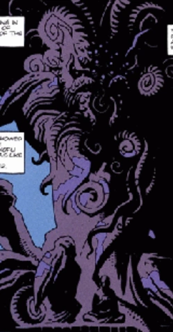
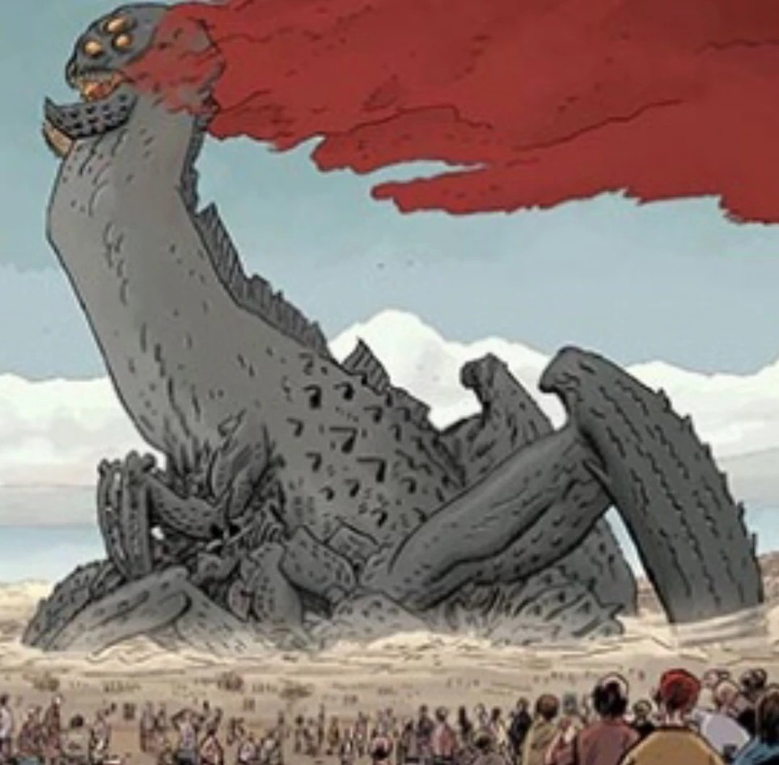
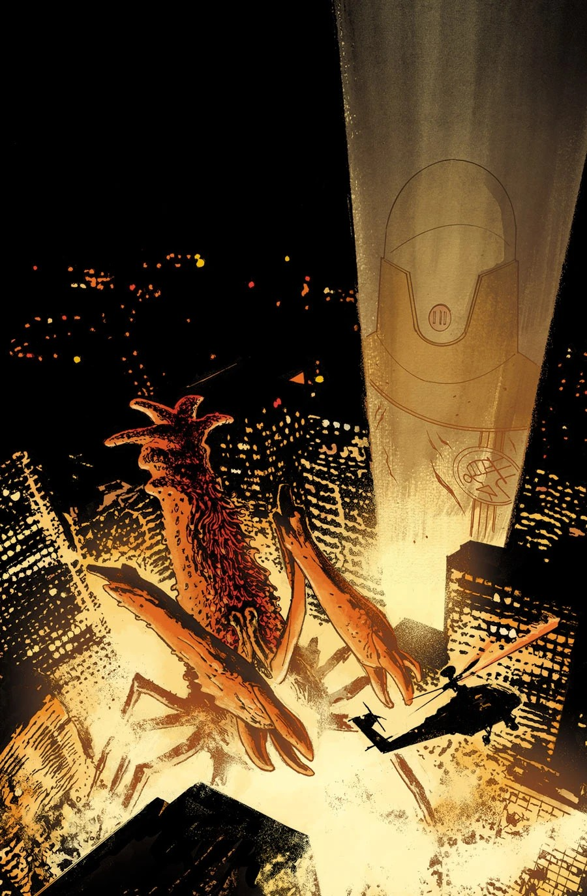
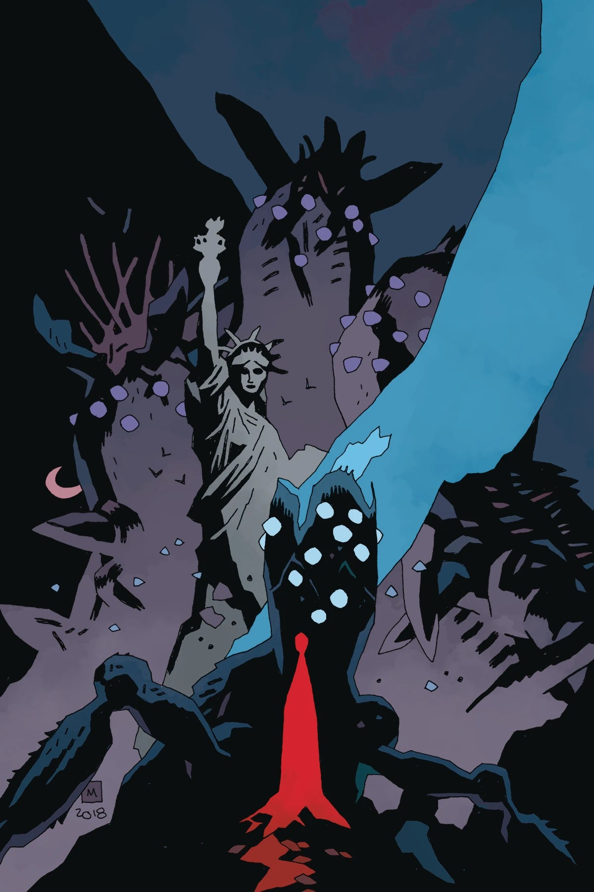
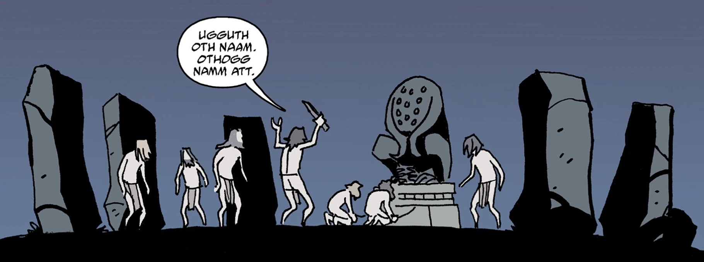
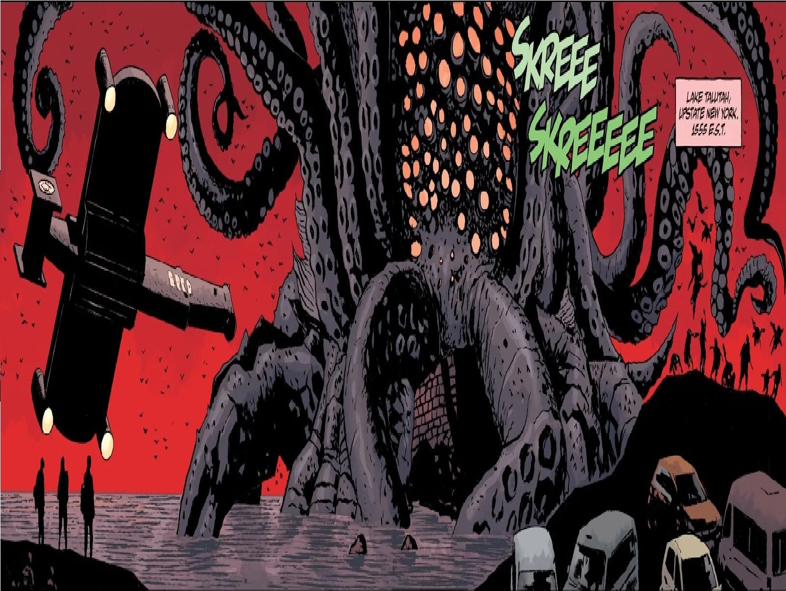

The 369 Ogdru Hem & the Watchers were so filled with horror at the sight of the Ogdru Hem that they went to war against them.

~The man recites the true history to Hellboy & tells him that the Ogdru Hem were defeated, but still live. One day they will awaken and reclaim the earth.

The **Ogdru Hem** are the monstrous three hundred and sixty-nine children of the [Ogdru Jahad](/entry/Ogdru_Jahad) and They are villains in the *Hellboy* franchise, serving notably as the main antagonists of the *Hell on Earth-*cycle of the *B.P.R.D.-*series.

The Ogdru Hem are essentially weaker versions of their parents, yet even so, they wield unimaginable power. All of the Ogdru Hem were imprisoned by the Watchers, but many are now re-emerging, with the aid of [Grigori Rasputin](/entry/Grigori_Rasputin) and other agents of the Ogdru Jahad.

Many of the Ogdru Hem are without bodies and existences, invisible, in the air and outer space/universe. These evil spirits are used to help raise the Ogdru Hem that have bodies (such as [Katha-Hem](/entry/Katha-Hem)) out of their earthly prisons or attempt to possess living bodies to return to physical form.

The physical form of at least one Ogdru Hem ([Sadu-Hem](/entry/Sadu-Hem)) has, under study, been revealed to be a kind of fungus. This body was created out of blood at some point in the distant past, leaving it unclear if the same holds true for the original bodies created by the Ogdru Jahad.

All of the Ogdru Hem can mutate living creatures with their breath, with the most common example being the [frog monsters](/entry/Frog_monster) as they attempted to bring about the Third Race of Man, however their creations were pale imitations of [Abe Sapien](/entry/Abe_Sapien), the true representative of the Third Race. Other Ogdru Hem produced various creatures; Katha-Hem spawned flaming-headed beings, [the Salton Sea Monster](/entry/Salton_Sea_Monster) mutated humans into insect-like creatures, and yet others still transformed humans into zombies.

## History

###### Background

The 369 Ogdru Hem were spawned from the Ogdru Jahad on the night it finally awakened, and thus are Earth's first lifeforms. When the Watchers, the creators of the Ogdru Jahad, beheld these creatures, they were horrified and waged war on them. After ten thousand years, the Watchers realized that they could not truly kill the Ogdru Hem, for even when they had destroyed the creatures' bodies their spirits still lingered. Thus, the Watchers imprisoned the remaining third of the Ogdru Hem beneath the Earth, while the Ogdru Jahad were encased in golden crystalline cocoons that were hurtled into the Abyss.

Despite the defeat of the Ogdru Hem, their spirits viciously attempted to return to the material world, possessing the bodies of creatures and transforming them to their image. The First Race of Man, the [Hyperboreans](/entry/Hyperboreans), used their powerful magics to keep the Ogdru spirits in check. However, the worship of the Black Goddess Hecate in the twilight years of their civilization brought with it evil magics to call up the Ogdru spirits back into the world. [Hyperborean](/entry/Hyperboreans) shamans feared that the Ogdru spirits would destroy humanity, the second Race of Man, before they could claim dominion of the world, and so they trained a number of humans in the ways of Vril to keep the spirits at bay. Some Ogdru Hem succeeded in turning humans to their cause, transforming them into a primitive form of [vampire](/entry/Vampire_(creature)) known as the Cold People, yet the work of the human shamans and other champions blessed with Hyperborean power prevented them from gaining a solid foothold. Legends of these heroes and their battles against the Ogdru Hem were passed down to ancient civilizations are between the Mayans and Aztecs, who remembered beings such as [Cipactlhem](/entry/Cipactlhem) and [Vucub Caquix](/entry/Vucub_Caquix) in their myths. Others were remembered might be as the dragons.

## The Aztecs

According to James Henry O'Donnell the entires pantheon of "Mesoamerican God-monsters", such as [Quetzalcoatl](/entry/Quetzalcoatl), were actually the spirits of some of the Ogdru Hem.

The blood rituals of the toltecs allowed the creatures to assume physical form and told the people the true history of the world, which the Aztecs would later inscribe on three gold tablets.

## Modern Day

The Visitor dealt with most manifestations, but a few evaded him. Although he didn't know it at the time, Hellboy encountered two Ogdru spirits prior to the events of [Cavendish Hall](/entry/Cavendish_Hall), one in the French Abbey of La Noe in 1965, and another in 1979 who had hijacked the ectoplasm of renowned spiritual medium [Mr. Tod](/entry/Goodbye_Mister_Tod).

Rasputin awakened Sadu-Hem, but it was destroyed by [Liz Sherman](/entry/Elizabeth_Sherman). Later [Herman Von Klempt](/entry/Herman_von_Klempt) summoned the [Conquerer Worm](/entry/Conqueror_Worm_(Ogdru_Hem)), which was destroyed by [Roger](/entry/Roger), Hellboy, and [Lobster Johnson](/entry/Lobster_Johnson). Hellboy later fought and killed a revived [Urgo-Hem](/entry/Urgo-Hem). After Sadu-Hem began to regenerate, he was captured and allowed to grow by BPRD researchers before being freed by cultists and allowed to create a large number of frog monsters. These would later summon large numbers of Ogdru Hem spirits, but it is doubtful many of them regained physical form.

[Landis Pope](/entry/Landis_Pope) later fulfilled the frog prophecy of the [Black Flame](/entry/The_Black_Flame) and awakened Katha-Hem, whose appearance was a sign that the world would begin to change. Although Liz Sherman defeated Katha-Hem, Landis Pope survived and began reviving Ogdru Hem instead of awakening them, with help from the King of Fear and his machines. Although all of these were destroyed by Liz Sherman, the Salton Sea Monster crawled out of the ocean soon after, marking the beginning of Hell on Earth.

### Hell on Earth

In the wake of Liz shaking the world with earthquakes through the incineration of the Hollow Earth, her explosion stirred many slumbering Ogdru spirits, who then began to reach out into the world to return to physical form. The Salton Sea monster began moving, laying eggs in its wake. When a new Black Flame was summoned by [Leopold Kurtz](/entry/Leopold_Kurtz) and [Karl Ruprecht Kroenen](/entry/Karl_Ruprect_Kroenen) at [Zinco Headquarters](/entry/Zinco_Corporation), it immediately awakened many Ogdru Hem imprisoned across the globe, intensifying the current crisis. Later when Nunn-Jahad arrived on Earth, it began to spawn numerous Ogdru Hem from, decimating the central United States as they marched. Eventually when Nunn-Jahad was slain, the Ogdru Hem froze and became inactive, giving the world a breath of respite.

### Ragna Rok

With the death of [Yomyae](/entry/Yomyael)l and the freeing of [Varvara](/entry/Varvara) from the demons' control, she managed to revive her father Rasputin. Rasputin at this time was empowered by the dark essence of Nunn-Jahad and immediately revived all the Ogdru-Hem on earth. Not simply the formless spirits but even Ogdru-Hem that had previously been defeated (such as Sadu-Hem) Finally all returned to physical form and stronger than ever they immediately laid waste to what remains of the planet and forcing what remained of humanity to seak shelter in the hollow earth underground. Hellboy and his friends while managing to defeat Rasputin it was too late as the Ogdru-Hem were now the undisputed rulers of the earth. They and their many spawned horrors remained the earths dominant species until many were destroyed in the explosion caused by the Ogdru-Jahads prison striking the earth. Its essence stolen by the [Osiris Club.](/entry/Osiris_Club) The spirit of hellboy destroyed them and ([Hecates](/entry/Hecate) help) had Elizabeth Sherman unleash all her power to wipe all life from the earth's surface (at the cost of her life). Any remaining Ogdru-Hem seemed to perish in this inferno. The Ogdru-Hem were seemingly extinct after this event; however it is unknown if any of their spirits still exist in some form.

## List of the Ogdru Hem

- [Cipactlhem](/entry/Cipactlhem)
- [The Conqueror Worm](/entry/Conqueror_Worm_(Ogdru_Hem))
- [Ghennu-Hem](/entry/Ghennu-Hem)
- [Istra-Hem](/entry/Istra-Hem)
- [Katha-Hem](/entry/Katha-Hem)
- [Mera-Hem](/entry/Mera-Hem)
- [Mister Tod's creature](/entry/Goodbye_Mister_Tod)
- [Sadu-Hem](/entry/Sadu-Hem)
- [Urgo-Hem](/entry/Urgo-Hem)
- [Yotha-Hem](/entry/Yotha-Hem)
- [Zara-Hem](/entry/Zara-Hem)
- [Salton Sea Monster](/entry/Salton_Sea_Monster)
- [Quetzalcoatl](/entry/Quetzalcoatl)
- [Vucub Caquix](/entry/Vucub_Caquix)

## Gallery

CipactI Hem

Ghennu-Hem

Istra Hem

Vucub Caquix

Zara Hem

|Sadu-Hem

|Salton Sea Monster

|

|

|

|
## Similar Creatures

There have been several creatures that have been connected to the Ogdru Jahad, but have not been said to be Ogdru Hem.

- **[Sammael](/entry/Sammael) the Desolate One**: A Hellhound from the *Hellboy* movie is a presumed member of the 369. While Sammael has more in common, physically, with the [frog monsters](/entry/Frog_monster) than with a full-blown Ogdru Hem, he is described by Abe Sapien as the "Son of Nergal", who is one of the seven Ogdru Jahad. One of Sammael's numerous titles, the "[Seed of Destruction](/entry/Seed_of_Destruction)", is a homage to the comic storyline of the same name, which first introduced the Ogdru Jahad.

<!-- -->

- **[Behemoth](/entry/Behemoth)**: The hydroid-like Behemoth from *Hellboy* was also possibly an Ogdru Hem, serving as Rasputin's god. Once Rasputin was killed, the Behemoth erupted out from his body, much like Urgo Hem was released through the priest's blood in *[Hellboy: The Island](/entry/The_Island)*, and grew to gigantic size. The Behemoth was very similar in size, appearance, and temperament to [Sadu-Hem](/entry/Sadu-Hem). [Hellboy](/entry/Hellboy_(character)) killed it with a belt of grenades through the throat.

<!-- -->

- **Thunder** and **Lightning**: Two evil Japanese storm demons sealed within the Sword of Storms were featured in *Hellboy: Sword of Storms*. They can not be considered Ogdru Hem, but rather as brothers to the Ogdru Jahad, whom were referred to as "the Dragons".

## Notes

1.  [↑](#cite_ref-1) This creature is stated to be the same species as the Conqueror Worm in *[Conqueror Worm](/entry/Conqueror_Worm_(story))* \#2
