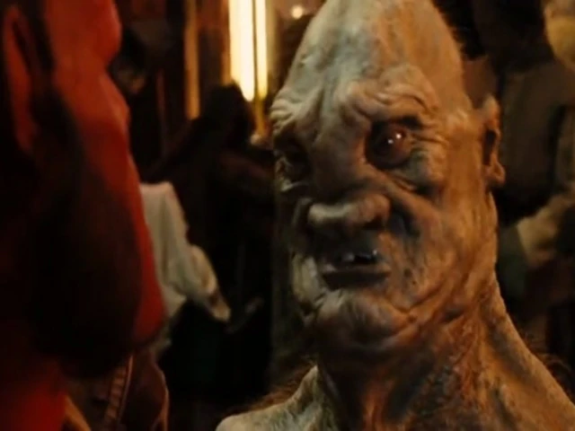

Ogres are are mythical race of beings that have gray warty skin, pointed heads and can grow tumors that can gain sentience.

## Appearances in Hellboy

In Hellboy 2: The Golden Army Ogres were revealed to have fought in the war against the human race along with their fellow Elves, Goblins, Trolls and Fairies, however many were killed during the carnage.

One Ogre appeared in the Troll Market where he was being shaved by a [Cronie Troll](/entry/Cronie_Troll) barber and had a talking tumor, he was slapped many times by Red when he refused to reveal who bought some illegal tooth fairies, he then revealed that it was Prince Nuada. He was visibly annoyed when Johann Krauss calls his tumor a baby.
