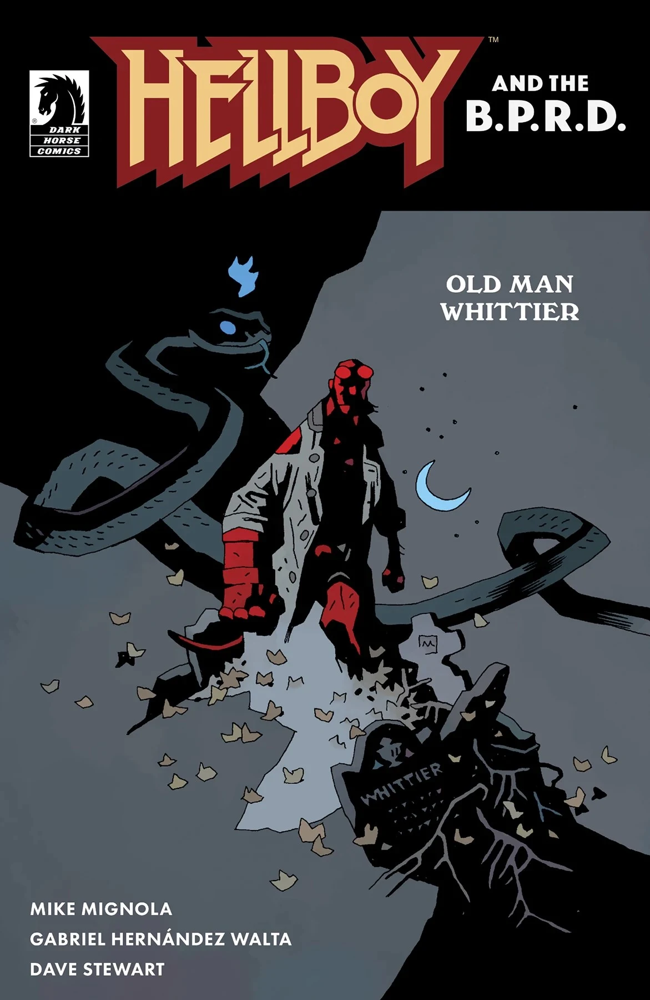

***Old Man Whittier*** is a one-shot arc of *[Hellboy and the B.P.R.D.](/entry/Hellboy_and_the_B.P.R.D.)* written by Mike Mignola and illustrated by Gabriel Hernández Walta.

## Synopsis

Trouble runs in the Whittier family! When Catherine Whittier learns she’s inherited the family home, she knows better than to go back alone, and Hellboy’s experience with the family (in Hellboy: The Whittier Legacy) makes him the perfect one to make sure any unkind spirits are rest. Because in a house with a history like this, “plot” can mean more than just a family graveyard.

## Gallery

*Hellboy and the B.P.R.D.:  
Old Man Whittier*  
by Gabriel Hernández Walta

*Hellboy and the B.P.R.D.:  
Old Man Whittier*  
by Mike Mignola and Dave Stewart

|Hellboy and the B.P.R.D.: Old Man Whittier by Mike Mignola and Dave Stewart
