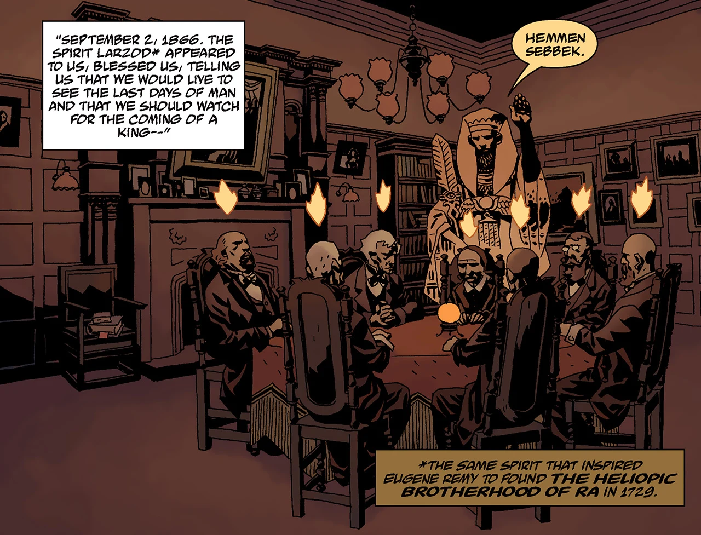

 The **Osiris Club** is a secret society founded in 1866 and branched separately from the [Heliopic Brotherhood of Ra](/entry/Heliopic_Brotherhood_of_Ra).

## History

On September 2nd, 1866, six members of the [Heliopic Brotherhood of Ra](/entry/Heliopic_Brotherhood_of_Ra) - including three high-ranking members - visited the mystic [Miss E.T. Hatton](/entry/Miss_E.T._Hatton) at the home of Lord Charles Burly and conducted a seance. During the seance they were visited by the spirit of [Larzod](/entry/Larzod) - the very same spirit that inspired Eugene Remy to found the Heliopic Brotherhood - who granted them immortality to see the "last days of man" and the coming of a king who would "refuse his crown" but "in the end would lead \[his soldiers\] in the last battle" and be killed, in which the chosen seven will cut off his right hand and use it to "elevate \[themselves\] over all that remains." The seven became the founding members of the Osiris Club.

Over a century, in 1954, the Club saw [Hellboy](/entry/Hellboy) as their possible candidate as the prophesied king, and had tasked him in slaying a dragon that was slain by St. Leonard as a test of his virtue. However, the test remained unclear as Hellboy was able to slay the Saint Leonard Worm, but his blood from his wounds fell to the ground and lilies grew from it, echoing the ancient legend of Saint Leonard.

In 2007, during the events of the *[The Wild Hunt](/entry/The_Wild_Hunt)*, the Osiris Club summons Hellboy to England to participate in the Wild Hunt, only for Hellboy to be attacked by the hunters as they attempt to kill him before he could claim his birthright as a descendant of Mordred. Later, after they learn that Hellboy obtained Excalibur and revealing their personal agenda, the original seven kill off their newer members when two of them attempted to call the Prime Minister of the turn of events. In the aftermath of *[The Fury](/entry/The_Fury)*, the Osiris Club discuss the turn of events of Hellboy's death, unable to claim his right hand at the time, and that the end of the world has only begun.

After Hellboy and [Rasputin](/entry/Rasputin) killed each other during Ragna Rok, the Osiris Club took the Right Hand of Doom for themselves. Using the Hand, they summoned from deep space the crystal prison of the [Ogdru Jahad](/entry/Ogdru_Jahad), hurtling it onto the Earth like an asteroid. The resulting impact wiped out the [Ogdru Hem](/entry/Ogdru_Hem), who dominated the planet. They then stole the Dragon's life and power for themselves, containing it within the Hand, intending to use it ascend into godhood. Hellboy's ghost, however, took back his hand and killed them.
