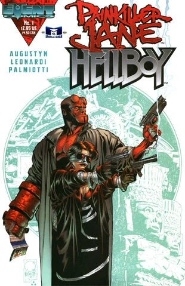

*Ancient Laughter* is an out-of-continuity one-shot crossover issue published by Event Comics.

## Synopsis

The story centers on the discovery of an ancient Native American urn unearthed at a construction site's foundations. Against the wishes of tribal elder Gregory Two Bears, researchers at the city's Natural History Museum inadvertently breach the urn's seal, releasing a malevolent creature known as the Maniskeet. The supernatural entity threatens to transform the entire city into a primeval forest. The crisis brings together two unlikely allies: Hellboy, the paranormal investigator from Dark Horse Comics, and Painkiller Jane, the regenerative vigilante created by Jimmy Palmiotti and Joe Quesada for Event Comics.

## Gallery

*cover by [Mike Mignola](/entry/Mike_Mignola)*

*variant cover by Joe Quesada*

|variant cover by Joe Quesada
