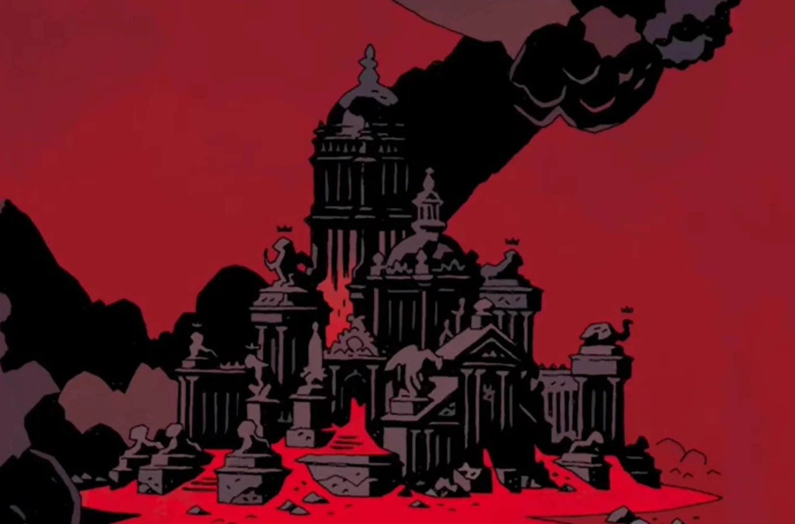

**Pandemonium** is the Capital of [Hell](/entry/Hell), where [Satan](/entry/Satan) and [Astaroth](/entry/Astaroth) reside.

## History

Pandemonium was constructed after the thousand-year war between Satan's and Pluto's factions of fallen angels, which [Pluto](/entry/Pluto) and his [Watchers](/entry/Watchers) lost. The defeated watchers built Pandemonium, which rose of their backs.

## Gallery

The demons of Pandemonium panic as Hellboy tastes his first pancake.

|
## Inspiration

Pandemonium is clearly inspired by Pandæmonium from John Milton's epic poem *Paradise Lost*, which was constructed by the 1/3 of the fallen angels that followed the Devil against God.
