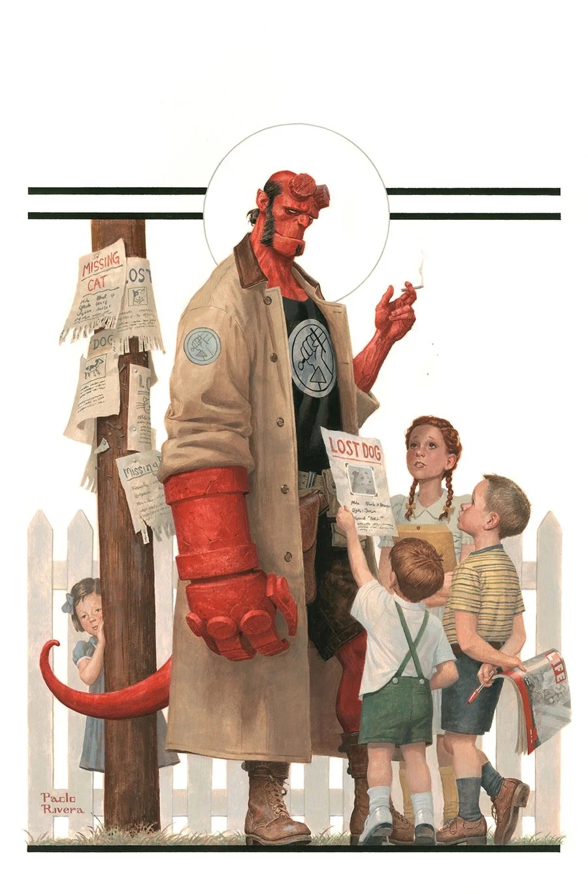
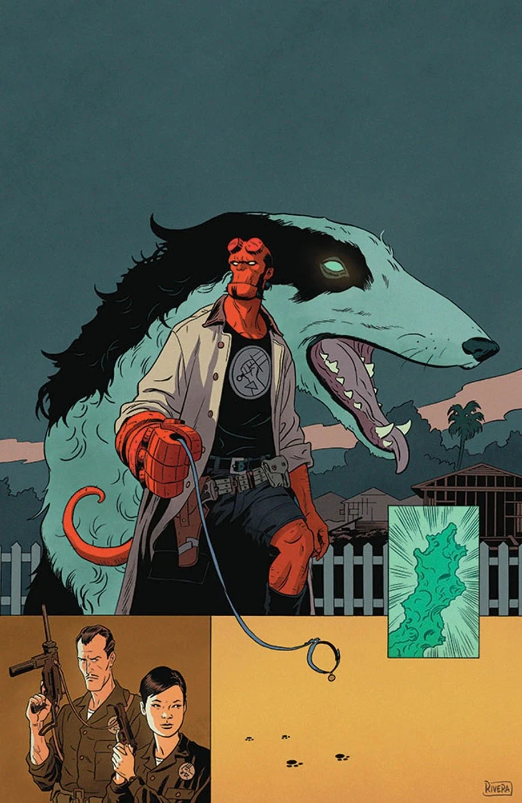
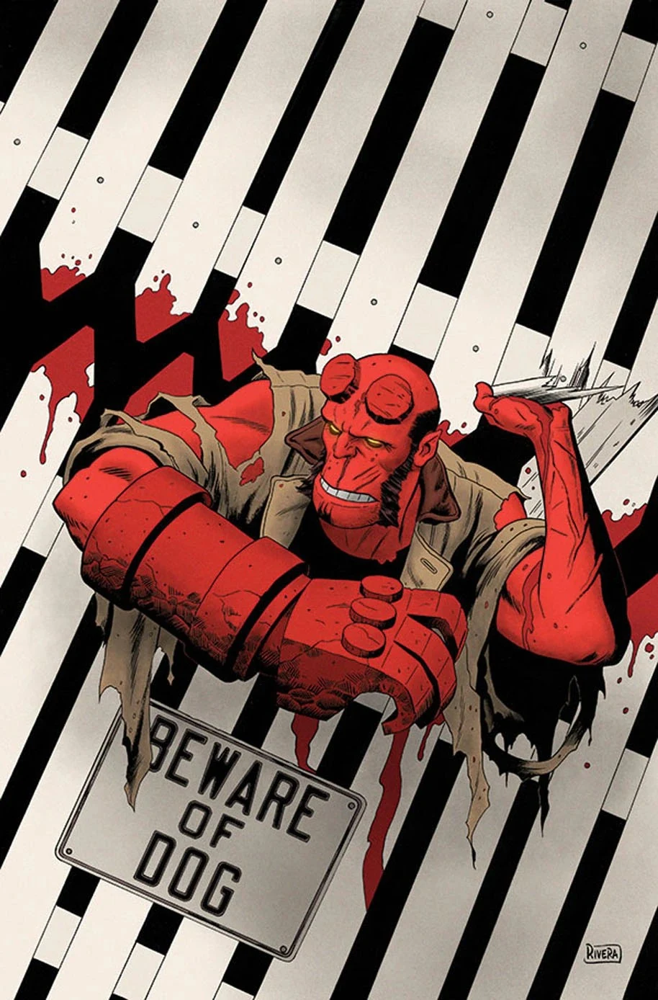
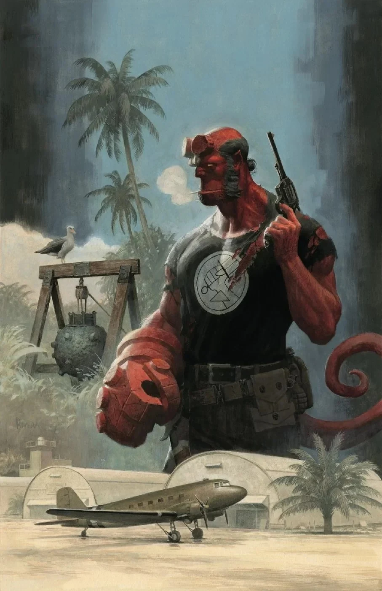
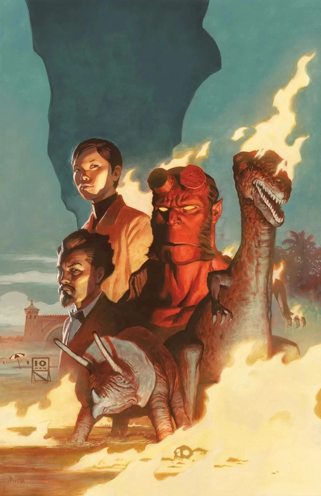
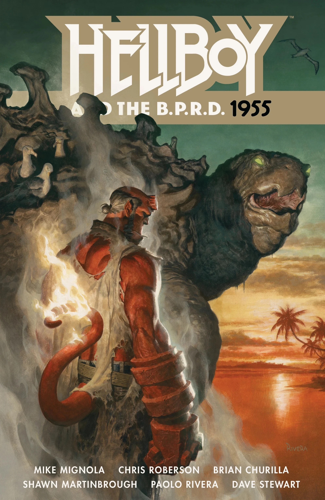

**Paolo Rivera** is an American comic book artist. He usually works alongside his father, [Joe Rivera](/entry/Joe_Rivera), who inks his pencil works.

## Interior Art

- *[Hellboy and the B.P.R.D.:1953—Beyond the Fences](/entry/Beyond_the_Fences)*
- *[Hellboy and the B.P.R.D.:1955—Burning Season](/entry/Burning_Season)*

## Cover Art

|Beyond the Fences #1

|Beyond the Fences #2

|Beyond the Fences #3

|Occult Intelligence #1

|Burning Season

|Hellboy and the B.P.R.D.: 1955
### *Hellboy and the B.P.R.D.* Issues

### Hellboy and the BPRD Collections

## External Links

- **[Wikipedia:](https://en.wikipedia.org/wiki/Paolo_Rivera)**[Paolo Rivera](https://en.wikipedia.org/wiki/Paolo_Rivera)
