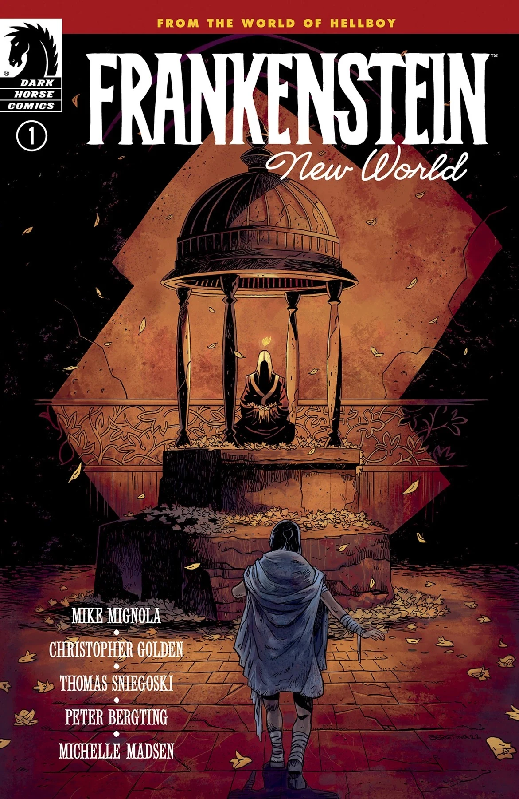
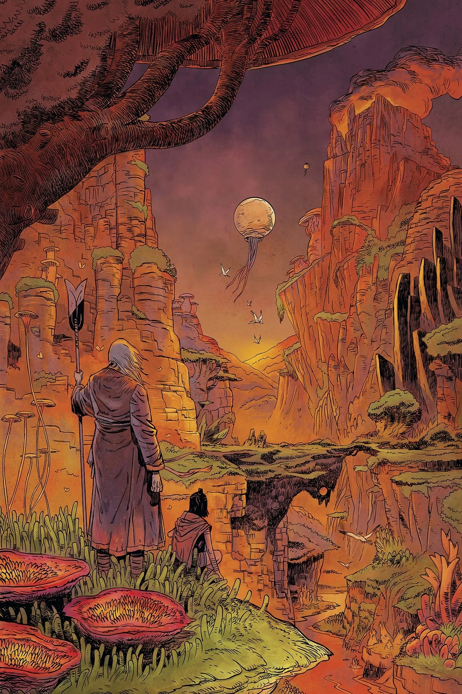
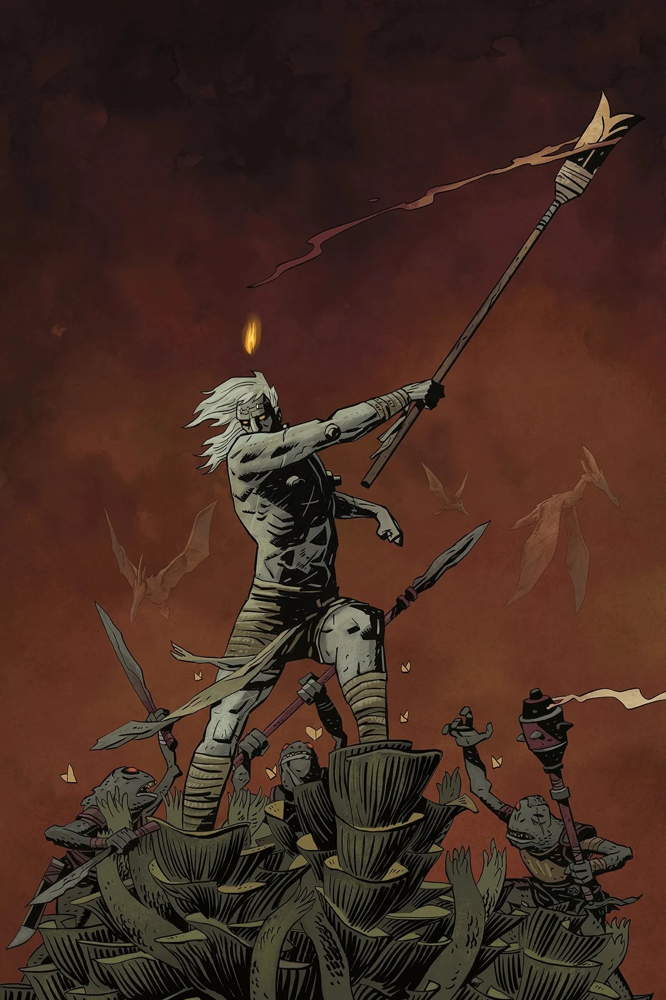
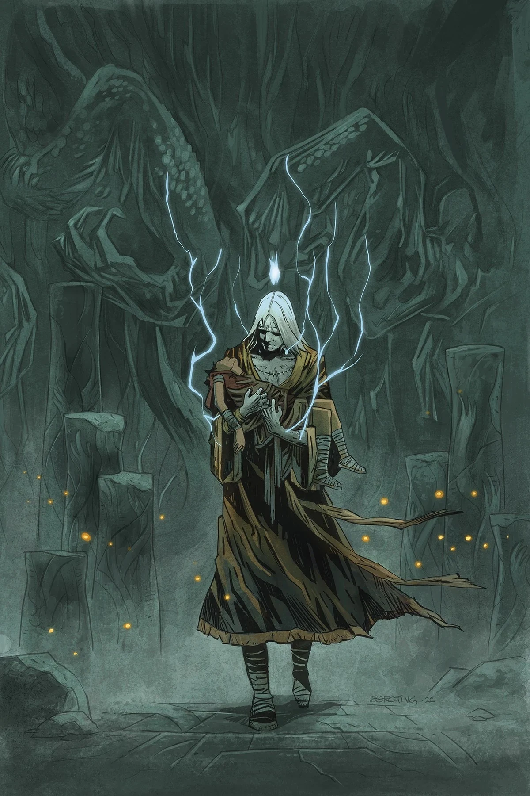
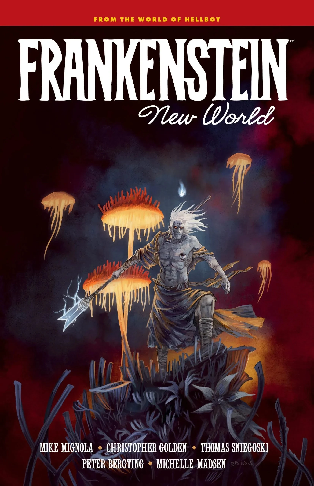

**Peter Bergting** is a Swedish author and artist. He made his debut in the Hellboy Universe working on the *[Hellboy Sourcebook and Roleplaying Game](/entry/Hellboy_Sourcebook_and_Roleplaying_Game)* in 2002. Most of his work with [Mike Mignola](/entry/Mike_Mignola) and [Christopher Golden](/entry/Christopher_Golden) has been on *The Outerverse*. He made his canonical Hellboy Universe debut in 2022 with *[Frankenstein: New World](/entry/New_World_(Frankenstein_story_arc))*.

## Interior Art

- *[The Astromagnet](/entry/The_Astromagnet)* for the *Hellboy Sourcebook and Roleplaying Game*
- *[Frankenstein: New World](/entry/New_World_(Frankenstein_story_arc))*

## Cover Art

Frankenstein: New World* \#1
Frankenstein: New World* \#2
Frankenstein: New World* \#3
Frankenstein: New World* \#4
Frankenstein: New World*

|Frankenstein: New World #1

|Frankenstein: New World #2

|Frankenstein: New World #3

|Frankenstein: New World #4

|Frankenstein: New World
## Colorist

- *[The Kabandha](/entry/The_Kabandha)* for the *Hellboy Sourcebook and Roleplaying Game*

## External Links

- Bergting.com
